# IT Operations Hub

IT Operations Hub là nền tảng quản lý dịch vụ và vận hành IT nội bộ, tập trung yêu cầu hỗ trợ, công việc xử lý, tài sản và thông tin vận hành trong một không gian làm việc. Nhân viên theo dõi yêu cầu đến khi hoàn tất; đội IT quản lý trách nhiệm và thời hạn; trưởng nhóm có dữ liệu để phát hiện điểm nghẽn và điều phối.

Phạm vi MVP của sản phẩm bao gồm **trợ lý AI tích hợp trong ứng dụng** để hỏi đáp hướng dẫn có dẫn nguồn, tra cứu thông tin theo quyền, tóm tắt ticket và soạn nháp yêu cầu hoặc phản hồi. AI hỗ trợ người dùng trong luồng làm việc hiện có; người dùng vẫn kiểm tra và xác nhận trước khi gửi. Tính năng AI có thể bật/tắt độc lập, không thay đổi quy tắc xử lý ticket, SLA, phân quyền hoặc quản lý tài sản.

MVP phục vụ **một tổ chức**, gồm bốn vai trò: **Requester, Technician, IT Manager và Admin**. Luồng trọng tâm là **tạo yêu cầu → tiếp nhận → xử lý → giải quyết → xác nhận đóng hoặc mở lại**.

**Trưởng phòng gửi ticket yêu cầu cấp tài khoản trong hệ thống** bằng vai trò Requester hiện có; Admin IT kiểm tra và cấp tại Quản trị → Người dùng. Mặc định cấp Requester; vai trò IT cần phê duyệt đúng thẩm quyền. Thông tin đăng nhập được bàn giao qua kênh doanh nghiệp; trưởng phòng theo dõi và xác nhận kết quả trên ticket. Xem [quy trình cấp tài khoản](docs/requirements/account-provisioning.md).

**Giai đoạn hiện tại:** phân tích và thiết kế; chưa triển khai ứng dụng. Đã có thiết kế chatbot AI trong phạm vi MVP; chưa có chatbot hoặc provider đang vận hành. Tech stack mục tiêu đã chốt, chưa cài đặt hoặc chạy kiểm thử ứng dụng. Sơ đồ có file XMind chỉnh sửa được. Các bản vẽ UI/UX dùng dữ liệu minh họa.

## 1. Requirements — INVEST, Use Cases và Acceptance Criteria

Yêu cầu được phân tích từ mục tiêu sản phẩm xuống năng lực nghiệp vụ, vai trò, use case, user story và tiêu chí nghiệm thu. Mỗi story liên kết tới màn hình và quy tắc tương ứng để giữ nhất quán giữa nghiệp vụ và trải nghiệm.

### 1.1 Phân tích bài toán (Top-down Research)

| Cấp phân tích | Nội dung |
|---|---|
| Bối cảnh | Doanh nghiệp có đội IT nội bộ, nhiều phòng ban và nhiều thiết bị |
| Vấn đề | Yêu cầu phân tán, dễ bỏ sót, thiếu người chịu trách nhiệm và khó theo dõi thời hạn |
| Mục tiêu | Tập trung yêu cầu, rõ trách nhiệm, kiểm soát SLA, liên kết tài sản và lịch sử |
| Năng lực cốt lõi | Ticket, phân công, hội thoại, SLA, tài sản, dashboard và thông báo |
| Phạm vi MVP | Một tổ chức, bốn vai trò, quản trị tài khoản nội bộ; trợ lý AI tích hợp thuộc phạm vi nghiệm thu MVP |
| Cách kiểm chứng | AC nghiệp vụ, truy vết yêu cầu, phỏng vấn và usability test theo kế hoạch |

Nghiên cứu hiện gồm phân tích đặc tả và desk research. Các proto-personas, journeys và giả thuyết chưa được xác nhận bằng nghiên cứu người dùng thực tế. Chi tiết trong [Research top down](docs/00-research.md) và [phạm vi sản phẩm](docs/01-scope.md).

### 1.2 Product mind map

[Mở file XMind: tổng quan và research](docs/xmind/01-product-map.xmind) · [Xem sơ đồ nghiên cứu](docs/xmind/previews/02-research.svg)

### 1.3 INVEST requirements

Backlog nghiệp vụ lõi có **47 user stories**, bao phủ tài khoản, quản trị, ticket, SLA, thông báo, tài sản, dashboard và nhật ký. Mỗi story có vai trò, giá trị, phụ thuộc và acceptance criteria.

| Tiêu chí | Áp dụng trong IT Operations Hub |
|---|---|
| **Independent** | Mỗi story hướng đến một kết quả có thể demo; phụ thuộc dữ liệu và quyền được ghi rõ |
| **Negotiable** | Bố cục và chi tiết tương tác có thể điều chỉnh; quyền và quy tắc nghiệp vụ bắt buộc được giữ |
| **Valuable** | Giá trị gắn với gửi yêu cầu, xử lý, điều phối hoặc quản trị vận hành |
| **Estimable** | Xác định đầu vào, kết quả, actor, nhánh lỗi và phụ thuộc để đội phát triển refinement |
| **Small** | Chia theo kết quả người dùng; story rộng được đánh dấu cần xem xét chia nhỏ |
| **Testable** | Có AC quan sát được, gồm kiểm tra quyền, trạng thái, SLA và lỗi quan trọng |

| Nhóm story | Phạm vi |
|---|---|
| US01–US04 | Đăng nhập, phiên và hồ sơ cá nhân |
| US05–US12 | Người dùng, phòng ban, nhóm, danh mục và SLA mặc định |
| US13–US19 | Tạo, tra cứu, phân công và tiếp nhận ticket |
| US20–US31 | Hội thoại, tệp, trạng thái, ưu tiên và timeline |
| US32–US34 | Hai đồng hồ SLA, cảnh báo nền và thông báo |
| US35–US40 | Hồ sơ và vòng đời cấp phát tài sản |
| US41–US46 | Dashboard, báo cáo, tải công việc và bảo hành |
| US47 | Nhật ký kiểm tra |

Các story rộng vẫn cần đội triển khai đánh giá và chia nhỏ; chưa có ước lượng hoặc cam kết sprint. Xem [47 user stories và review INVEST](docs/08-invest-requirements.md), [AC catalog](docs/06-acceptance-criteria.md) và [bản đồ backlog XMind](docs/xmind/06-invest-backlog.xmind).

### 1.4 Use cases

Nghiệp vụ lõi có **33 use case**; phần AI bổ sung **8 use case riêng**. Bốn sơ đồ SVG dưới đây gồm tổng quan theo vai trò và ba nhóm nghiệp vụ chi tiết. Một mã UC có thể xuất hiện ở nhiều góc nhìn nhưng vẫn là cùng một use case.

#### Tổng quan theo vai trò

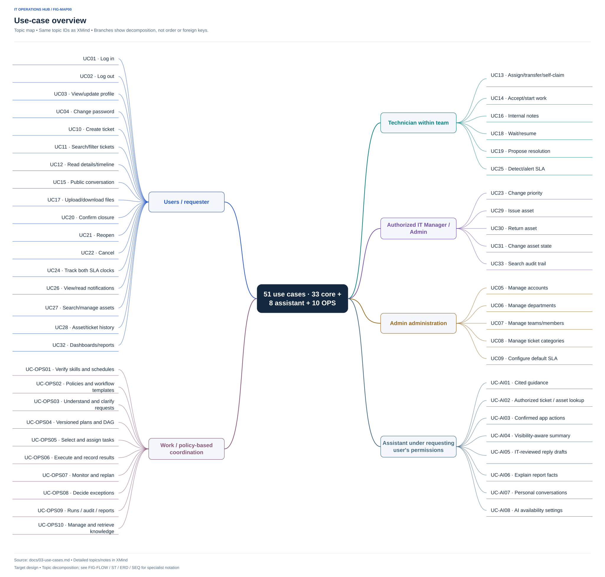

#### Tài khoản và quản trị — UC01–UC09

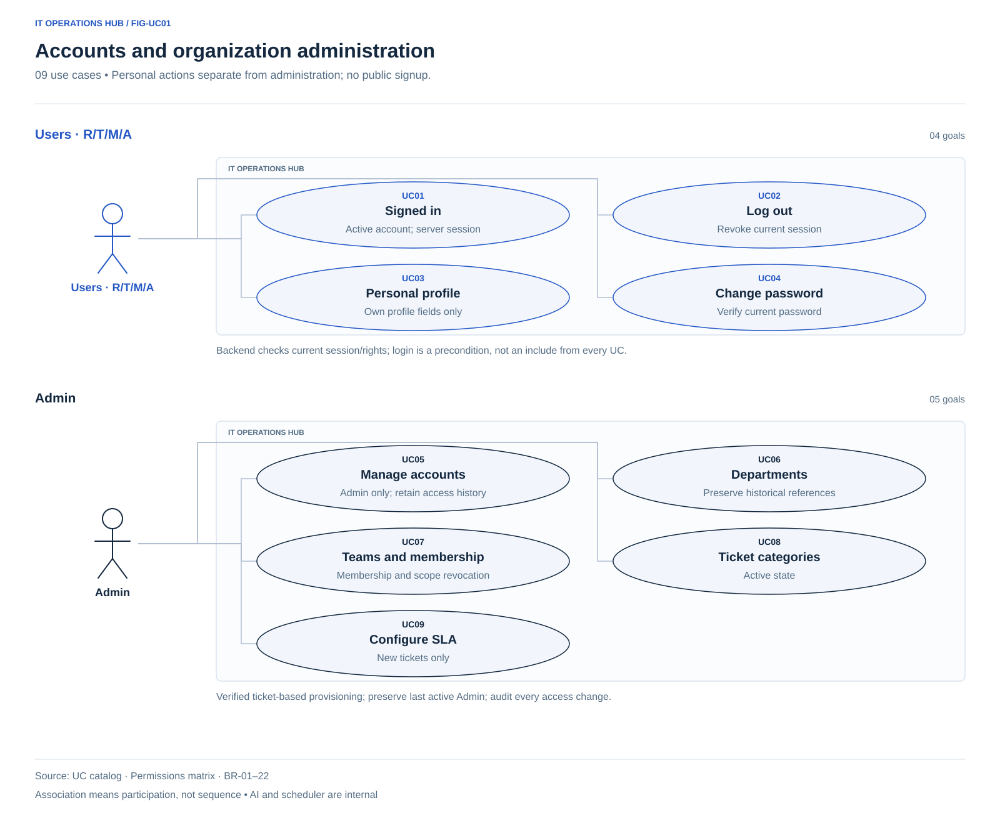

#### Ticket, SLA và thông báo — UC10–UC26

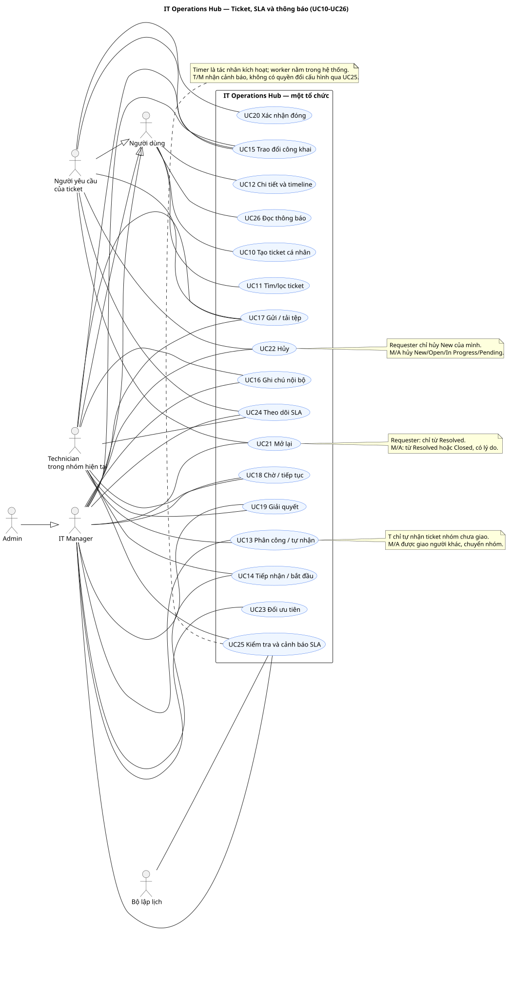

#### Tài sản, dashboard và nhật ký — UC27–UC33

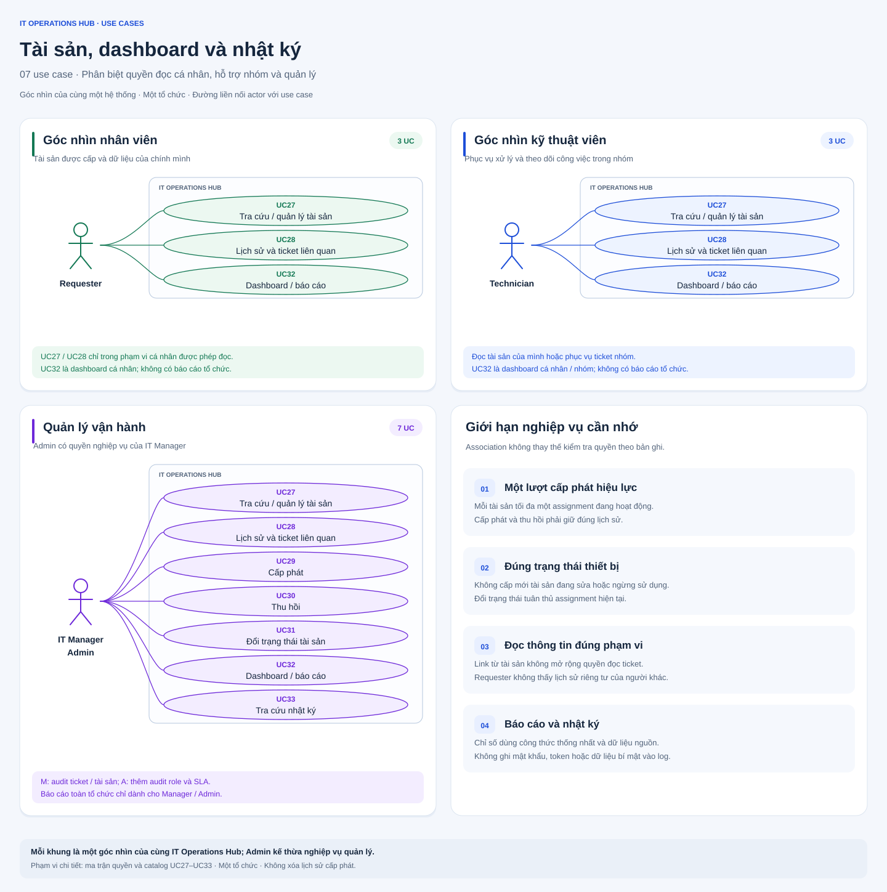

[Mở bộ use case XMind](docs/xmind/02-use-cases.xmind) · [Danh mục 33 use case và luồng chi tiết](docs/03-use-cases.md) · [Xem sơ đồ UML dạng SVG](docs/diagrams/README.md)

Các bản đồ actor–goal hỗ trợ đọc và thảo luận phạm vi. Điều kiện theo bản ghi và trạng thái vẫn phải đối chiếu ma trận quyền; một actor xuất hiện trên sơ đồ không có nghĩa được thao tác trên mọi ticket.

### 1.5 Roles and permissions

| Năng lực | Requester | Technician | IT Manager | Admin |
|---|---|---|---|---|
| Gửi yêu cầu cá nhân | Có | Có | Có | Có |
| Xem ticket | Của mình | Trong nhóm; ticket cá nhân theo quyền requester | Toàn bộ | Toàn bộ |
| Bình luận công khai | Ticket của mình | Ticket trong phạm vi | Có | Có |
| Ghi chú nội bộ | Không | Trong nhóm | Có | Có |
| Tự nhận ticket chưa giao | Không | Trong nhóm | Theo điều kiện nhóm | Theo điều kiện nhóm |
| Phân công và chuyển nhóm | Không | Không | Có | Có |
| Đổi ưu tiên | Không | Đề nghị qua ghi chú | Có lý do | Có lý do |
| Xác nhận đóng Resolved | Chính người yêu cầu | Khi là người yêu cầu | Khi là người yêu cầu | Khi là người yêu cầu |
| Mở lại Closed | Không | Không | Có lý do | Có lý do |
| Tài sản | Được cấp cho mình | Phục vụ xử lý và tài sản cá nhân | Quản lý toàn bộ | Quản lý toàn bộ |
| Báo cáo tổ chức | Không | Không | Có | Có |
| User, nhóm, phòng ban và SLA | Không | Không | Đọc dữ liệu cần thiết | Quản lý |

Backend tương lai phải kiểm tra quyền ở từng thao tác và từng bản ghi. Ẩn nút/menu không thay thế kiểm tra quyền. Xem [ma trận quyền chi tiết](docs/requirements/permissions-matrix.md).

### 1.6 Acceptance criteria

Các AC xác định kết quả quan sát được, gồm luồng thành công, dữ liệu không hợp lệ, từ chối quyền và xung đột khi hai người cùng sửa.

- Ticket chỉ chuyển qua các trạng thái hợp lệ; bắt đầu xử lý cần người phụ trách.
- Pending có câu hỏi công khai; requester trả lời thì tiếp tục In Progress.
- Resolved bắt buộc giải pháp; requester xác nhận đóng hoặc mở lại có lý do.
- First response chỉ tính public comment có nội dung của IT; phân công và note không được tính.
- SLA giữ tổng thời gian đã dùng qua chuyển nhóm, đổi ưu tiên và mở lại; worker không báo trùng.
- Tệp, dữ liệu tài sản và dashboard đều tuân thủ phạm vi quyền.

Lõi có **47 AC theo story**, **10 AC xuyên suốt** và **12 ví dụ SLA**. Phần AI có thêm **8 AC và 12 ca kiểm chứng**, được quản lý riêng và bắt buộc đạt khi nghiệm thu MVP. Đây là kịch bản nghiệm thu dự kiến, chưa phải kết quả chạy test. Độ phủ 12 tiêu chí nghiệm thu gốc được ghi trong [master traceability](docs/traceability/master-traceability.md).

## 2. Information Architecture, Screen Hierarchy và UI/UX

Workspace được tổ chức theo nhiệm vụ: tổng quan, yêu cầu/ticket, tài sản, theo dõi và quản trị. Điều hướng, màn hình và hành động thay đổi theo vai trò và phạm vi bản ghi.

### 2.1 Information architecture

[Mở kiến trúc thông tin XMind](docs/xmind/03-information-architecture.xmind) · [Sitemap, navigation, routes và screen inventory](docs/04-information-architecture.md)

### 2.2 Screen hierarchy

Đăng nhập dẫn vào workspace có sidebar và topbar. Tạo yêu cầu và chi tiết ticket dùng trang riêng; phân công, chờ phản hồi, giải quyết và mở lại dùng các dialog theo ngữ cảnh. Trang tài sản liên kết hồ sơ, lịch sử bàn giao và ticket trong cùng phạm vi quyền.

| Khu vực | Màn hình và tương tác |
|---|---|
| Tài khoản | Đăng nhập, hồ sơ, đổi mật khẩu |
| Tổng quan | Dashboard cá nhân, Technician và Manager/Admin |
| Ticket | Danh sách, tạo mới, chi tiết, hội thoại, nội bộ, SLA và timeline |
| Xử lý ticket | Phân công, trạng thái, ưu tiên và các xác nhận |
| Tài sản | Danh sách, hồ sơ, chi tiết, cấp phát, thu hồi và trạng thái |
| Kỹ thuật mục tiêu | [Tech stack](docs/technical/tech-stack.md) · [Kiến trúc](docs/technical/architecture.md) · [Phiên bản](docs/technical/version-baseline.md) |
| Theo dõi | Báo cáo, thông báo và nhật ký |
| Quản trị | Người dùng, phòng ban, nhóm/thành viên, danh mục và SLA |
| Truy cập/lỗi | Không có quyền và không tìm thấy bản ghi |

Inventory lõi có **26 mẫu màn hình/tương tác**, bao gồm dialog và trang lỗi. Phần AI bổ sung **3 mẫu riêng**. Các đường dẫn trong tài liệu là thiết kế điều hướng, chưa được triển khai.

### 2.3 Primary user flows

Bộ luồng còn gồm nhận/xử lý ticket, điều phối, cấp phát/thu hồi, quản trị quyền, phục hồi lỗi và thông báo. Xem [user journeys và task flows](docs/05-user-flows.md) hoặc [bộ luồng XMind](docs/xmind/04-user-flows.xmind).

### 2.4 UI/UX design

Giao diện dùng nền sáng, xanh dương dịu, card bo mềm và khoảng trắng thoáng để đọc bảng và xử lý công việc lâu dài. Bộ icon cùng hệ nét đi với nhãn rõ ràng; tiêu đề, bộ lọc và thao tác chính có cấp bậc dễ nhận biết. Thiết kế thân thiện bằng tiếng Việt, có bố cục desktop/tablet/mobile và quy định chuyển động ngắn, tôn trọng reduced motion. Trạng thái luôn có nhãn chữ.

Các hình dưới đây là bản thiết kế UI/UX tĩnh. Số liệu trên dashboard và ticket là dữ liệu hư cấu để minh họa bố cục. Các entry/nút AI thuộc thiết kế MVP; khi triển khai chỉ hiển thị thao tác sinh nội dung khi đã có cấu hình và chức năng thật, không dùng nút hoặc phản hồi giả để nghiệm thu.

#### Đăng nhập

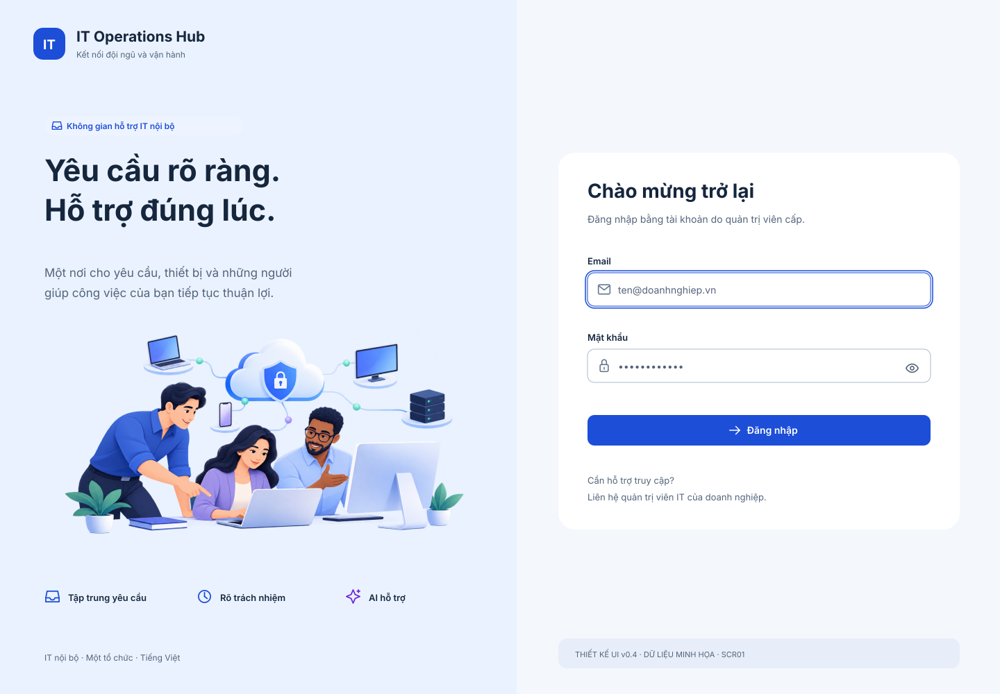

#### Dashboard — Tổng quan vận hành

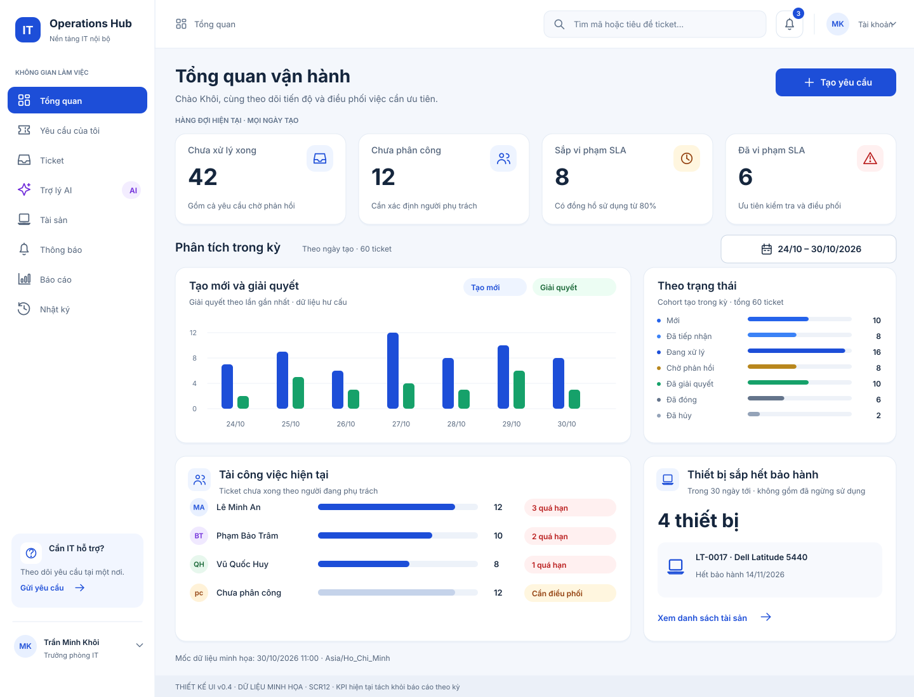

#### Dashboard Requester / trưởng phòng

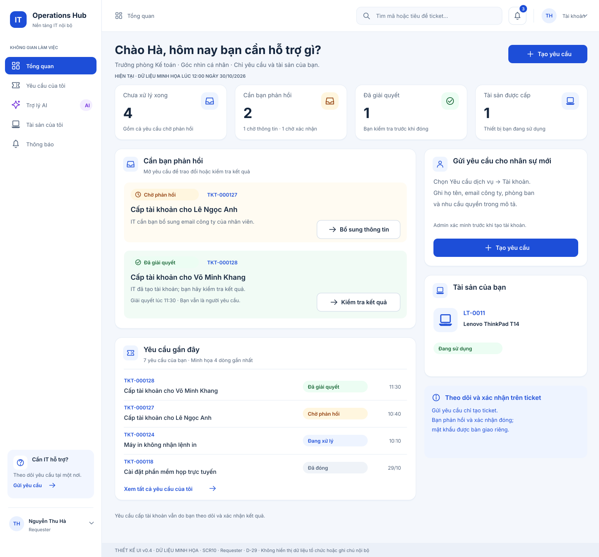

#### Dashboard Admin

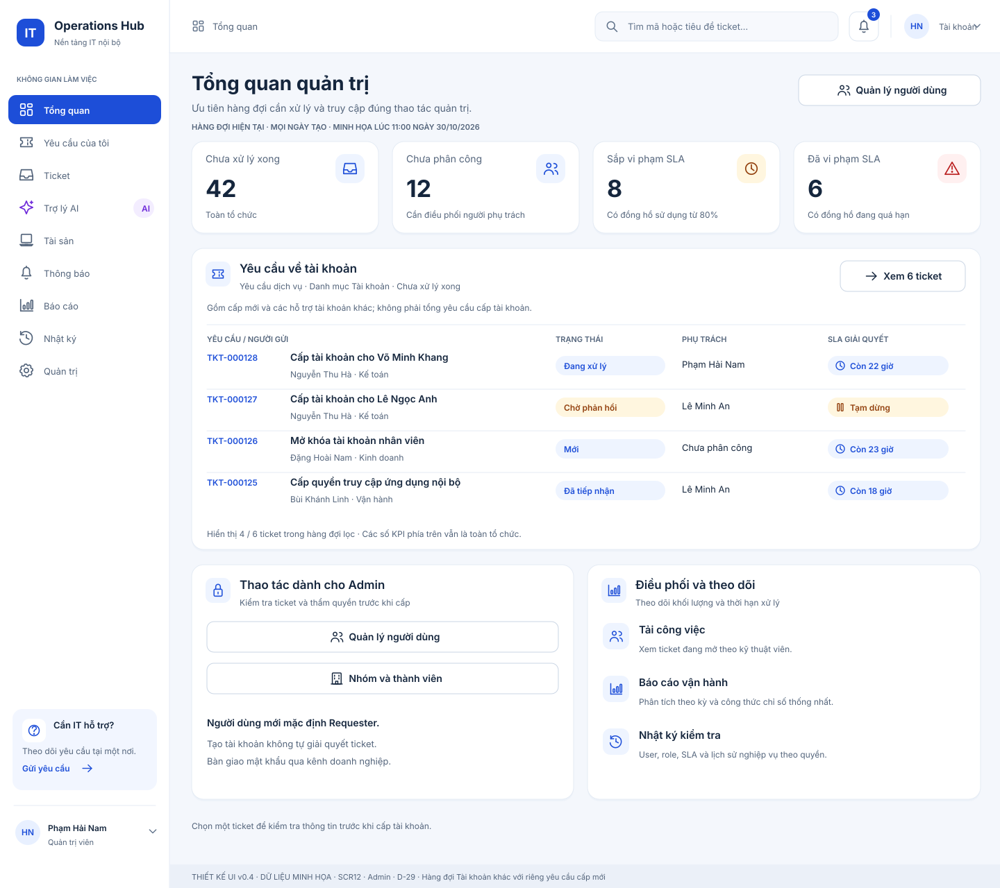

#### Danh sách ticket

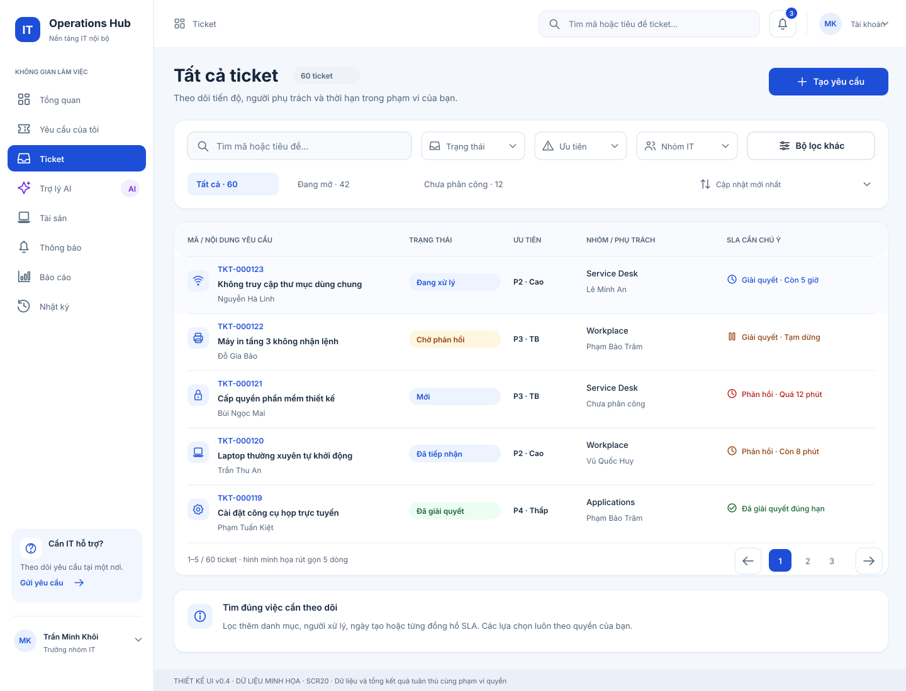

#### Chi tiết và xử lý ticket

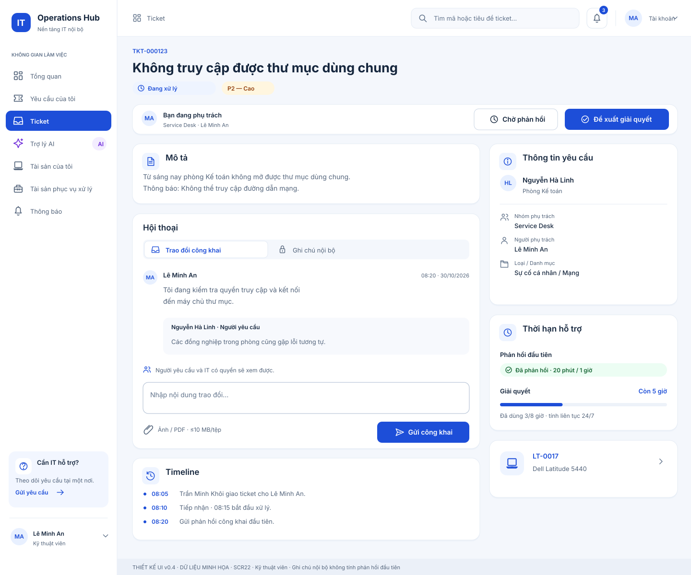

#### Xử lý yêu cầu cấp tài khoản — Admin

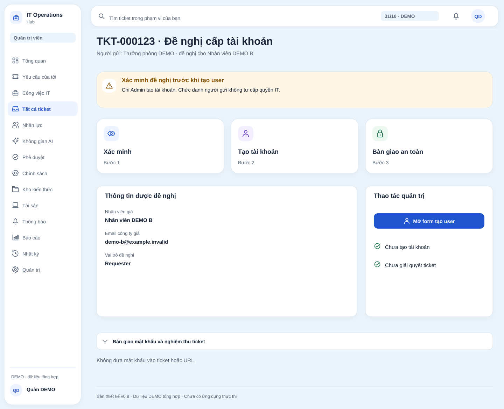

#### Xác nhận kết quả của người yêu cầu

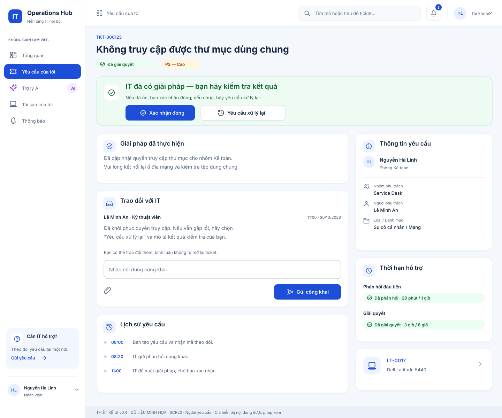

#### Mobile

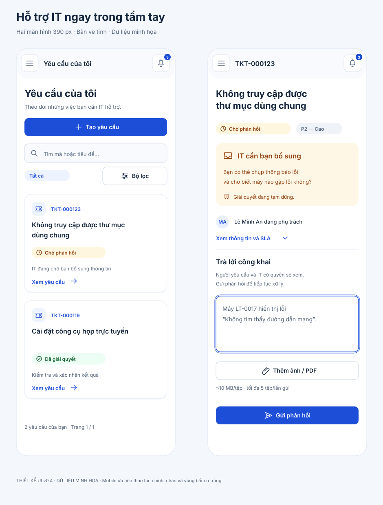

Bộ thiết kế có **16 bản UI SVG** (13 bản lõi và 3 bản AI), **2 board bổ trợ** và **44 icon SVG riêng**, bao gồm đăng nhập, tạo ticket, tài sản, SLA và trạng thái lỗi. Xem [gallery UI/UX](docs/design/wireframes/README.md), [đặc tả màn hình](docs/07-uiux-specification.md) và [bản đồ UI/UX XMind](docs/xmind/07-uiux.xmind).

[Xem board icon và component](docs/design/wireframes/14-icons-and-components.svg) · [Storyboard responsive/motion](docs/design/wireframes/15-responsive-motion.svg) · [Định hướng giao diện v0.4](docs/design/visual-refresh.md).

Các hình trên là thiết kế tĩnh, không phải ứng dụng đang hoạt động. Một số màn hình phụ trợ đã có đặc tả nhưng chưa có bản vẽ riêng.

### 2.5 Trạng thái và chất lượng trải nghiệm

| Trạng thái / yêu cầu | Hành vi thiết kế |
|---|---|
| Đang tải / cập nhật | Giữ shell, hiển thị trạng thái ở vùng dữ liệu liên quan |
| Chưa có dữ liệu / filter rỗng | Phân biệt hai trường hợp, có hành động phù hợp quyền |
| Lỗi tại trường | Giữ dữ liệu, lỗi cạnh input, focus rõ |
| Xung đột | Giữ bản nhập, yêu cầu kiểm tra dữ liệu mới; không ghi đè âm thầm |
| Không có quyền / hết phiên | Không lộ dữ liệu riêng tư, có đường về an toàn |
| Thành công | Cập nhật dữ liệu nguồn và thông báo kết quả cụ thể |
| Accessibility | Nhãn input, bàn phím, focus, tương phản, không chỉ dựa màu |
| Responsive | Bảng desktop, card mobile, form một cột và thao tác chính dễ bấm |

Chi tiết trong [Design system](docs/design/design-system.md), [Content and states](docs/design/content-and-states.md) và [kế hoạch kiểm chứng thiết kế](docs/research/validation-plan.md).

### 2.6 Trợ lý AI tích hợp trong MVP

Trợ lý AI là hạng mục bắt buộc triển khai và nghiệm thu trong MVP, có thể bật/tắt khi vận hành: hỏi đáp hướng dẫn có nguồn, tra cứu dữ liệu được phép, tóm tắt ticket và chuẩn bị nháp. Manager/Admin có thể hỏi báo cáo dựa trên các chỉ số hiện có. Phần bổ sung có **8 user stories**, dùng mã riêng, không thay 47 stories lõi.

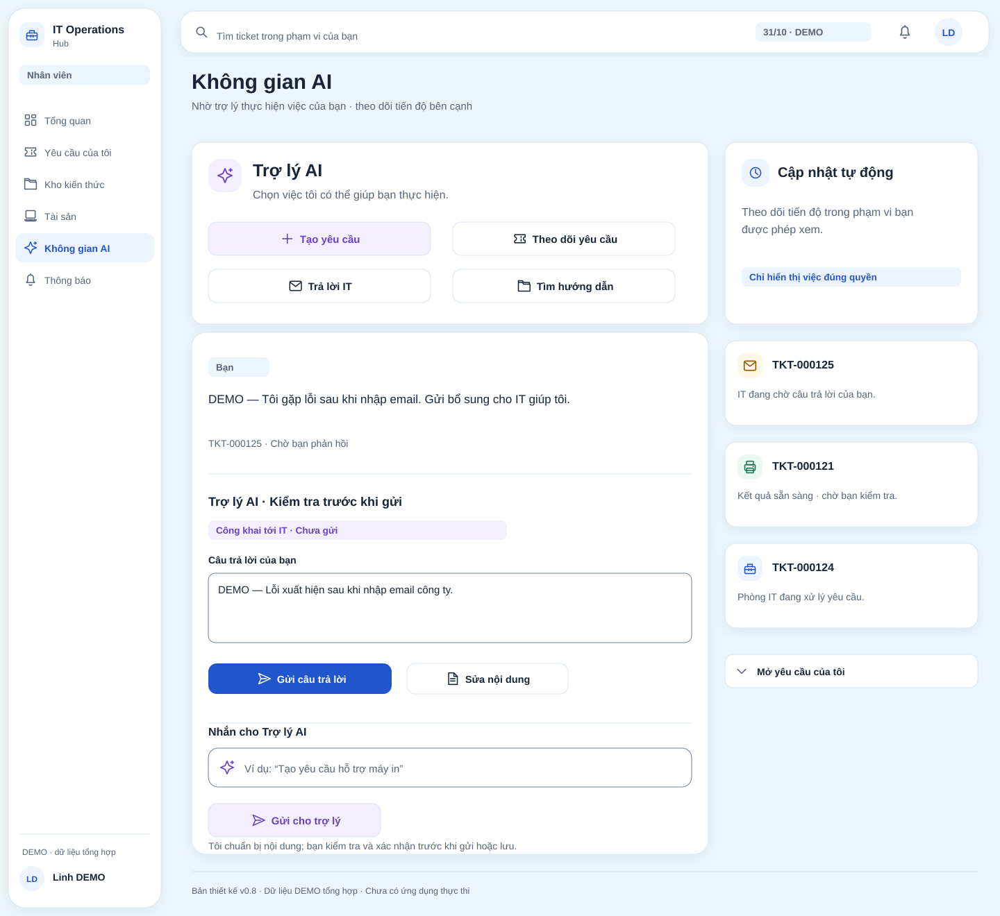

- **Tạo yêu cầu:** chat chuẩn bị nháp → người dùng kiểm tra tại form cũ → bấm gửi mới tạo ticket và bắt đầu SLA.
- **Phản hồi:** AI soạn nháp → người IT đọc/chỉnh → gửi qua composer cũ; câu trả lời trong chat không tính first response.
- **Quyền và dữ liệu:** giữ phạm vi ticket/asset/report; public và internal tách ngữ cảnh; câu trả lời có nguồn.
- **Khả dụng:** AI tắt hoặc lỗi không chặn tạo/xử lý ticket, worker SLA hoặc cấp phát tài sản.

AI không có công cụ đổi trạng thái, phân công, ưu tiên, SLA, tài sản hoặc role. Xem [thiết kế chatbot](docs/10-ai-assistant.md), [8 UC/stories và AC](docs/ai/use-cases-stories-and-acceptance.md), [bất biến nghiệp vụ](docs/ai/integration-and-non-regression.md) và [file XMind AI](docs/xmind/08-ai-assistant.xmind).

## 3. Bộ sơ đồ XMind

Sơ đồ được tổ chức theo chủ đề để dễ chỉnh sửa và review. File tổng có **27 sheet**; các file nhỏ chỉ chứa phần tương ứng. Ảnh xem nhanh trong README được dựng từ cùng nội dung; bố cục khi mở trong XMind có thể khác.

| File XMind | Nội dung |
|---|---|
| [IT Operations Hub — toàn bộ](docs/xmind/it-operations-hub.xmind) | 27 sheet, gồm 23 sheet nghiệp vụ/thiết kế và 4 sheet AI bổ sung |
| [01 — Product map](docs/xmind/01-product-map.xmind) | Tổng quan sản phẩm và nghiên cứu top down |
| [02 — Use cases](docs/xmind/02-use-cases.xmind) | Tổng quan actor–goal và ba nhóm use case chi tiết |
| [03 — Information architecture](docs/xmind/03-information-architecture.xmind) | Sitemap và phân cấp màn hình |
| [04 — User flows](docs/xmind/04-user-flows.xmind) | Bảy luồng nghiệp vụ chính |
| [05 — Business rules](docs/xmind/05-business-rules.xmind) | Trạng thái ticket/tài sản, SLA, ưu tiên và mô hình thông tin |
| [06 — INVEST backlog](docs/xmind/06-invest-backlog.xmind) | 47 story lõi có nội dung và AC trong ghi chú |
| [07 — UI/UX](docs/xmind/07-uiux.xmind) | Trải nghiệm, chất lượng giao diện và 18 ảnh đính kèm: 16 bản UI + 2 board |
| [08 — Chatbot AI](docs/xmind/08-ai-assistant.xmind) | Phạm vi, 8 UC/stories, handoff và bất biến nghiệp vụ; 3 ảnh AI đính kèm |

Xem [hướng dẫn mở và danh mục sơ đồ](docs/xmind/README.md). Wireframe màn hình là tài liệu riêng; chúng cũng được đính kèm dạng ảnh trong file UI/UX để thuận tiện review.

## 4. Tech stack mục tiêu

| Phần | Công nghệ đã chọn |
|---|---|
| Frontend | Next.js App Router, React, TypeScript strict; Tailwind CSS, shadcn/ui, Lucide React |
| Form và dữ liệu | React Hook Form + Zod; TanStack Query/Table; Recharts; date-fns + @date-fns/tz |
| Backend | Python, FastAPI, Pydantic; SQLAlchemy đồng bộ, Alembic, Psycopg 3, PostgreSQL |
| Xác thực | Session phía server lưu PostgreSQL, cookie HttpOnly; Argon2id qua pwdlib, bảo vệ CSRF |
| Tác vụ và tệp | Celery + một Beat + Redis; local private khi dev, S3 private qua boto3 khi production |
| Kiểm thử/vận hành | pytest/HTTPX, Vitest/RTL, Playwright; uv/pnpm; Docker Compose, Nginx, Linux VPS, GitHub Actions |

Next.js sở hữu giao diện; FastAPI sở hữu API `/api/v1`, phân quyền và nghiệp vụ. Hai phần giao tiếp qua OpenAPI; UI không đọc database. Đây là lựa chọn thiết kế, chưa có ứng dụng chạy hoặc lockfile. Bộ phiên bản ứng viên đã được rà metadata, có điều chỉnh TypeScript/OpenAPI generator và redis-py/Kombu; chưa chạy solver/build.

Xem [đối chiếu và chốt stack](docs/technical/tech-stack.md), [kiến trúc](docs/technical/architecture.md), [baseline phiên bản và gate M1](docs/technical/version-baseline.md).

## Documentation

| Nhóm | Tài liệu |
|---|---|
| Phân tích sản phẩm | [Research](docs/00-research.md) · [Scope](docs/01-scope.md) · [Features](docs/02-features.md) |
| Yêu cầu | [Use cases](docs/03-use-cases.md) · [INVEST](docs/08-invest-requirements.md) · [Acceptance criteria](docs/06-acceptance-criteria.md) |
| Cấu trúc và trải nghiệm | [IA](docs/04-information-architecture.md) · [Flows](docs/05-user-flows.md) · [UI/UX](docs/07-uiux-specification.md) |
| Quy tắc | [Nghiệp vụ](docs/requirements/business-rules.md) · [Phân quyền](docs/requirements/permissions-matrix.md) · [Chỉ số](docs/requirements/metrics-catalog.md) |
| Mô hình và chất lượng | [Thông tin khái niệm](docs/requirements/conceptual-data-model.md) · [NFR](docs/requirements/non-functional-requirements.md) |
| Thiết kế | [XMind](docs/xmind/README.md) · [Wireframes](docs/design/wireframes/README.md) · [Design system](docs/design/design-system.md) · [Nội dung và trạng thái](docs/design/content-and-states.md) |
| Thị giác và tương tác | [Giao diện v0.4](docs/design/visual-refresh.md) · [Motion và responsive](docs/design/motion-and-responsive.md) · [44 icon SVG](docs/design/icons/) |
| Chatbot AI | [Thiết kế](docs/10-ai-assistant.md) · [Use cases/INVEST/AC](docs/ai/use-cases-stories-and-acceptance.md) · [Tích hợp và bảo toàn nghiệp vụ](docs/ai/integration-and-non-regression.md) |
| Kiểm chứng | [Validation plan](docs/research/validation-plan.md) · [Quyết định](docs/decisions/design-decisions.md) · [Truy vết](docs/traceability/master-traceability.md) |
| Kỹ thuật mục tiêu | [Tech stack](docs/technical/tech-stack.md) · [Kiến trúc](docs/technical/architecture.md) · [Phiên bản](docs/technical/version-baseline.md) |
| Theo dõi | [Checklist M1–M6](docs/09-design-readiness.md) · [Kết quả rà soát](docs/review-report.md) |

## Project Progress

- [x] Phân tích top down, mục tiêu, phạm vi và giả thuyết nghiên cứu.
- [x] 33 use case, ma trận quyền và điều kiện nghiệp vụ.
- [x] 47 user stories cùng review INVEST, AC và truy vết.
- [x] Information architecture, screen hierarchy và user flows.
- [x] Bộ sơ đồ XMind có thể chỉnh sửa và ảnh xem nhanh.
- [x] UI/UX v0.4: 16 bản UI, 2 board thiết kế, 44 icon SVG; đặc tả responsive và chuyển động.
- [ ] Prototype tương tác và kiểm chứng animation, bàn phím, responsive trên UI thực thi.
- [x] Chốt stack frontend/backend và kiến trúc mục tiêu; rà metadata, ghi rõ gate kiểm chứng M1.
- [x] Thiết kế chatbot AI trong MVP, 8 use case/stories, AC riêng và ranh giới tích hợp.
- [ ] Triển khai/kết nối provider AI và đạt 8 AC AI, 12 ca kiểm chứng AI cùng regression lõi trước nghiệm thu MVP.
- [ ] Phỏng vấn, tree test và usability test với người dùng thực tế.
- [ ] Hoàn thiện bản vẽ riêng cho các màn hình phụ trợ.
- [ ] Triển khai M1–M6 và kiểm thử ứng dụng khi bắt đầu giai đoạn phát triển.

Phạm vi hiện tại chỉ gồm tài liệu và thiết kế. Backend, dữ liệu bền vững, worker SLA, chatbot AI và các luồng tự động chưa được triển khai hoặc nghiệm thu.
