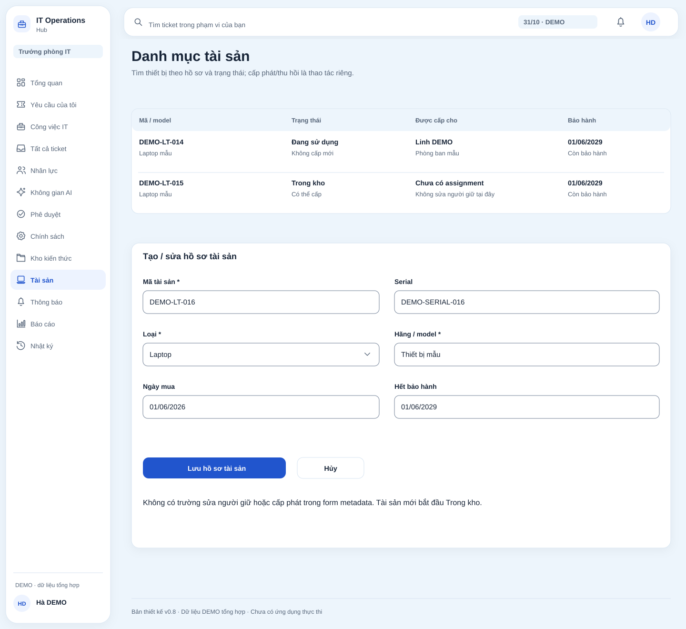
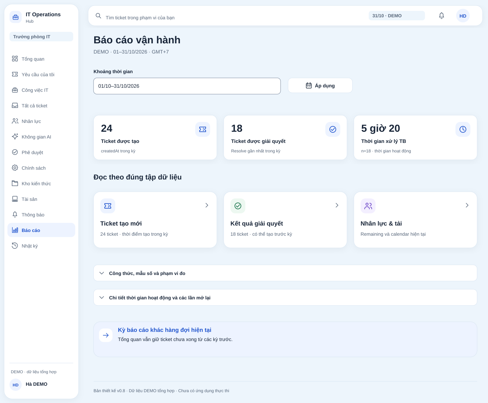

# IT Operations Hub

IT Operations Hub is an internal IT department management and operations system. It brings support requests, execution work, workforce, assets, and operational information into one workspace. Employees track requests; technicians perform specialist work; the IT Manager sets policies, supervises, intervenes, and approves exceptions.

The product serves **one organization**, with four user roles: **Requester, Technician, IT Manager, and Admin**. **AI_COORDINATOR** is an internal, policy-constrained service identity, not a fifth user or a general-purpose Admin. The main workflow is **receive requests → create plans/tasks → assign work → monitor/adjust → complete and report**. Tickets record incoming requests and SLAs; execution Tasks have effort, deadlines, and dependencies.

**IT Manager (IT_MANAGER) means Head of IT.** AI coordinates work under policy; the IT Manager sets policies, supervises, intervenes, and approves exceptions. Teams organize specialists and work scope without adding another management tier. Other department heads submit requests with Requester permissions.

**A department head submits an account-provisioning ticket as Requester; Admin verifies it and creates the user.** AI may assign that task to an authorized person but cannot create accounts/roles itself. Managing IT policy differs from requesting an account as a department head. See the [account-provisioning workflow](docs/requirements/account-provisioning.md).

**Current phase:** analysis and design; no application has been implemented or accepted. M0–M5 describe a proposed roadmap. Diagrams and UI designs use illustrative data. [Design decisions and open questions](docs/decisions/design-decisions.md) record their status.

## 1. Requirements — INVEST, Use Cases and Acceptance Criteria

Requirements are broken down from product goals into business capabilities, roles, use cases, user stories, and acceptance criteria. Each story links to the relevant screens and rules to keep business behavior and user experience consistent.

### 1.1 Problem Analysis (Top-down Research)

| Analysis level | Content |
| --- | --- |
| Context | An organization with an internal IT team, multiple departments, and many devices |
| Problems | Scattered requests; manual work breakdown/assignment; missing skills/schedule/workload data; difficult dependency/deadline tracking |
| Goals | Centralize requests, clarify ownership, control SLAs, link assets and history |
| Core capabilities | Tickets, plans/tasks, workforce, AI coordination, SLA, assets, KB/RAG, dashboards, notifications |
| MVP scope | One organization, four user roles; AI assistant, AI coordination, and KB/RAG included in MVP acceptance |
| Validation | Business AC, requirements traceability, planned interviews and usability testing |

Research currently consists of specification analysis and desk research. Proto-personas, journeys, and assumptions have not been validated through user research. See [top-down research](docs/00-research.md) and [product scope](docs/01-scope.md).

### 1.2 Product mind map


[Open XMind: overview and research](docs/xmind/01-product-map.xmind) · [Research diagram](docs/xmind/previews/02-research.svg)

### 1.3 INVEST requirements

The target backlog contains **67 user stories: 47 core + 8 AI assistant + 12 work management/coordination (OPS)**. Each story records its role, value, dependencies, and acceptance criteria; existing core IDs are retained for traceability.

| Criterion | Application in IT Operations Hub |
| --- | --- |
| **Independent** | Each story targets a demonstrable outcome; data and permission dependencies are explicit |
| **Negotiable** | Layout and interaction details may evolve; mandatory authorization and business rules remain |
| **Valuable** | Value relates to submitting requests, execution, coordination, or operational administration |
| **Estimable** | Inputs, outcomes, actors, error paths, and dependencies support development refinement |
| **Small** | Stories are divided by user outcome; broad stories are marked for possible splitting |
| **Testable** | Observable AC include authorization, states, SLA, and important failures |

| Story group | Scope |
| --- | --- |
| US01–US04 | Login, sessions, personal profile |
| US05–US12 | Users, departments, teams, categories, default SLA |
| US13–US19 | Ticket creation, lookup, assignment, acceptance |
| US20–US31 | Conversations, files, states, priority, timeline |
| US32–US34 | Two SLA clocks, background alerts, notifications |
| US35–US40 | Asset records and issue/return lifecycle |
| US41–US46 | Dashboards, reports, workload, warranty |
| US47 | Audit trail |
| US-AI01–08 | Cited Q&A/search/summaries, confirmed conversational tickets, reply drafts, availability |
| US-OPS01–12 | Workforce, workflows/policies, plans/DAG, assignment, task progress, replanning, approval, manual locks, traces, KB, reports |

Broad stories still need development review and splitting; no estimates or sprint commitments exist. See [67 target stories and INVEST review](docs/08-invest-requirements.md), [AC catalog](docs/06-acceptance-criteria.md), and [XMind backlog](docs/xmind/06-invest-backlog.xmind).

### 1.4 Use cases

The target catalog contains **51 use cases: 33 core + 8 AI assistant + 10 OPS**. The overview and five detailed groups below align with the catalog and permissions matrix. An ID shown in multiple views still represents one use case.

#### Overview by role


#### Accounts and administration — UC01–UC09


#### Tickets, SLA, and notifications — UC10–UC26


#### Assets, dashboards, and audit — UC27–UC33


#### AI assistant — UC-AI01–08


#### Work, coordination, and knowledge — UC-OPS01–10


[Open XMind use cases](docs/xmind/02-use-cases.xmind) · [Use-case catalog and detailed flows](docs/03-use-cases.md) · [SVG UML views](docs/diagrams/README.md)

Actor–goal maps support scope review. Record-level and state conditions still require the permissions matrix; an actor on a diagram is not authorized to act on every ticket.

### 1.5 Roles and permissions

| Capability | Requester | Technician | IT Manager | Admin |
| --- | --- | --- | --- | --- |
| Submit personal requests | Yes | Yes | Yes | Yes |
| View tickets | Own | Team; personal tickets as Requester | All | All |
| Public comments | Own tickets | Scoped tickets | Yes | Yes |
| Internal notes | No | Within team | Yes | Yes |
| Self-assign unassigned tickets | No | Within team | Subject to team conditions | Subject to team conditions |
| Assign and transfer teams | No | No | Yes | Yes |
| Change priority | No | Suggest through a note | Reason required | Reason required |
| Confirm closure of Resolved | Original requester only | When original requester | When original requester | When original requester |
| Reopen Closed | No | No | Reason required | Reason required |
| Assets | Assigned to self | For support and personal assets | Manage all | Manage all |
| Organization reports | No | No | Yes | Yes |
| Users, teams, departments, SLA | Minimal lookup | Minimal lookup | Necessary lookup | Manage |
| Tasks/plans | Filtered public progress | Team; update assigned tasks | Coordinate within scope | Under business permissions |
| Skills/schedules/capacity | No | Self/minimal lookup | Configure/verify | Under management permissions |
| Policies/templates/exceptions | No | Read execution requirements | Grant/disable, intervene, approve | Under management permissions |
| Knowledge base | Published under ACL | Published under ACL | Under ACL/granted publisher rights | Under ACL; no blanket content access |

Conversational AI uses the requesting user's permissions; background coordination uses AI_COORDINATOR with a policy/grantor. The model cannot autonomously mark Done/Resolved/Closed, grant roles, or change SLA/commitments. The future backend must enforce authorization per action and record. Hidden controls do not replace authorization. See the [detailed permissions matrix](docs/requirements/permissions-matrix.md).

### 1.6 Acceptance criteria

AC define observable outcomes, including successful flows, invalid data, denied access, and concurrent-edit conflicts.

- Tickets follow valid transitions; starting work requires an assignee.
- Pending requires a public question; a requester reply resumes In Progress.
- Resolved requires a solution; the requester confirms closure or reopens with a reason.
- First response requires a substantive public IT comment; assignment and notes do not count.
- SLA elapsed time survives team/priority changes and reopening; workers avoid duplicate alerts.
- Files, asset data, and dashboards respect access scope.

Retain **47 core AC, 10 cross-cutting AC, and 12 SLA examples**; the assistant has **8 AC/12 TC**; OPS has **12 AC/12 TC**, alongside acceptance gates **A1–A13**. Gates cover plans/DAG, skills/schedules/workload, automatic assignment, absence/exceptions, concurrency/retry, stale approvals/manual locks, sources/permissions, provider failures, and persistence/restore. All are **PLANNED / NOT RUN**. [Master traceability](docs/traceability/master-traceability.md) links stories/UC/AC/screens/BR/milestones.

## 2. Information Architecture, Screen Hierarchy and UI/UX

The workspace follows user tasks: overview, requests/tickets, assets, monitoring, and administration. Navigation, screens, and actions vary by role and record scope.

### 2.1 Information architecture


[Open XMind information architecture](docs/xmind/03-information-architecture.xmind) · [Sitemap, navigation, routes, and screen inventory](docs/04-information-architecture.md)

### 2.2 Screen hierarchy

Login opens a workspace with a sidebar and topbar. Request creation and ticket details use dedicated pages; assignment, waiting for a reply, resolution, and reopening use contextual dialogs. Asset pages link records, handover history, and related tickets within the same authorization scope.

| Area | Screens and interactions |
| --- | --- |
| Account | Login, profile, password change |
| Overview | Personal, Technician, and Manager/Admin dashboards |
| Tickets | List, creation, details, conversations, internal notes, SLA, timeline |
| Work/workforce | Task board/my work, plans/DAG, skills/schedules/capacity |
| Coordination | Events/runs/actions, exceptions/approval, policies, workflow/templates |
| Knowledge base | Draft/Published/version/ACL, cited retrieval |
| Ticket handling | Assignment, states, priority, confirmations |
| Assets | List, records, details, issue, return, states |
| Target technology | [Tech stack](docs/technical/tech-stack.md) · [Architecture](docs/technical/architecture.md) · [Versions](docs/technical/version-baseline.md) |
| Monitoring | Reports, notifications, audit |
| Administration | Users, departments, teams/members, categories, SLA |
| Access/errors | Access denied and record not found |

The target inventory has **36 patterns: 26 core + 3 AI assistant + 7 OPS**, including pages/dialogs/error pages. Routes are navigation designs, not implemented. The v0.8 set illustrates all seven OPS patterns, but not every variant/state/breakpoint separately.

### 2.3 Primary user flows


The flow set covers ticket intake/handling, policy/plans/task assignment, absence/reassignment/approval, asset issue/return, access administration, error recovery, and notifications.

Diagrams use dark blue borders and a bright outer outline, with arrows, conditions, and responsible actors. See the [Technician flow](docs/xmind/previews/08-flow-technician.svg) and [IT Manager supervision/exception approval](docs/xmind/previews/09-flow-manager.svg). These are target designs; unresolved operational details are tracked in D-40.


See [user journeys and task flows](docs/05-user-flows.md) or the [XMind flow set](docs/xmind/04-user-flows.xmind).

### 2.4 UI/UX design

The UI uses light surfaces, cards with icons and short labels, clear hierarchy, and generous spacing. Seven capability groups and eight representative images show the core workflow: **receive requests → manage work and workforce → coordinate/execute → monitor assets and operational results**. The AI assistant supports authorized actions; the IT Manager supervises and intervenes when needed.

These are static designs using synthetic DEMO data, not a running application. They combine Apple Design Skill principles, the earlier UI, and P-047 quick-action card layouts, with desktop/tablet/mobile and reduced-motion specifications. **UI and dashboard artwork intentionally remains in Vietnamese.**

#### Operations overview

The IT Manager sees ticket/SLA status, blocked work, and actionable exceptions, with links into the relevant areas.


#### Support request management

Centralize tickets by status, priority, assignee, and SLA; filter, create requests, and open details to communicate, resolve issues, and track results.


#### Execution work management

Track tasks separately from tickets, with assignees, states, deadlines, and dependencies. Authorized users can plan, assign manually, and record work results.


#### Workforce and availability

Compare skills, work/absence schedules, and workload to make suitable assignments. AI coordination validates against the same data.


#### AI Workspace — assistant and automatic coordination

The assistant supports search, cited Q&A, and work through forms/previews/confirmation. Background coordination plans, selects people, assigns, and monitors under policy, requesting approval only for exceptions. The image below shows normal operation with no exception awaiting approval.


**Exception proposal state:** AI suggests a replacement after availability changes, but the task has an assignment lock, so it waits for IT Manager approval and has not been reassigned. After approval, the system still rechecks permissions, schedules, and workload before execution. This is a state of the same AI Workspace, not its default screen.


#### IT asset management

Find devices, their condition, and current users; open records to manage issue/return, history, and related tickets.



#### Operations reporting

Review request volumes/outcomes, resolution time, and SLA metrics by period to evaluate IT operations.



The full design set contains **34 UI SVGs, 3 supporting boards, and 44 separate SVG icons**. Detailed screens, exception approval, knowledge, notifications, audit, login, and administration remain in the [UI/UX gallery](docs/design/wireframes/README.md). See the [screen specification](docs/07-uiux-specification.md), [UI/UX XMind map](docs/xmind/07-uiux.xmind), and [design review](docs/design/uiux-review.md). Some patterns share a view/board; not every variant/state/breakpoint has a separate drawing.

### 2.5 States and experience quality

| State / requirement | Designed behavior |
| --- | --- |
| Loading / updating | Preserve the shell; show status in the affected data region |
| No data / empty filters | Distinguish these cases; offer an authorized next action |
| Field error | Preserve input, place the error beside the field, show clear focus |
| Conflict | Preserve edits and request a review of fresh data; never overwrite silently |
| Access denied / session expired | Avoid private-data disclosure; provide a safe return path |
| Success | Update source data and report a specific outcome |
| Accessibility | Input labels, keyboard access, focus, contrast, more than color alone |
| Responsive | Desktop tables, mobile cards, single-column forms, easy-to-tap primary actions |

See [Design system](docs/design/design-system.md), [Content and states](docs/design/content-and-states.md), and the [design validation plan](docs/research/validation-plan.md).

### 2.6 AI assistant integrated into the MVP

**One AI Workspace for the assistant and automatic coordination.** Chat/action cards sit beside authorized activity; automation continues under policy while chat is closed. The shared screen keeps the user actor and AI_COORDINATOR separate. See [decisions and detailed flows](docs/10-ai-assistant.md).

AI has two modes: **on-demand assistance** and **policy-based automatic coordination**. Enable/disable flags are operational choices and do not remove AI from MVP acceptance. The assistant has 8 stories; coordination/work management/KB has 12 OPS stories.

[Employee variant](docs/design/wireframes/11-ai-assistant.svg) · [Technician](docs/design/wireframes/12-ai-ticket-assistant.svg) · [Exception awaiting approval](docs/design/wireframes/23-coordination.svg).

The **AI assistant** area has role-based suggestions and an explicitly labeled message field; background coordination has its own name/icon. Users choose a task, review it, and confirm before sending/saving. The assistant supports other work without a run or while approval is pending; it is not limited to post-reassignment work. Reassignment proposals retain full cards outside chat; coordination progress uses numbered steps and arrows for the current branch.

- **Create a request:** conversation → preview → user confirms content/version → Ticket service creates idempotently and starts SLA; users may edit in the form. No confirmation means no ticket.
- **App actions:** state a goal → card/form → preview → authorized user confirms → domain service saves; users can send replies, update progress, or approve exceptions within the AI Workspace. Chat/drafts do not count as first response; secrets use secure forms.
- **Coordination:** understand the request → plans/tasks/DAG → eligible candidates by skills/schedule/workload → ranking → service assignment → monitor events → policy-authorized reassignment or approval. Default deny; no overwrite of manual locks/in-progress work.
- **Permissions and sources:** user scope for conversation, service grants for background work; KB Published/version/ACL and accessible citations; separate public/internal contexts.
- **Availability:** AI failure does not block manual workflows/SLA; outbox/retry avoids duplicates; model calls run outside transactions, followed by revalidation before writes.

AI cannot autonomously mark Done/Resolved/Closed, create users/roles, purchase items, or run shell commands. Approved proposals still recheck policy/version/capacity; Approved differs from execution succeeded. See [AI design](docs/10-ai-assistant.md), [assistant catalog](docs/ai/use-cases-stories-and-acceptance.md), [integration](docs/ai/integration-and-non-regression.md), and [AI XMind](docs/xmind/08-ai-assistant.xmind).

<details>
<summary>Coordination example: onboarding task DAG and absence handling (DEMO)</summary>


[Full flows](docs/05-user-flows.md) · [Sequences and architecture](docs/diagrams/architecture.md) · [Domain ERDs](docs/requirements/conceptual-data-model.md).

</details>

## 3. XMind Diagram Set

Diagrams are grouped by topic for editing and review. The master file contains **27 sheets**; smaller files contain their corresponding subsets. SVG previews retain the node/branch structure of the same source topics; flows/states have explicit edges/conditions. Layout may vary in XMind.

| XMind file | Content |
| --- | --- |
| [IT Operations Hub — complete set](docs/xmind/it-operations-hub.xmind) | 27 sheets: 23 business/design sheets and 4 additional AI sheets |
| [01 — Product map](docs/xmind/01-product-map.xmind) | Product overview and top-down research |
| [02 — Use cases](docs/xmind/02-use-cases.xmind) | Core, assistant, and OPS actor–goals; full 51-UC catalog |
| [03 — Information architecture](docs/xmind/03-information-architecture.xmind) | Sitemap and screen hierarchy |
| [04 — User flows](docs/xmind/04-user-flows.xmind) | Seven business views, including updated onboarding/replanning/approval |
| [05 — Business rules](docs/xmind/05-business-rules.xmind) | Ticket/task/approval states, SLA, assets, priority, data model |
| [06 — INVEST backlog](docs/xmind/06-invest-backlog.xmind) | 67 stories with IDs/dependencies/AC: 47 core + 8 AI + 12 OPS |
| [07 — UI/UX](docs/xmind/07-uiux.xmind) | Experience, UI quality, 37 attached images: 34 UI designs + 3 boards |
| [08 — AI assistant](docs/xmind/08-ai-assistant.xmind) | Assistant/coordination, 8 UC-AI + 10 UC-OPS, confirmation/tools/policies/exceptions; 3 assistant images |

See [opening instructions and diagram inventory](docs/xmind/README.md). UI wireframes are separate documents and are also embedded as images in the UI/UX file.

## 4. Target Tech Stack

| Layer | Selected technology |
| --- | --- |
| Frontend | Next.js App Router, React, TypeScript strict; Tailwind CSS, shadcn/ui, Lucide React |
| Forms and data | React Hook Form + Zod; TanStack Query/Table; Recharts; date-fns + @date-fns/tz |
| Backend | Python, FastAPI, Pydantic; synchronous SQLAlchemy, Alembic, Psycopg 3, PostgreSQL |
| Authentication | PostgreSQL-backed server sessions, HttpOnly cookies; Argon2id through pwdlib, CSRF protection |
| Jobs and files | Celery + one Beat + Redis; private local storage in development, private S3 through boto 3 in production |
| AI and knowledge | Provider/model/embedding adapters; PostgreSQL + pgvector; versions/ACL/background indexing |
| Testing/operations | pytest/HTTPX, Vitest/RTL, Playwright; uv/pnpm; Docker Compose, Nginx, Linux VPS, GitHub Actions |

Next.js owns UI; FastAPI owns /api/v1, authorization, and business logic. OpenAPI connects them; the UI does not read the database. This is a design choice, not a running application or lockfile. Candidate versions have undergone metadata review, with adjustments to TypeScript/OpenAPI generation and redis-py/Kombu; no dependency/runtime set has passed acceptance.

See [tech stack](docs/technical/tech-stack.md), [architecture](docs/technical/architecture.md), and [versions/M1 validation gates](docs/technical/version-baseline.md).

## 5. C4 Architecture

Following the reference repository format, README shows C1–C3 and links to detailed documentation. C4 Level 4 and sequences are in the architecture documents. This is a **target design**, with no running code/containers.

### C1 — System Context


Four roles R/T/M/A; the IT Manager sets policies, supervises, and approves exceptions. There is no IT Team Lead. AI_COORDINATOR is internal; external providers receive only permitted sources.

[Context and boundaries](docs/architecture/c4/01-context.md).

### C2 — Container


Next.js owns UI; FastAPI owns /api/v1, session/CSRF, authorization, and domains. Celery workers share domain services with their own Sessions; one Beat, Redis broker, and durable PostgreSQL/pgvector. The model adapter is a component, not a microservice with inherent write permissions.

[Container catalog and failure boundaries](docs/architecture/c4/02-containers.md).

### C3 — Component


Router/schema → identity/scope → application/domain service → Unit of Work → repository/database. Business effects, audit, and outbox commit atomically; model calls do not hold DB locks.

<details>
<summary>C3 worker — snapshot, model, revalidation, and commit</summary>


</details>

[Component catalog](docs/architecture/c4/03-components.md) · [C4 Level 4 — proposed code collaboration](docs/architecture/c4/04-code.md) · [Sequences and deployment](docs/diagrams/architecture.md) · [C4 Documentation](docs/architecture/c4/README.md).

## 6. Database Diagrams and OpenAPI Document

These data/HTTP contracts are design documentation, not a database, migration, API server, or generated client. FastAPI + synchronous SQLAlchemy + Alembic is retained.

### 6.1 DBML / ER Mermaid format


| Representation | Artifact | Scope |
| --- | --- | --- |
| DBML | [schema.dbml](docs/database/schema.dbml) | 52 logical entities, 59 references, selected fields |
| ER Mermaid | [Logical model and Mermaid source](docs/requirements/conceptual-data-model.md) | 11 PK/FK/cardinality views and an overall graph |
| SVG | [ERD inventory](docs/diagrams/README.md) | Rendered domain views |
| Constraints and mapping | [Database documentation](docs/database/README.md) | Invariants; nullable/index/FK refinement under D-40 |

DBML uses the same logical entities as ER; it does not replace BR/ACL/atomic capacity or a physical schema. Partial uniqueness (one Effective plan, one active asset assignment), DAGs, actor XOR, and deduplication require review before migration.

### 6.2 OpenAPI API documentation

The contract uses **OpenAPI 3.1.1 JSON**, with **74 paths, 96 operations, and 96 reusable schemas**, covering API01–19.

```text
/api/v1 — target contract, not a running API
Opaque server session cookie + CSRF / Origin
Stable operationId + role / scope / BR metadata
JSON and multipart input; scoped public/internal response projections
expectedVersion + Idempotency-Key; bounded retry and conflict handling
200 / 201 / 202 / 204, safe 401 / 403 / 404 / 409 / 422 / 429 / 503 errors
Internal EVT01–17 and service grants documented separately from public HTTP
```

The reference repository does not change the design to JWT. Requester/role/grantor come from the server; AI cannot autonomously mark Done/Resolved/Closed or create users. Approval decisions differ from execution; provider failure is not an assignment result.

- [OpenAPI document](docs/api/openapi.json)
- [API documentation and DEMO examples](docs/api/README.md)
- [Operation catalog: method/path/operationId/role/scope](docs/api/operations.md)
- [API, transaction, and event rules](docs/technical/api-design.md)

## 7. Frontend and Backend Folder Structures

Current and target layouts are separate. Planned trees describe file locations for a separately authorized implementation; this documentation phase creates no application source/config/tests.

### 7.1 Current repository layout

```text
IT-Operation-Hub/
├── README.md
├── docs/
│   ├── api/                   # OpenAPI JSON, operation catalog, documentation
│   ├── database/              # DBML and ER Mermaid mappings
│   ├── architecture/c4/       # C1–C4 documentation
│   ├── requirements/          # BR, scope, logical data model
│   ├── technical/             # Stack, architecture, code structure
│   ├── diagrams/              # Rendered SVGs
│   ├── design/                # Static UI/UX
│   └── xmind/                 # Native diagrams and previews
└── src/
    ├── frontend/.gitkeep       # No Next.js application code
    └── backend/.gitkeep        # No FastAPI application code
```

### 7.2 Target Next.js feature structure

```text
src/frontend/                  # PLANNED
├── src/app/                   # App Router, layouts, page composition
├── src/features/              # Auth, tickets, work, workforce, automation, KB...
├── src/components/            # UI primitives, shell, feedback
├── src/lib/api/
│   ├── generated/schema.d.ts  # PLANNED from OpenAPI
│   ├── client.ts              # Cookie/CSRF/idempotency/error adapter
│   └── query-keys.ts          # Partition by user/scope
└── tests/                     # PLANNED component/e2e
```

### 7.3 Target FastAPI modular structure

```text
src/backend/                   # PLANNED
├── app/api/                   # Router / dependencies / HTTP errors
├── app/core/                  # Settings / security / principal / UTC clock
├── app/modules/               # Auth, tickets/SLA, assets, work/workforce,
│                              # automation, assistant/KB, reports/audit
├── app/infrastructure/        # Sync SQLAlchemy UoW, events, AI/storage adapters
├── app/workers/               # Celery jobs; SLA queues separate from model queues
├── migrations/                # PLANNED Alembic; no migration created
└── tests/                     # PLANNED unit/integration/contract
```

Each module separates transport/schema, services, policy/domain, models, and repositories as needed. Repositories do not commit independently; workers use the same command services, not Admin impersonation over HTTP. See [complete routes/modules/files, ownership, and dependency rules](docs/technical/code-structure.md).

## Documentation

[Documentation index and authoritative sources](docs/README.md) · [Documentation/diagram conventions](docs/documentation-standard.md) · [Context, containers, sequences, and deployment](docs/diagrams/architecture.md).

| Group | Documents |
| --- | --- |
| Product analysis | [Research](docs/00-research.md) · [Scope](docs/01-scope.md) · [Features](docs/02-features.md) |
| Requirements | [Use cases](docs/03-use-cases.md) · [INVEST](docs/08-invest-requirements.md) · [Acceptance criteria](docs/06-acceptance-criteria.md) |
| Structure and experience | [IA](docs/04-information-architecture.md) · [Flows](docs/05-user-flows.md) · [UI/UX](docs/07-uiux-specification.md) |
| Rules | [Business rules](docs/requirements/business-rules.md) · [Permissions](docs/requirements/permissions-matrix.md) · [Metrics](docs/requirements/metrics-catalog.md) |
| Machine-readable contracts and architecture | [DBML/ER](docs/database/README.md) · [OpenAPI](docs/api/README.md) · [C4 C1–C4](docs/architecture/c4/README.md) · [Folders/files](docs/technical/code-structure.md) |
| Models and quality | [Data model/ERD](docs/requirements/conceptual-data-model.md) · [API design](docs/technical/api-design.md) · [NFR](docs/requirements/non-functional-requirements.md) |
| Design | [XMind](docs/xmind/README.md) · [Wireframes](docs/design/wireframes/README.md) · [Design system](docs/design/design-system.md) · [Content and states](docs/design/content-and-states.md) |
| Visuals and interaction | [UI v0.8](docs/design/visual-refresh.md) · [Motion and responsive](docs/design/motion-and-responsive.md) · [44 SVG icons](docs/design/icons/) |
| AI assistant and coordination | [Design](docs/10-ai-assistant.md) · [Use cases/INVEST/AC](docs/ai/use-cases-stories-and-acceptance.md) · [Integration and non-regression](docs/ai/integration-and-non-regression.md) |
| Validation | [Validation plan](docs/research/validation-plan.md) · [Decisions](docs/decisions/design-decisions.md) · [Traceability](docs/traceability/master-traceability.md) |
| Target technology | [Tech stack](docs/technical/tech-stack.md) · [Architecture](docs/technical/architecture.md) · [Versions](docs/technical/version-baseline.md) |
| Tracking | [M0–M5 roadmap](docs/09-design-readiness.md) · [Documentation review](docs/review-report.md) |

## Project Progress

- [x] Top-down analysis, goals, scope, research assumptions.
- [x] 51-use-case catalog, permissions matrix, business conditions at design level.
- [x] 67 target stories with INVEST review, AC, and traceability; not estimated for implementation.
- [x] Information architecture, screen hierarchy, user flows.
- [x] Editable XMind diagrams and previews.
- [x] UI/UX v0.8: 34 UI designs, 3 supporting boards, 44 SVG icons; responsive/motion specifications.
- [ ] Interactive prototype and validation of animation, keyboard access, responsive behavior in a running UI.
- [x] Target frontend/backend stack and architecture selected; metadata reviewed and M1 validation gates recorded.
- [x] AI assistant/coordination, tasks/policies/approvals/KB, ERD, and API specified.
- [x] DBML/ER, OpenAPI, C4 C1–C4, and target code trees prepared as design drafts.
- [ ] Review/approve DTOs/physical schema and validate contracts against runtime after a separate development request.
- [ ] Connect providers/models and run A1–A13, core/assistant/OPS AC/TC after a separate development request.
- [ ] Interviews, tree testing, usability tests with actual users.
- [ ] Separate drawings for remaining supporting screens.
- [ ] Implement M1–M5 and test the application when separately requested; current work covers M0 documentation only.

The current scope is documentation and design only. Backend, durable data, SLA workers, AI chat, and automated workflows are not implemented or accepted.
