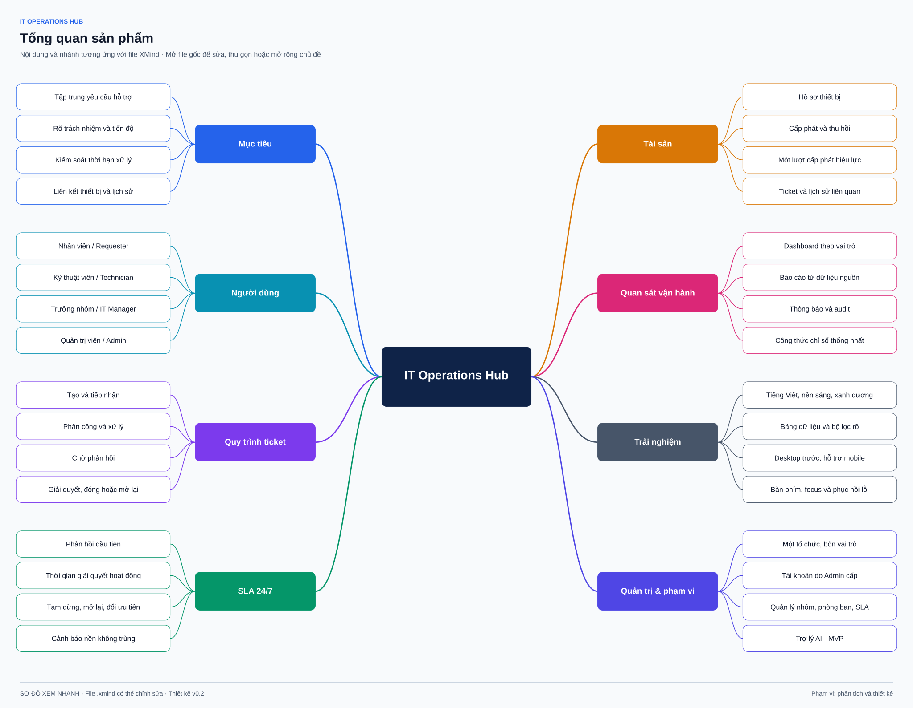

# Research top down

Ngày nghiên cứu: **30/10/2026**. Phương pháp đã thực hiện: phân tích đặc tả, đánh giá hiện trạng dự án, desk research nguồn sơ cấp và tổng hợp giả thuyết thiết kế. **Chưa phỏng vấn, khảo sát nhân viên, đo hệ thống hiện tại hoặc chạy usability test.**

## 1. Bối cảnh → vấn đề → kết quả mong muốn

| Cấp phân tích | Nội dung |
|---|---|
| Bối cảnh tổ chức | Một doanh nghiệp, nhiều phòng ban, nhiều thiết bị, đội IT nội bộ gồm nhiều nhóm |
| Vấn đề được đặc tả | Yêu cầu phân tán; dễ bỏ sót; thiếu người chịu trách nhiệm; khó thấy thời hạn và lịch sử thiết bị |
| Hệ quả cần kiểm chứng | Người dùng hỏi lại tiến độ; kỹ thuật viên đổi ngữ cảnh; trưởng nhóm phát hiện tồn đọng muộn |
| Năng lực sản phẩm | Một nơi tiếp nhận, điều phối, trao đổi, xử lý, xác nhận; liên kết tài sản và kiểm soát SLA |
| Giá trị cho nhân viên | Biết yêu cầu đã được ghi nhận, ai xử lý, đang chờ gì và cách xác nhận kết quả |
| Giá trị cho IT | Hàng đợi rõ phạm vi; giao việc có lịch sử; phân biệt trao đổi công khai với nội bộ |
| Giá trị cho quản lý | Phát hiện ticket chưa có người, áp lực SLA và tải công việc từ dữ liệu nguồn |

Chuỗi lập luận: **tập trung yêu cầu → nhìn rõ trách nhiệm → xử lý có kiểm soát → xác nhận kết quả → đo lường và cải tiến**. Chỉ làm dashboard đẹp không giải quyết được chuỗi này.

## 2. Cơ sở phân tích và hiện trạng dự án

| Cơ sở | Kết luận cho thiết kế |
|---|---|
| Đặc tả sản phẩm | Một tổ chức, bốn vai trò, ưu tiên luồng ticket xuyên suốt |
| Hiện trạng workspace | Giai đoạn phân tích và thiết kế; chưa có ứng dụng, database hoặc worker |
| Yêu cầu giao diện | Tiếng Việt, desktop trước, nền sáng, màu nhấn xanh dương, bảng dữ liệu rõ |
| Ràng buộc nghiệp vụ | Quyền theo từng bản ghi; trạng thái có điều kiện; hai đồng hồ SLA; lịch sử không xóa |
| Phương pháp phân tích | Phân rã mục tiêu → năng lực → actor/use case → story/AC → thông tin và màn hình |
| Tài liệu trực quan | Sơ đồ XMind chỉnh sửa được; ảnh xem nhanh đi cùng tài liệu nghiệp vụ |

Các thông tin thực địa về doanh nghiệp, khối lượng ticket và thói quen người dùng vẫn cần kiểm chứng. Không suy diễn tài liệu thiết kế thành bằng chứng tính năng đã hoạt động.

## 3. Cây phân rã sản phẩm

[Mở file XMind](xmind/01-product-map.xmind)

## 4. Desk research và cách áp dụng

Các nguồn dưới đây hỗ trợ phương pháp hoặc nguyên tắc thiết kế. Chúng **không thay thế** quy tắc cụ thể trong đề bài, không chứng minh sản phẩm đã tuân thủ một chứng nhận và không phải nghiên cứu thị trường có định lượng.

| Nguồn sơ cấp, truy cập 30/10/2026 | Kết luận tham khảo | Suy luận thiết kế cho dự án |
|---|---|---|
| [Bill Wake — INVEST](https://xp123.com/invest-in-good-stories-and-smart-tasks/) | Story nên độc lập, thương lượng được, có giá trị, ước lượng được, nhỏ và kiểm chứng được | Chia theo kết quả người dùng; ghi phụ thuộc thật; không coi tầng database/UI là một story độc lập |
| [Atlassian — Service request management](https://www.atlassian.com/itsm/service-request-management) | Yêu cầu cung cấp dịch vụ và gián đoạn dịch vụ có mục đích khác nhau; cần luồng tiếp nhận rõ | MVP dùng hai loại ticket; việc gom nhiều ticket thành incident để sau theo đề bài |
| [Nielsen Norman Group — 10 heuristics](https://www.nngroup.com/articles/ten-usability-heuristics/) | Khả năng thấy trạng thái, ngăn lỗi và phục hồi lỗi là các nguyên tắc đánh giá giao diện | Luôn thấy trạng thái, người phụ trách và hành động tiếp theo; xác nhận các thao tác có hệ quả |
| [W3C — WCAG 2.2](https://www.w3.org/TR/WCAG22/) | Có tiêu chí kiểm tra về bàn phím, tương phản, nhãn và phản hồi lỗi | Đặt mục tiêu AA, có checklist kiểm tra; chưa tuyên bố đạt chuẩn |
| [W3C — Target size](https://www.w3.org/WAI/WCAG22/Understanding/target-size-minimum.html) | SC 2.5.8 quy định mục tiêu trỏ tối thiểu 24 × 24 CSS px, có ngoại lệ | Chọn vùng bấm 44 px cho tác vụ chính trên di động; không mô tả 44 px là yêu cầu AA bắt buộc |
| [W3C — Focus not obscured](https://www.w3.org/WAI/WCAG22/Understanding/focus-not-obscured-minimum.html) | Focus không được bị nội dung tác giả che hoàn toàn | Thiết kế sticky header/footer có khoảng đệm và kiểm tra bàn phím |
| [OWASP — Authorization](https://cheatsheetseries.owasp.org/cheatsheets/Authorization_Cheat_Sheet.html) | Quyền cần kiểm tra trên từng request và tài nguyên; mặc định từ chối | UI lọc theo quyền, đồng thời yêu cầu backend kiểm tra ticket, comment, tệp và liên kết tài sản |
| [OWASP — File upload](https://cheatsheetseries.owasp.org/cheatsheets/File_Upload_Cheat_Sheet.html) | Cần kiểm tra loại/nội dung, giới hạn tệp và vị trí lưu | Giao diện nêu định dạng, kích thước, quyền tải; không gắn URL thư mục upload công khai |

## 5. Proto-personas và jobs to be done

Đây là **mô hình giả định theo vai trò**, không phải chân dung được suy ra từ người đã phỏng vấn.

| Vai trò | Khi… tôi muốn… để… | Điều cần thấy đầu tiên | Rủi ro trải nghiệm |
|---|---|---|---|
| Nhân viên | Khi công việc bị gián đoạn, tôi muốn gửi mô tả và theo dõi để biết cách tiếp tục làm việc | Tạo yêu cầu, trạng thái, câu hỏi IT đang chờ, kết quả cần xác nhận | Không hiểu thuật ngữ SLA/P1; nhầm “đã giải quyết” với “đã đóng” |
| Kỹ thuật viên | Khi bắt đầu ca làm, tôi muốn biết việc của mình và việc nhóm chưa ai nhận để ưu tiên xử lý | Việc được giao, nhóm, tuổi ticket, hai thời hạn SLA | Gửi nhầm ghi chú nội bộ ra công khai; vô tình nhận trùng |
| Trưởng nhóm | Khi hàng đợi tăng, tôi muốn thấy điểm nghẽn để phân công và chuyển nhóm có căn cứ | Chưa phân công, sắp hạn/quá hạn, tải theo người | KPI tổng che khuất ticket cũ; đếm SLA đang hoạt động lẫn lịch sử vi phạm |
| Admin | Khi nhân sự hoặc chính sách thay đổi, tôi muốn cập nhật quyền và cấu hình để vận hành an toàn | Tài khoản hoạt động, nhóm, chính sách hiện hành, lịch sử thay đổi | Khóa user nhưng phiên còn hiệu lực; đổi SLA làm ticket cũ đổi theo |

## 6. Giả thuyết ưu tiên kiểm chứng

| ID | Giả thuyết | Cách kiểm chứng | Ảnh hưởng nếu sai |
|---|---|---|---|
| H01 | Nhân viên chọn được ảnh hưởng/khẩn cấp qua ví dụ ngắn | Test form tạo yêu cầu, hỏi lại cách hiểu | Viết lại nhãn và gợi ý; giữ nguyên ma trận nghiệp vụ |
| H02 | Nhân viên phân biệt được Resolved và Closed | Tác vụ xác nhận và yêu cầu xử lý lại | Tăng hướng dẫn ở banner và thông báo |
| H03 | Tách tab công khai/nội bộ giảm gửi nhầm | Cho technician soạn hai loại nội dung liên tiếp | Chỉnh composer và bước xác nhận phạm vi |
| H04 | Hàng đợi chưa phân công và SLA hữu ích hơn dashboard nhiều biểu đồ | Test điều phối với manager | Đổi thứ tự nội dung, không đổi công thức |
| H05 | Thông tin cấp phát và ticket trước đây đủ hỗ trợ xử lý thiết bị | Phỏng vấn kỹ thuật viên/tài sản | Bổ sung trường mô tả trong MVP nếu thực sự cần; không tự thêm CMDB |
| H06 | Trưởng nhóm cần nhìn vi phạm đã từng xảy ra dù ticket hiện còn ngân sách | Test đổi ưu tiên và mở lại | Điều chỉnh cách diễn đạt lịch sử, không xóa vi phạm |

## 7. Rủi ro và câu hỏi nghiên cứu

Ưu tiên cao: độ hiểu của các trạng thái; quyền sau chuyển nhóm; nhầm nội bộ/công khai; tài khoản bị khóa còn ticket; định nghĩa chỉ số theo kỳ. Ưu tiên vừa: bảng trên điện thoại, mật độ bộ lọc, tra cứu tài sản. Các quyết định tạm thời có trong [sổ quyết định](decisions/design-decisions.md); kế hoạch phỏng vấn và thử nghiệm nằm ở [validation plan](research/validation-plan.md).

Không đặt mục tiêu giảm thời gian xử lý theo phần trăm khi chưa có baseline. Sau triển khai có thể đo tỷ lệ ticket có người phụ trách, thời gian phản hồi đầu tiên, thời gian giải quyết hoạt động, số lần mở lại và task success của các luồng chính.

## 8. Nghiên cứu bổ sung cho trợ lý AI

Phạm vi được mở thêm lớp hỗ trợ tùy chọn: hỏi đáp có nguồn, tra cứu theo quyền, tóm tắt và nháp chuyển về form cũ. Không dùng AI thay máy trạng thái, first response, clock SLA hoặc quyết định cấp phát. Các giả thuyết H-AI01–04 và nguồn desk research được ghi trong [thiết kế chatbot](10-ai-assistant.md); chưa có kết quả người dùng hoặc benchmark chất lượng AI.
