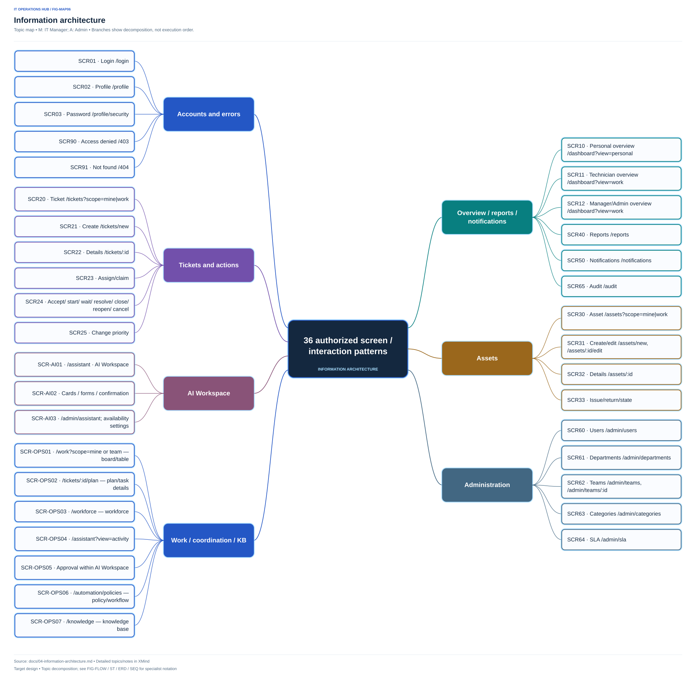

# Information architecture

> **Thiết kế mục tiêu:** Chỉ tài liệu thiết kế; chưa triển khai/kiểm thử. AI trong MVP gồm trợ lý và điều phối theo policy; Ticket khác Task; KB/RAG trong phạm vi. Xem quyết định D-34–40 và tài liệu nguồn theo chủ đề.

## Mô hình tổ chức thông tin

Đối tượng tiếp nhận là **ticket**, đối tượng thực thi là **plan/task**; nhân lực, policy, KB, tài sản, SLA và lịch sử cung cấp ngữ cảnh. Tách không gian yêu cầu cá nhân với công việc IT bằng scope và navigation, dùng chung chi tiết ticket có quyền. Không dựng bốn ứng dụng tách rời theo role.

[Mở file XMind](xmind/03-information-architecture.xmind)

Hình giữ bố cục mind map trung tâm, các nhóm và nhánh hai phía như trước; chỉ tăng độ đậm và thêm viền sáng quanh khung. Đủ 36 mẫu màn hình/tương tác với ID/tên/route; loại trình bày và phạm vi truy cập chi tiết nằm trong catalog và notes XMind. PAGE/LIST/BOARD là trang hoặc vùng danh sách; DIALOG/PREVIEW là tương tác trong ngữ cảnh; ERROR không là mục sidebar. R/T/M/A lần lượt là Requester/Technician/Trưởng phòng IT/Admin. Khung nhóm chỉ tổ chức thông tin, không cấp quyền cho mọi ô bên trong; URL đầy đủ nằm trong catalog dưới đây và notes XMind. Cấu hình khả dụng AI chỉ Admin được sửa, khác policy điều phối nghiệp vụ của M/A theo thẩm quyền. Quyền xuất bản KB vẫn cần quyết định D-40.

Sitemap là cấu trúc có điều kiện; node không có quyền không xuất hiện. Requester không thấy “Công việc IT”, “Báo cáo”, “Nhật ký” hoặc “Quản trị”. Technician không thấy báo cáo tổ chức/quản trị/nhật ký toàn cục; timeline ticket vẫn có.

## Navigation theo vai trò

| Vùng | Requester | Technician | Manager | Admin |
|---|---|---|---|---|
| Mục đầu sidebar | Tổng quan | Tổng quan | Tổng quan | Tổng quan |
| Ticket | Yêu cầu của tôi | Yêu cầu của tôi; Công việc IT | Yêu cầu của tôi; Tất cả ticket | Như Manager |
| Công việc | Chỉ tổng hợp công khai trên ticket | Công việc của tôi/nhóm; plan trong scope | Task board/plan của phòng IT | Theo quyền quản lý |
| Nhân lực | — | Bản thân/lookup tối thiểu | Kỹ năng/lịch/capacity | Theo quyền quản lý |
| Điều phối | — | Thông tin nhiệm vụ cần thực hiện | Runs/actions/approval/policy/template | Theo quyền quản lý |
| Kiến thức | Published theo ACL | Published theo ACL | Theo ACL/quyền publisher | Theo ACL/quyền được cấp |
| Asset | Tài sản của tôi | Tài sản của tôi; Tài sản phục vụ xử lý | Danh mục tài sản | Danh mục tài sản |
| Quan sát | Thông báo | Thông báo | Báo cáo; Thông báo; Nhật ký | Như Manager |
| Quản trị | — | — | — | Người dùng; Phòng ban; Nhóm; Danh mục; SLA |
| Account menu | Hồ sơ; Đổi mật khẩu; Đăng xuất | Như R | Như R | Như R |

Sidebar có nhóm nhãn “Không gian làm việc”, “Theo dõi”, “Quản trị” nếu có item tương ứng. Topbar có tìm ticket trong scope, thông báo unread và tài khoản; không có công tắc role hoặc dark mode. Điểm vào trợ lý AI chỉ xuất hiện khi tính năng khả dụng, như phần bổ sung bên dưới.

## Screen inventory và đường dẫn dự kiến

URL dưới đây là **thiết kế điều hướng**, chưa phải route được triển khai. `:id` là định danh nội bộ, mã ticket được trình bày trong trang. Dialog có thể dùng state của trang; chưa cam kết deep link dialog.

| Screen | Tên / đường dẫn | Trình bày | Quyền / use case |
|---|---|---|---|
| SCR01 | Đăng nhập `/login` | Page public | UC01 |
| SCR02 | Hồ sơ `/profile` | Page | UC03, mọi user |
| SCR03 | Đổi mật khẩu `/profile/security` | Page | UC04, mọi user |
| SCR10 | Tổng quan cá nhân `/dashboard?view=personal` | Page | UC32, mọi user |
| SCR11 | Tổng quan Technician `/dashboard?view=work` | Page | UC32, T theo nhóm |
| SCR12 | Tổng quan Manager/Admin `/dashboard?view=work` | Page | UC32, M/A |
| SCR20 | Ticket `/tickets?scope=mine\|work` | Table/cards | UC11, scope theo quyền |
| SCR21 | Tạo `/tickets/new` | Page form | UC10, mọi user |
| SCR22 | Chi tiết `/tickets/:id` | Page | UC12,15–17,24 theo scope |
| SCR23 | Phân công/nhận | Dialog trên SCR20/22 | UC13 |
| SCR24 | Tiếp nhận/bắt đầu/chờ/giải quyết/đóng/mở lại/hủy | Action + dialog trên SCR22 | UC14,18–22 |
| SCR25 | Điều chỉnh ưu tiên | Dialog trên SCR22 | UC23, M/A |
| SCR30 | Asset `/assets?scope=mine\|work` | Table/cards | UC27, theo scope |
| SCR31 | Tạo/sửa `/assets/new`, `/assets/:id/edit` | Page form | UC27, M/A |
| SCR32 | Chi tiết `/assets/:id` | Page, tab | UC28, theo scope |
| SCR33 | Cấp phát/thu hồi/trạng thái | Dialog trên SCR32 | UC29–31, M/A |
| SCR40 | Báo cáo `/reports` | Page, tab ticket/SLA/tải | UC32, M/A |
| SCR50 | Thông báo `/notifications` | Page list | UC26, của mình |
| SCR60 | Người dùng `/admin/users` | Page + form dialog | UC05, A |
| SCR61 | Phòng ban `/admin/departments` | Page + dialog | UC06, A |
| SCR62 | Nhóm `/admin/teams`, `/admin/teams/:id` | Page + panel thành viên | UC07, A |
| SCR63 | Danh mục `/admin/categories` | Page + dialog | UC08, A |
| SCR64 | SLA `/admin/sla` | Page form + history | UC09, A |
| SCR65 | Nhật ký `/audit` | Page table | UC33, M/A đúng phạm vi |
| SCR90 | Không có quyền `/403` | Page | Chức năng bị cấm theo role |
| SCR91 | Không tìm thấy `/404` | Page | Bản ghi thiếu/ngoài phạm vi, thông điệp chung |

SCR23/24/25/33 là mẫu tương tác có nhiều biến thể, không phải hàng loạt page độc lập. Scope query không bao giờ là nguồn cấp quyền.

## Cấu trúc chi tiết ticket

1. Breadcrumb và mã → tiêu đề → nhãn trạng thái/priority.
2. Banner tác vụ tiếp theo nếu Pending/Resolved hoặc dữ liệu vừa đổi.
3. Vùng chính: mô tả, public conversation, composer; tab nội bộ chỉ IT có scope.
4. Vùng ngữ cảnh: requester, nhóm/assignee, category/type, impact/urgency, hai SLA, asset link.
5. Kế hoạch/task theo quyền IT; Requester chỉ có tổng hợp tiến độ công khai đã lọc, không dữ liệu nhân lực.
6. Timeline có event công khai/nội bộ đã lọc; metadata thời gian dễ đọc.

Không nhúng toàn bộ hồ sơ user hoặc toàn bộ danh sách tài sản vào ticket. Link asset phải kiểm tra quyền riêng; nội dung ticket đã được phép đọc không tự cấp quyền cho mọi thông tin của user/asset liên quan.

## Taxonomy, tìm kiếm và bộ lọc

| Đối tượng | Trường tìm | Filter chính | Sort |
|---|---|---|---|
| Ticket | Mã, tiêu đề | Status, priority, category, team, assignee, loại SLA + ngưỡng, ngày tạo; thêm ngày resolve gần nhất cho drill-down báo cáo | Cập nhật mới nhất mặc định; tạo cũ/mới; ưu tiên P1→P4; hạn gần nhất |
| Asset | Mã, serial, hãng/model | Loại, trạng thái, user/department trong quyền, bảo hành | Mã; bảo hành; cập nhật |
| User Admin | Tên, email | Role, department, active | Tên; ngày tạo |
| Notification | Không cần search MVP | Tất cả/chưa đọc, loại | Mới nhất |
| Audit | Mã đối tượng, actor theo quyền | Loại đối tượng, thao tác, ngày | Mới nhất |

SLA filter cho phép chọn “Phản hồi / Giải quyết / Bất kỳ”, nhãn “Lịch sử đã vi phạm” tách khỏi “Đang quá hạn”. Nhiều giá trị cùng filter dùng OR; giữa filter dùng AND. Paging20/50/100, page reset về1 khi đổi filter; không có infinite scroll cho bảng nghiệp vụ.

Filter và sort có thể biểu diễn bằng query URL để quay lại/chia sẻ trong cùng quyền; không đưa nội dung mô tả/note/tokens vào URL. Back giữ vị trí và filter khi còn scope. Không lưu filter riêng của role trước khi user đổi tài khoản.

## Nhãn và ngôn ngữ

UI dùng “Yêu cầu” cho nhân viên và “Ticket” khi phù hợp công việc IT, cùng một đối tượng. Trạng thái tiếng Việt có giá trị API/thuật ngữ chuẩn được ghi trong glossary. “Đã tiếp nhận” không có nghĩa “Đã phản hồi”; “Đã giải quyết” yêu cầu requester kiểm tra; “Đã đóng” là xác nhận. SLA có tooltip “Thời hạn cam kết hỗ trợ, tính liên tục24/7”.

## Trợ lý AI trong MVP — SCR-AI01–03

Giữ nguyên 26 mẫu màn hình/tương tác lõi và mọi scope hiện có. Bổ sung 3 mẫu riêng:

| Screen | Đường dẫn / trình bày | Quyền và hành vi |
|---|---|---|
| SCR-AI01 | `/assistant`; page hoặc panel ngữ cảnh | Mọi user khi khả dụng, dữ liệu theo quyền hiện tại; mobile có đường quay lại |
| SCR-AI02 | Thẻ/dialog xem trước nháp trong trợ lý | Preview ticket với xác nhận tạo qua service hoặc chỉnh tại SCR21; nháp reply chỉ chuyển composer SCR22 |
| SCR-AI03 | `/admin/assistant`; page cấu hình khả dụng | Chỉ Admin; không nhập bí mật trong chat hoặc mở chat người khác |

Sidebar có “Trợ lý AI” khi đủ cấu hình; SCR22 có action phụ “Nhờ AI hỗ trợ” và không tự mở panel. Khi tắt, không có hành động sinh nội dung AI; nếu còn hội thoại cá nhân thì cung cấp lối quản lý lịch sử chỉ đọc/xóa theo chính sách, không gọi provider.

[Thiết kế AI](10-ai-assistant.md) · [8 use case và stories](ai/use-cases-stories-and-acceptance.md). Các sơ đồ tương ứng có trong [file XMind AI](xmind/08-ai-assistant.xmind).

## Quản lý công việc và điều phối — SCR-OPS01–07

Bổ sung bảy mẫu; tổng mục tiêu 26 lõi + 3 AI + 7 OPS = 36 mẫu màn hình/tương tác. Route là thiết kế, chưa triển khai.

| Screen | Đường dẫn dự kiến / trình bày | Quyền / UC / nội dung |
|---|---|---|
| SCR-OPS01 | /work?scope=mine hoặc team — board/table | T theo nhóm, M/A; UC-OPS05/06; task trạng thái/remaining/assignee/dependency; “Công việc của tôi” lọc assignee |
| SCR-OPS02 | /tickets/:id/plan — chi tiết plan/task | IT đúng scope; UC-OPS04/06/07; version effective/history/DAG/estimate/hạn/lock và lý do |
| SCR-OPS03 | /workforce — nhân lực | M/A; T bản thân/lookup tối thiểu; UC-OPS01; kỹ năng xác nhận/lịch/absence/capacity/load |
| SCR-OPS04 | /coordination — trung tâm AI | M/A; UC-OPS09; events/runs/proposals/actions/result/error/retry/usage đã lọc; không chat người khác |
| SCR-OPS05 | /approvals — queue/detail | M/A có thẩm quyền; UC-OPS08; before/after/impact/lý do/snapshot/decision và execution riêng |
| SCR-OPS06 | /automation/policies — policy/workflow | M/A; UC-OPS02; scope/actions/limits/grantor, template/version/publish, tắt automation |
| SCR-OPS07 | /knowledge — kho kiến thức | Reader theo ACL, publisher được cấp; UC-OPS10; search/article/version, draft/publish/ACL và nguồn |

Navigation bổ sung: T có “Công việc của tôi”, “Công việc nhóm” và “Kho kiến thức” đúng ACL; M/A thêm “Nhân lực”, “Điều phối AI”, “Phê duyệt”, “Chính sách & quy trình”. Requester chỉ thêm KB được phép/Trợ lý, không có task board/nhân lực/approval.

Bộ lọc task theo state/team/assignee/deadline/blocked/plan; approval theo pending/decision/execution; run theo event/policy/outcome/time. URL giữ filter/page/sort, không chứa body/note/source nhạy cảm. Count cùng scope, không load toàn phòng IT rồi lọc client.

Các SVG lõi cũ minh họa một phần; [UI/UX](07-uiux-specification.md) đặc tả OPS bổ sung. XMind/preview cập nhật nội dung thiết kế, không chứng minh route hoạt động.
