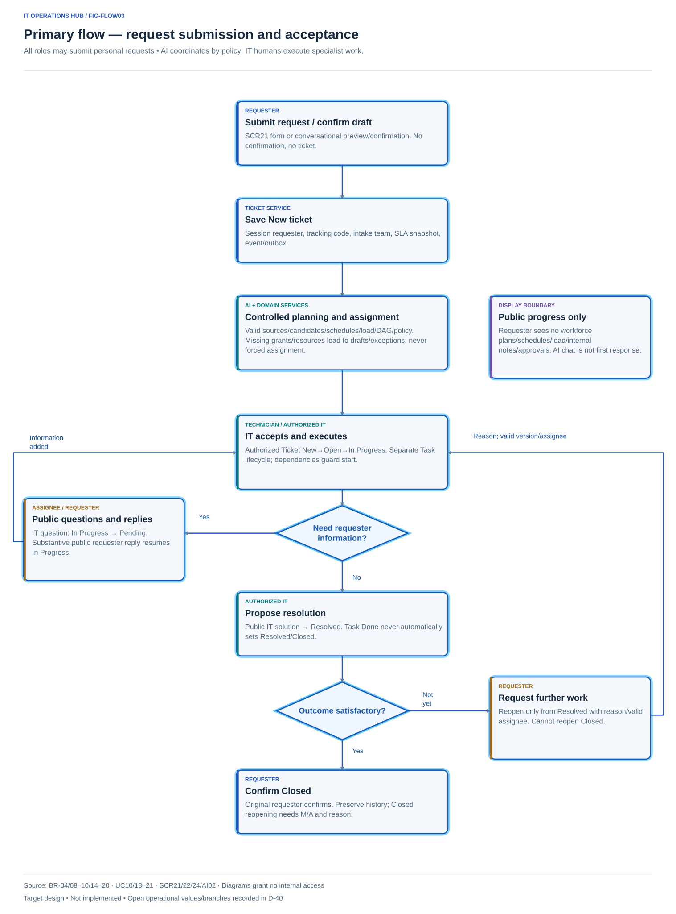
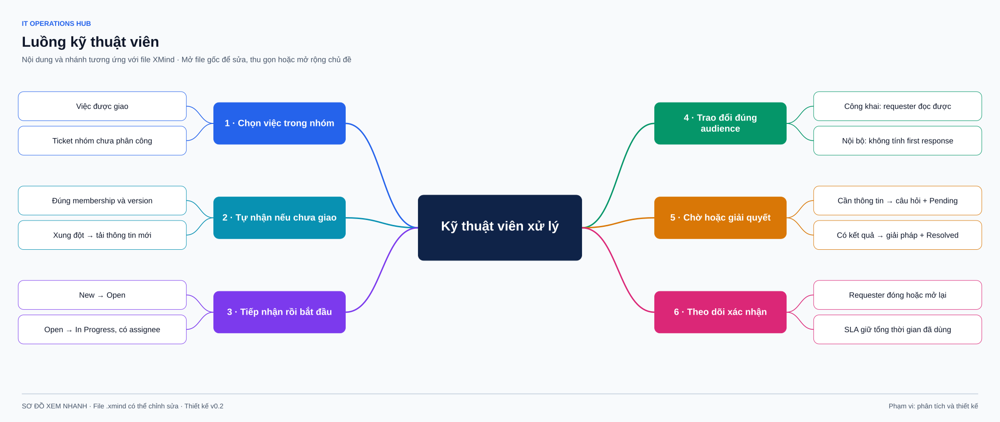
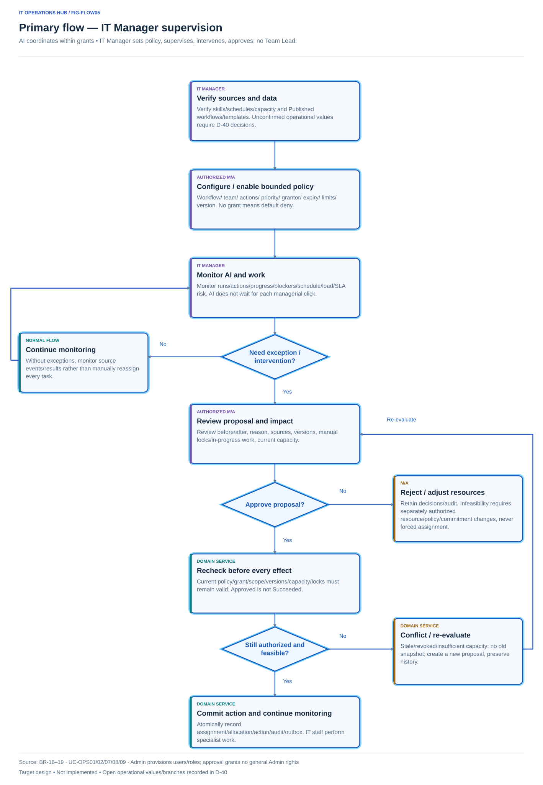
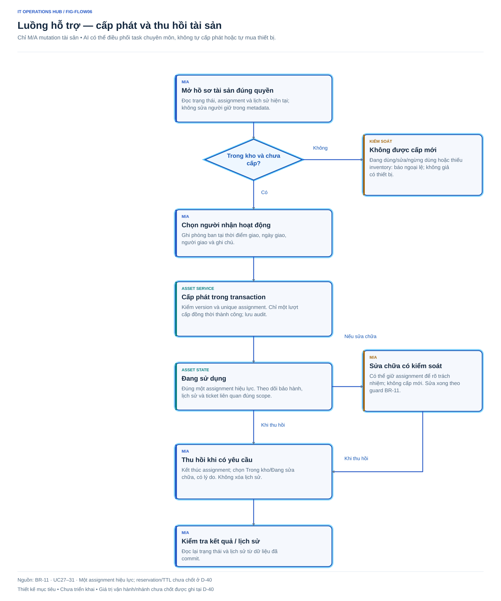
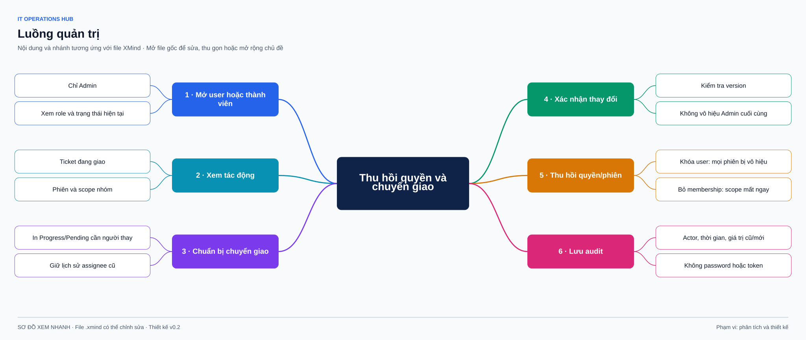
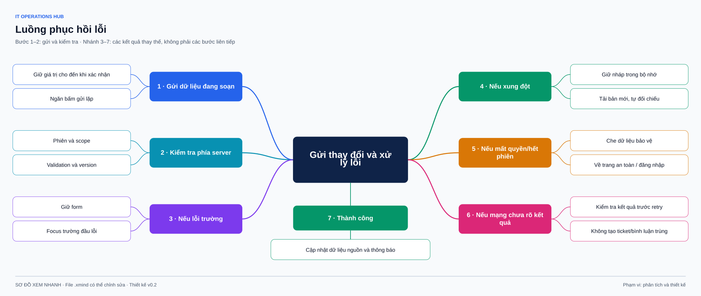
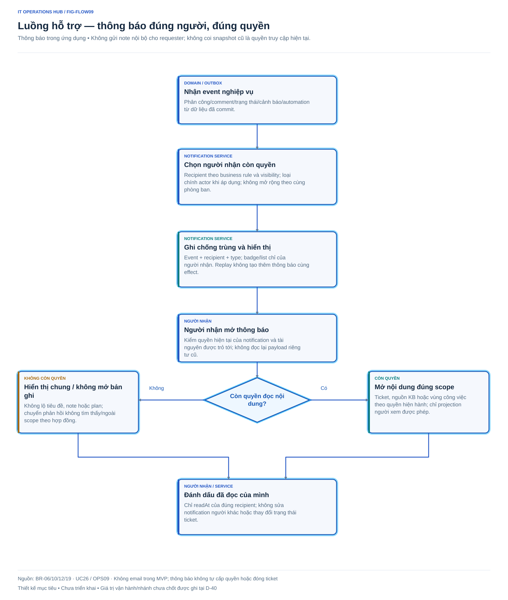
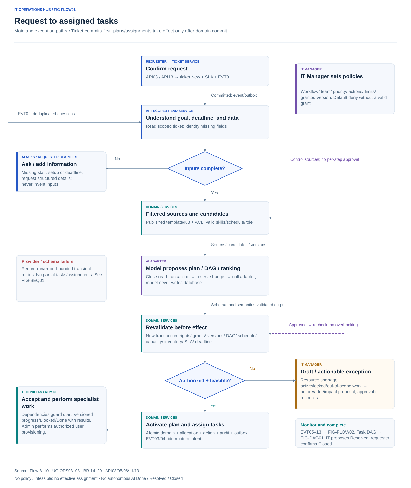
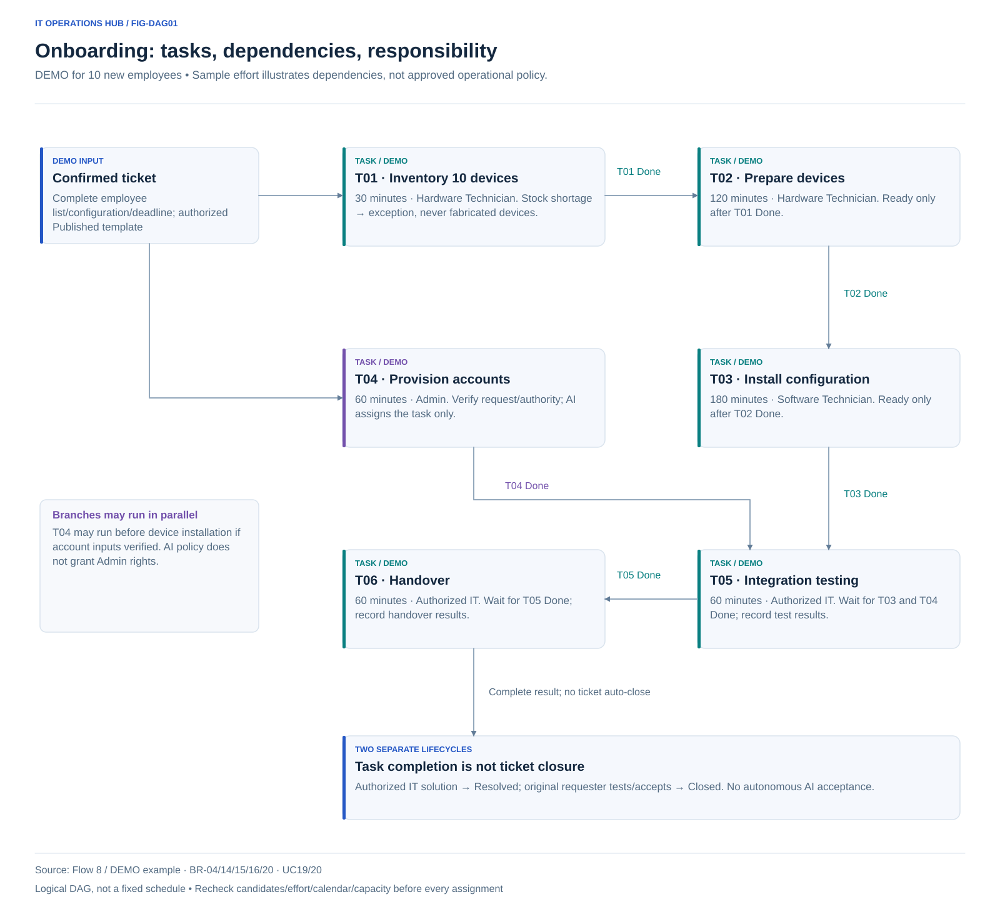
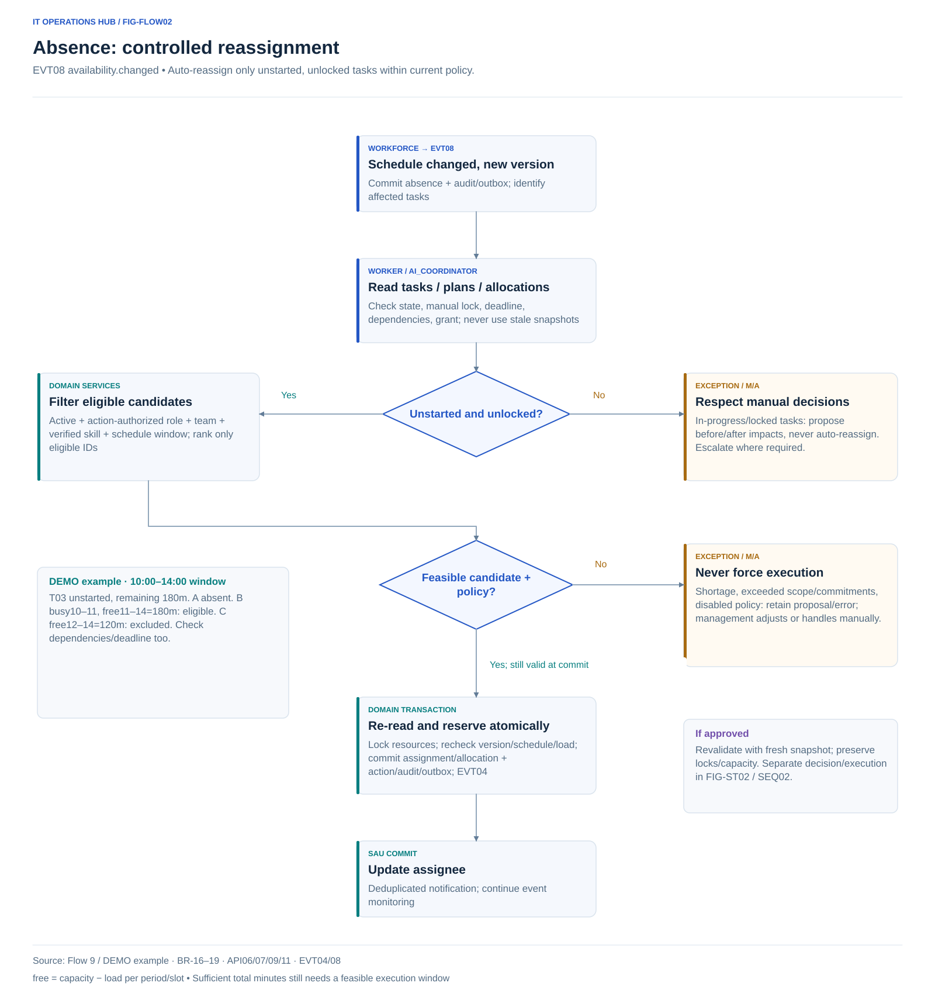

# User journeys and task flows

Journeys are **experience hypotheses**, not observed behavior. Flows show target designs and failure branches requiring validation.

Journey 1–3 and Flow 4–7 are directed activities: frames contain actions/responsible actors, diamonds are conditions, arrow labels identify branches. Dark blue borders/bright outer outlines separate frames; secondary colors always have labels. Read each flow with BR/permissions; these are not topic trees, complete state machines, or confirmed enterprise-process evidence.

## Journey 1 — Employee needs support

| Step | Goal / question | Touchpoint | Risk and design support |
| --- | --- | --- | --- |
| Recognize problem | Where do I submit it? | Personal dashboard, Create request CTA | One clear CTA, examples of both request types |
| Submit | What must I describe? | SCR21 | Labels/help, calculated priority, optional asset |
| Track | Is someone handling it? | SCR22, notifications | Team/person, distinguish acceptance from response |
| Add information | What is IT waiting for? | Pending banner, public composer | Latest question; replying resumes work |
| Check result | Is the issue fixed? | Resolved banner, solution | Contextual close/reopen choices |
| Finish | Can I review it later? | Closed, timeline | Read-only; contact M/A for post-closure work |

[Open XMind](xmind/04-user-flows.xmind)

## Journey 2 — Technician starts and handles work

| Step | Question | Design |
| --- | --- | --- |
| Select | What is assigned/unclaimed in my team? | Two queues, SLA filters, explicit sorting |
| Claim | Did someone claim it first? | Version conflict, no overwrite |
| Understand | Prior discussion and device issues? | Public conversation, authorized internal notes, linked assets |
| Work | Who will receive this? | Explicit composer audience, supporting color |
| Wait | What must the requester provide? | Pending requires a public question |
| Finish IT work | How can the requester check? | Solution with outcome/test instructions; Resolved |

[Open XMind](xmind/04-user-flows.xmind)

## Journey 3 — Manager coordinates

IT Manager verifies skills/schedules/capacity/workflows, sets bounded policies, then monitors runs/actions/progress/exceptions. AI coordinates within current grants; the Manager need not assign every ticket/task. Authorized M/A intervention reviews before/after, sources, versions, and impact before approval/rejection. Domain services recheck rights/policies/capacity/locks before commit. Approved is not Succeeded. Insufficient resources lead to exception handling, not forced assignment. No IT Team Lead tier.

Manual assignment/team transfer is an authorized intervention. Priority dialogs show the new budget over elapsed usage and require a reason; never promise an extension starting now. User/role administration remains Admin-only.

[Open XMind](xmind/04-user-flows.xmind)

## Flow 4 — Assets

[Open XMind](xmind/04-user-flows.xmind)

No issue action for Under Repair/Retired devices. In Use devices support return, not changing holders through metadata edits.

## Flow 5 — Admin locks a user or changes membership

[Open XMind](xmind/04-user-flows.xmind)

Open user/member → review role/assigned tickets/tasks → choose valid handover/unassignment preserving dependencies/capacity/in-progress work/locks → confirm → server checks last Admin/version → revoke permissions/sessions → audit. If impacts cannot be resolved, preserve the screen and explain each affected ticket. Never report success before session revocation.

**D-40 decision required:** emergency revocation without an eligible replacement, especially In Progress/Pending tickets and in-progress/locked tasks. The diagram marks this incomplete branch; blocking invalid changes is not an approved enterprise offboarding procedure.

## Flow 6 — Conflicts and error recovery

[Open XMind](xmind/04-user-flows.xmind)

Loading a fresh record does not automatically merge states/priority/assignee. Unsent sensitive content stays out of URLs/localStorage. Ambiguous network outcomes need implementation-time deduplication.

## Flow 7 — Notifications

[Open XMind](xmind/04-user-flows.xmind)

Event → identify currently authorized recipients → persist with dedup key → unread badge → user opens list → open ticket after current-access check → mark read. After transfer/revocation, show generic notification without sensitive previews, not private send-time snapshots.

## Task-completion navigation patterns

After ticket creation, open details and announce the ID. After successful dialogs, close them, refresh affected data, and return focus to trigger/result banner. After cancellation/closure, remain on details to review history. Field errors preserve the form and focus the first error; conflicts focus the explanatory banner.

## Flow 8 — Target onboarding automation

Design flow, not a running engine. Do not hold transactions/locks while waiting for models; re-read snapshots/check constraints before commit. Standard branch: inventory → prepare devices → install. Authorized Admin account requests may run in parallel with sufficient inputs; testing waits for both branches → handover. Dependencies prevent premature starts.

### Illustrative task DAG — DEMO data

| DEMO task | Outcome | Sample effort | Dependencies / performer |
| --- | --- | --- | --- |
| T01 | Verify 10 devices match configuration | 30 minutes | Verified inputs; hardware Technician; shortages become exceptions |
| T02 | Prepare devices | 120 minutes | T01 Done; hardware Technician |
| T03 | Install configuration | 180 minutes | T02 Done; software Technician |
| T04 | Create accounts after authority verification | 60 minutes | Complete provisioning data; Admin performs, AI only assigns task |
| T05 | Integration testing | 60 minutes | T03 and T04 Done; authorized IT person |
| T06 | Handover | 60 minutes | T05 Done; authorized IT person records result |

Effort covers one synthetic 10-employee scenario, not field estimates or approved policy. Do not extrapolate enterprise norms. Confirm templates/skills/calendar/capacity under D-40 before auto-assignment. T04 may run parallel to device preparation when inputs suffice; T06 Done does not close the ticket.

## Flow 9 — Absence and exception approval

M updates versioned absence/skills/capacity → domain + outbox → worker finds affected tasks → current policy/candidates/load → reassign eligible unstarted/unlocked/feasible work → create before/after/impact/reason approval for in-progress/locked/out-of-authority/understaffed cases.

M approves/rejects → save decision separately → recheck permissions/policies/versions/capacity → succeeded/failed/conflict. Old snapshots cannot execute after recipients become busy/policy disablement. Infeasibility needs authorized resource/plan/commitment adjustment, not approval forcing overbooking.

### Concrete replanning case — DEMO

At 10:00, T02 is Done; T03 is unstarted/unlocked, remaining 180 minutes, deadline 14:00. A is absent 10:00–14:00. Within authorized team/action/skills, B is busy 10:00–11:00 then free 11:00–14:00 (180 minutes); C is free only 12:00–14:00 (120 minutes). B is feasible; C lacks minutes. Do not assume everyone is free or check aggregate hours without actual windows.

If policy permits unstarted-task reassignment, service re-reads versions and reserves atomically before assigning B. Schedule/load changes between ranking/commit cause Conflict/re-evaluation. In-progress/locked tasks need exceptions, not automatic assignee changes. DEMO values are neither real staff schedules nor capacity policy.

[Planning/assignment sequence](diagrams/architecture.md) and [approval sequence](diagrams/architecture.md) clarify transactions, provider failure, and stale approval.

## Flow 10 — Assistant ticket creation and KB

Conversation → draft preview → user confirms exact content/version → idempotent user-authorized creation → return persisted ID. Without confirmation, no ticket/SLA/event. Editing invalidates prior confirmation; SCR21 remains available. IT still sends reply drafts through the composer.

KB Draft → granted publisher reviews/publishes version → background index → reader under Published/ACL/version → cited answer with openable sources. ACL revocation applies immediately to query/output/history without waiting for embeddings. Internal history never transfers to public.

## Failure branches and current scope

Retry/redelivery does not duplicate domain effects. Provider/output errors do not partially create plans. Broker outages preserve durable outbox/manual APIs; background SLA scans may lag and need alerts/recovery scans from PostgreSQL without resetting clocks. Manual locks/Done work do not regress automatically. Exhausted retries expose audited failed states for management. These flows are specified only; no models/workers/application tests run in this phase.

## Flow 11 — One AI Workspace, app actions, and background activity

1. User opens `/assistant` directly or from a ticket: retrieve own conversation and authorized activity projection; no management traces for R.
2. User states a goal. Assistant resolves an existing intent/valid data, asks for missing information, opens a trusted form/card in the workspace.
3. User edits/reviews audience/impact and confirms the specific action; business API checks session/CSRF/permissions/state/version/idempotency. Tickets retain draft/digest/TTL; secure forms keep secrets out of models.
4. Only committed responses produce Saved cards with links. Errors/stale/timeout preserve drafts and allow outcome checking before retry; model text is not action evidence.
5. Events/outbox/policy independently trigger coordination. M/A see scoped runs/exceptions and review/approve diffs in the workspace; R sees public progress; T sees authorized work.
6. Closing/deleting chat/changing tabs does not undo committed effects, stop workers, reset SLA, or delete audit. Provider failures still allow forms/source records.

An alternative channel for flows 1–10, not different rights/states/business behavior. Done requires human result/remaining 0; Resolved/Closed require correct actors/guards. [D-42 design](10-ai-assistant.md) is authoritative.
