# C1 — System Context

**Thiết kế mục tiêu, chưa triển khai.** View nguồn FIG-CTX01 được giữ tại [Mermaid/kiến trúc](../../diagrams/architecture.md).

## Actors và ranh giới

| Actor/system | Mục tiêu / tương tác | Boundary |
|---|---|---|
| Requester | Gửi/bổ sung yêu cầu, hỏi trợ lý/KB theo ACL, nghiệm thu | Ngoài Hub; dữ liệu của mình |
| Technician | Task chuyên môn, public reply/note theo scope, kết quả | Ngoài Hub; nhóm hiện hành/assignee |
| Trưởng phòng IT | Policy, giám sát, can thiệp, duyệt ngoại lệ | Ngoài Hub; không thêm Trưởng nhóm IT |
| Admin | Tạo/thu hồi user, tổ chức, khả dụng/SLA | Ngoài Hub; không mặc định mọi chat |
| Hub | Ticket/task/workforce/SLA/assets/KB, AI trợ lý và điều phối | Software system đang thiết kế |
| AI provider | Model/embedding qua adapter; output chưa tin cậy | Ngoài trust boundary; production chưa chốt |

AI_COORDINATOR nằm trong Hub và dùng grant/policy hiện hành; không vẽ như người đăng nhập. Trưởng phòng ban khác gửi ticket bằng quyền Requester; Admin cấp user sau xác minh D-29. Không thêm HR/calendar/email thật vào MVP.

## Data và failure boundary

Chỉ nguồn được phép và tối thiểu được đưa tới provider; M3 chỉ synthetic DEMO theo D-39 khi có yêu cầu chạy riêng. Provider lỗi không chặn core ticket/SLA/thao tác thủ công. Output model không cấp quyền hoặc tự đóng/Done/cấp tài khoản.

## Liên quan

[Scope](../../01-scope.md) · [Permissions](../../requirements/permissions-matrix.md) · [C2](02-containers.md).
