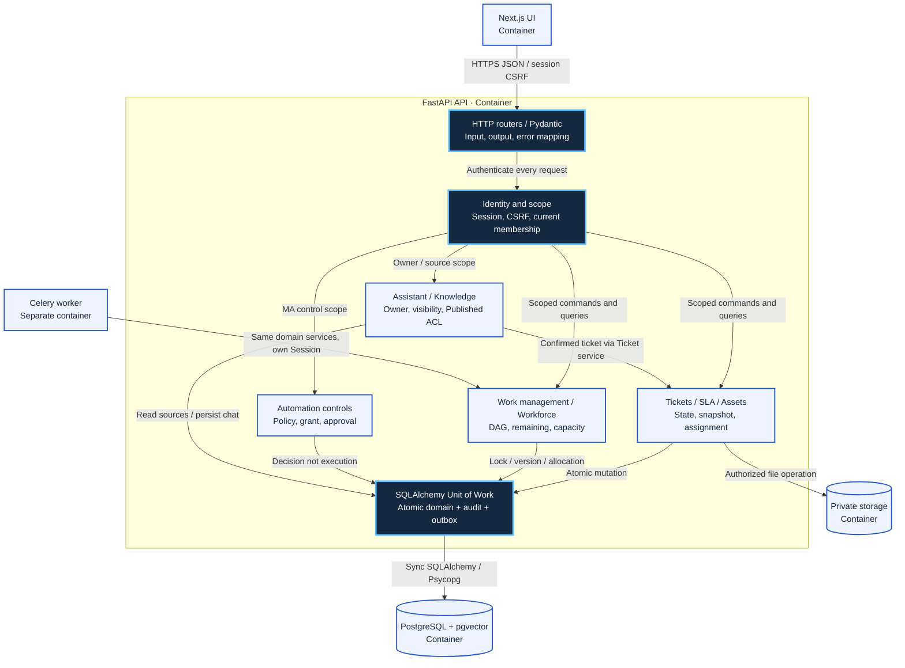
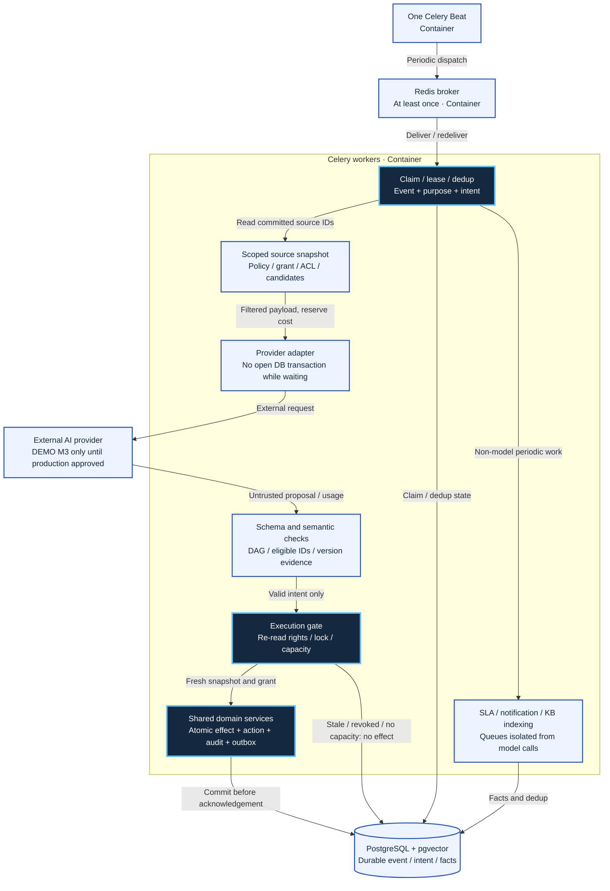

# C3 — API and worker components

**Target design.** These components belong to a modular monolith, not separate microservices. API and worker load shared domain packages but use different entrypoints, Sessions, and principals.

## C3 API — FIG-CMP01

Mermaid source

## C3 worker — FIG-CMP02

Mermaid source

## Ownership and dependencies

| Component | Owns | Must not do |
| --- | --- | --- |
| HTTP/IAM | DTO/error mapping; session/CSRF/current scope | Trust client-supplied role/requester/grantor |
| Tickets/SLA/assets | State, public/internal visibility, snapshots/clocks, asset assignments | Close tickets automatically when tasks are Done; let models allocate assets |
| Work/workforce | Plans/DAG/tasks/skills/schedules/capacity/allocation | Auto-assign using unverified estimates/schedules |
| Automation controls | Workflows/policies/grants/runs/actions/approvals | Treat Approved as Succeeded or skip revalidation |
| Assistant/knowledge | Chat ownership/drafts/confirmation, Published/version/ACL | Execute model SQL/shell; serve caches beyond current permissions |
| UoW/repository | One Session/transaction for domain + audit + outbox | Commit separately in repositories or hold locks through model calls |
| Adapter | Provider protocol/schema/results/usage | Own domain permissions or increase model cost/budget autonomously |
| SLA/notification/index | Source-based calculations, deduplication, ACL | Wait for a model to advance clocks; grant access through notifications |

Cross-module service calls use public application contracts; routers do not access another module's repository. Workers re-read policies/ACL/candidates/locks/capacity inside the execution transaction. Stale data, refusal, schema errors, or provider failures have no partial effect. Reservations for actual/unknown/in-flight costs are recorded in the ledger.

## Traceability and verification

API01–19 map to modules in [code structure](../../technical/code-structure.md); HTTP commands are in [OpenAPI](../../api/openapi.json); EVT01–17 are in the [source catalog](../../technical/api-design.md). Rendering/metadata/relationships are checked; no benchmarks, application tests, or runtime dependency-graph verification have run. Exception grants, key TTL/leases/retry, and calendar/capacity details remain under D-40.
