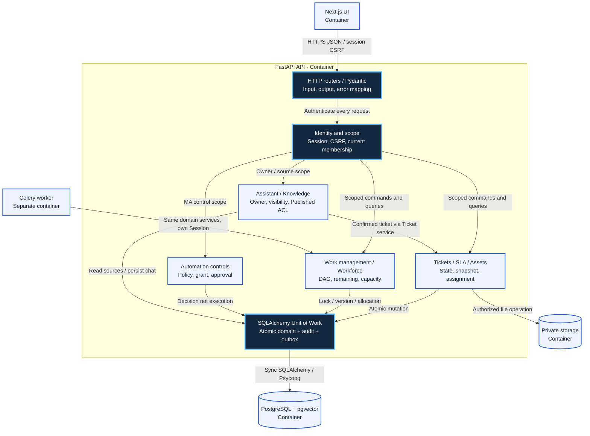
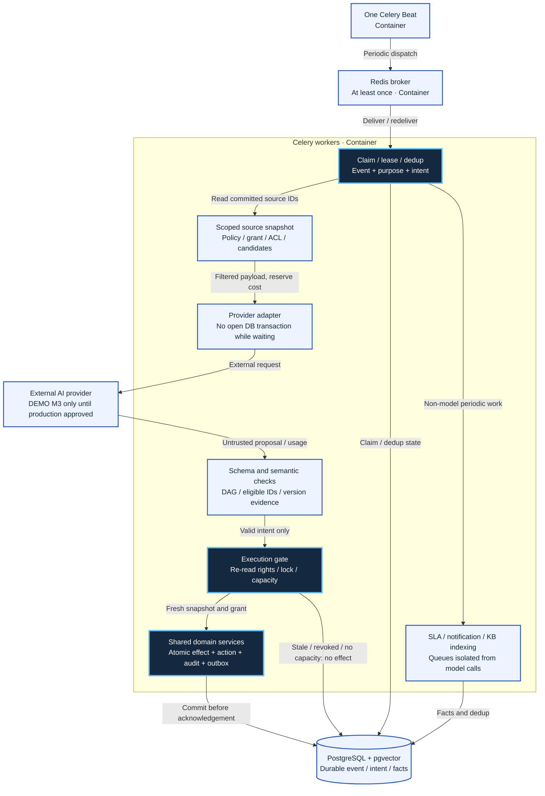

# C3 — Components của API và worker

**Thiết kế mục tiêu.** Đây là các component trong modular monolith; không tách thành microservice. API và worker nạp chung các package domain nhưng có entrypoint, Session và principal khác nhau.

## C3 API — FIG-CMP01

Nguồn Mermaid

## C3 worker — FIG-CMP02

Nguồn Mermaid

## Ownership và phụ thuộc

| Component | Sở hữu | Không được làm |
|---|---|---|
| HTTP/IAM | DTO/error mapping; session/CSRF/current scope | Tin role/requester/grantor do client truyền |
| Tickets/SLA/assets | State, public/internal, snapshot/clock, asset assignment | Task Done tự đóng ticket; model tự cấp tài sản |
| Work/workforce | Plan/DAG/task/skills/lịch/capacity/allocation | Dùng estimate/lịch chưa xác nhận để tự giao |
| Automation controls | Workflow/policy/grant/run/action/approval | Coi Approved là Succeeded hoặc bỏ revalidation |
| Assistant/knowledge | Owner chat/draft/confirm, Published/version/ACL | SQL/shell từ model; cache vượt quyền |
| UoW/repository | Một Session/transaction cho domain + audit + outbox | Repository tự commit tách hoặc giữ lock qua model |
| Adapter | Provider protocol/schema/result/usage | Quyền domain, tự tăng model/budget |
| SLA/notification/index | Tính từ dữ liệu nguồn, dedup, ACL | Chờ model để chạy clock; notification tự cấp quyền |

Service call cross-module qua public application contract; router không truy cập repo module khác. Worker re-read policy/ACL/candidate/locks/capacity trong execution transaction; stale/refusal/schema/provider lỗi không partial effect. Reservation actual/unknown/in-flight được ledger hóa.

## Truy vết và kiểm chứng

API01–19 → module tại [code structure](../../technical/code-structure.md); command HTTP tại [OpenAPI](../../api/openapi.json); EVT01–17 tại [catalog nguồn](../../technical/api-design.md). Kiểm render/metadata/relationship; chưa benchmark, test application hoặc verify runtime dependency graph. Grant ngoại lệ, key TTL/lease/retry và lịch/capacity còn D-40.
