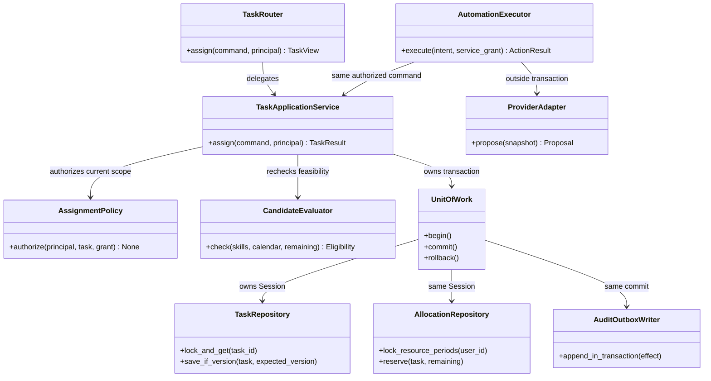

# C4 — Code collaboration dự kiến

**Design only.** Tên lớp/hàm và file dưới đây là đề xuất tổ chức, chưa tồn tại trong src/. Không suy từ class diagram rằng code đã triển khai.

## FIG-CODE01 — Assignment command

Nguồn Mermaid

## Hợp đồng lớp và trình tự xử lý

| Thành phần dự kiến | File trong backend/app | Hợp đồng |
|---|---|---|
| TaskRouter | modules/work_management/router.py | DTO/HTTP mapping, principal từ dependency; không commit |
| TaskApplicationService | modules/work_management/service.py | Sở hữu use case và transaction; idempotency, quyền/version/eligibility |
| AssignmentPolicy | modules/work_management/policy.py | Human M/A hoặc service grant; manual lock/đang làm phải qua phê duyệt đúng scope |
| CandidateEvaluator | modules/workforce/service.py | Skills đã xác nhận, lịch/absence, remaining/capacity; không bịa rảnh |
| UnitOfWork | infrastructure/database/unit_of_work.py | Một SQLAlchemy Session/transaction; rollback toàn bộ |
| Repositories | modules/work_management/repository.py, modules/workforce/repository.py | Scoped read/conditional version update/lock; không tự commit |
| AuditOutboxWriter | infrastructure/events/writer.py | Audit/redacted event cùng transaction effect |
| AutomationExecutor | modules/automation/executor.py | Snapshot → adapter ngoài TX → validate → command domain với grant hiện hành |
| ProviderAdapter | infrastructure/ai/provider.py | Output schema/usage, không SQL/quyền domain |

Human assignment: parse DTO → principal/scope → claim key → UoW khóa resource theo thứ tự → recheck version/skills/calendar/load/policy → ghi assignment/allocation/action/audit/outbox → commit → response. Conflict rollback, không ghi thành công giả. Automation proposal thêm model call ngoài TX trước bước recheck; approved exception vẫn kiểm lại.

## Failure, trách nhiệm và kiểm chứng

Cùng intent đã thành công trả kết quả cũ, không reserve lần hai. Snapshot/grant/policy cũ trả conflict/re-evaluate; task đang làm/lock không tự ghi đè. Provider timeout giữ unknown cost theo ledger và retry hữu hạn, không tự đổi model/ngân sách. Không gọi provider trong transaction.

Expected application tests sau này: hai assignment cạnh tranh không vượt tải; mutate calendar/policy giữa snapshot/effect; crash sau commit trước ack; same/different digest retry; revoked actor; manual lock; stale approval. Hiện chỉ kiểm tài liệu/diagram, không viết hoặc chạy các test này.

## Liên quan

[Sequences](../../diagrams/architecture.md) · [Code structure](../../technical/code-structure.md) · [BR-15–19](../../requirements/business-rules.md) · [D-40](../../decisions/design-decisions.md).
