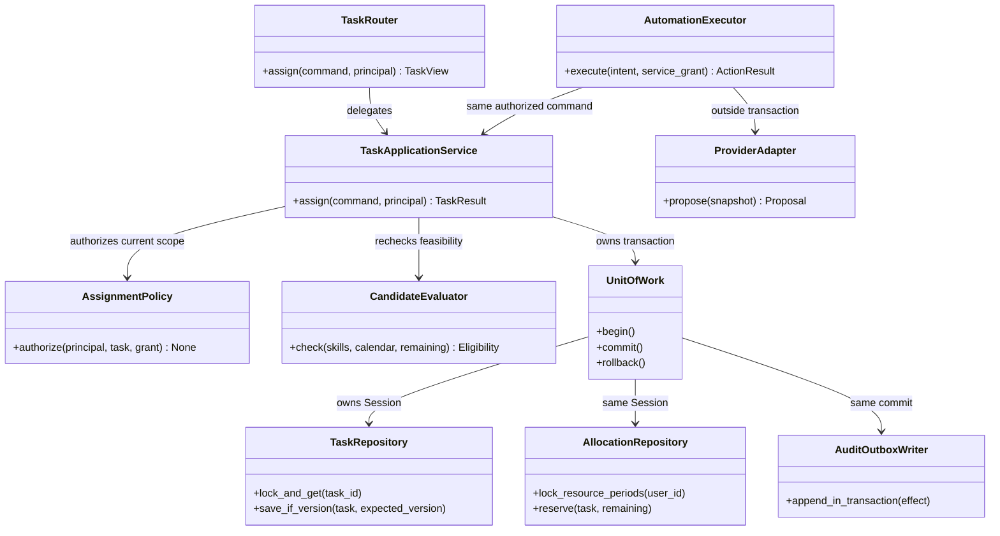

# C4 — Proposed code collaboration

**Design only.** Class/function names and files below are proposed structures and do not exist in src/. The class diagram is not evidence of implemented code.

## FIG-CODE01 — Assignment command

Mermaid source

## Class contracts and processing order

| Proposed component | File under backend/app | Contract |
| --- | --- | --- |
| TaskRouter | modules/work_management/router.py | DTO/HTTP mapping, dependency-provided principal; no commit |
| TaskApplicationService | modules/work_management/service.py | Owns use case/transaction; idempotency, permissions/version/eligibility |
| AssignmentPolicy | modules/work_management/policy.py | Human M/A or service grant; manual locks/in-progress work require correctly scoped approval |
| CandidateEvaluator | modules/workforce/service.py | Verified skills, schedule/absence, remaining effort/capacity; no invented availability |
| UnitOfWork | infrastructure/database/unit_of_work.py | One SQLAlchemy Session/transaction; full rollback |
| Repositories | modules/work_management/repository.py, modules/workforce/repository.py | Scoped reads/conditional version updates/locks; no independent commit |
| AuditOutboxWriter | infrastructure/events/writer.py | Audit/redacted events in the same transaction as the effect |
| AutomationExecutor | modules/automation/executor.py | Snapshot → adapter outside TX → validation → domain command using current grant |
| ProviderAdapter | infrastructure/ai/provider.py | Output schema/usage; no SQL/domain permissions |

Human assignment: parse DTO → principal/scope → claim key → UoW locks resources in a consistent order → recheck version/skills/calendar/load/policy → write assignment/allocation/action/audit/outbox → commit → respond. Conflicts roll back without false success. Automation adds a model call outside TX before revalidation; approved exceptions still recheck.

## Failures, responsibilities, and verification

A previously successful intent returns its stored result without reserving capacity again. Stale snapshots/grants/policies cause conflict/re-evaluation; in-progress/locked tasks are not silently overwritten. Provider timeouts retain unknown costs in the ledger and use bounded retries; no autonomous model/budget switch. Never call providers inside a transaction.

Future application tests: concurrent assignments do not overbook; calendar/policy changes between snapshot/effect; crash after commit before ack; same/different digest retries; revoked actor; manual lock; stale approval. Current work only checks documents/diagrams and does not write or run these application tests.

## Related documents

[Sequences](../../diagrams/architecture.md) · [Code structure](../../technical/code-structure.md) · [BR-15–19](../../requirements/business-rules.md) · [D-40](../../decisions/design-decisions.md).
