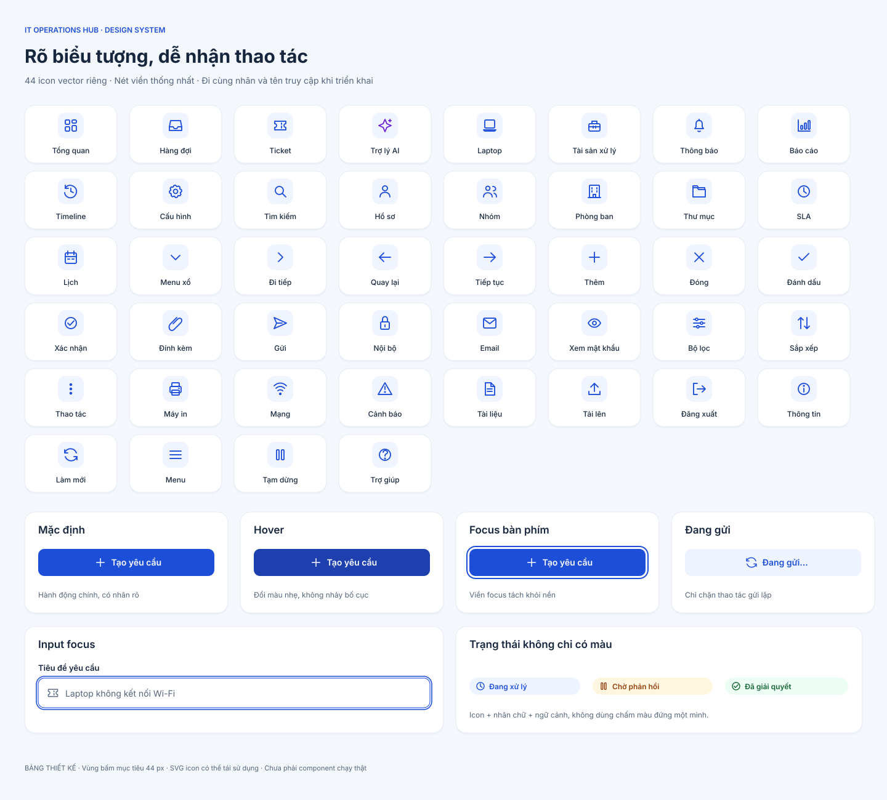
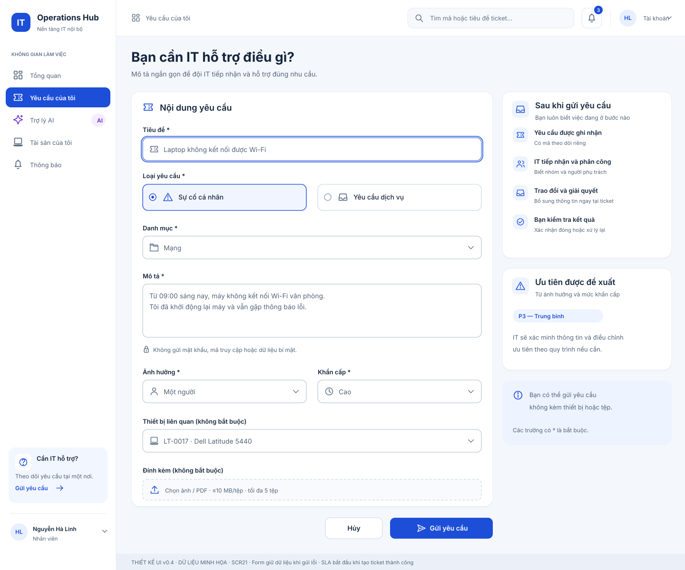
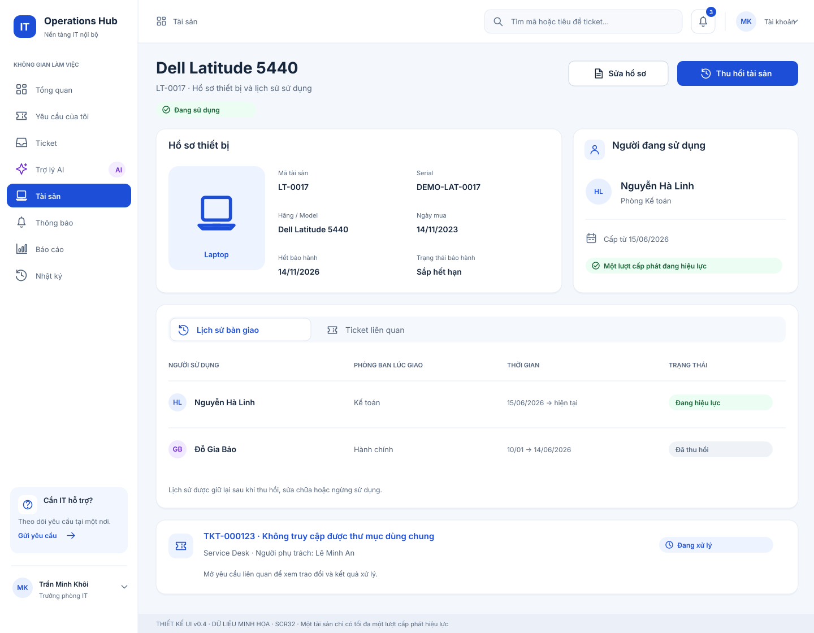
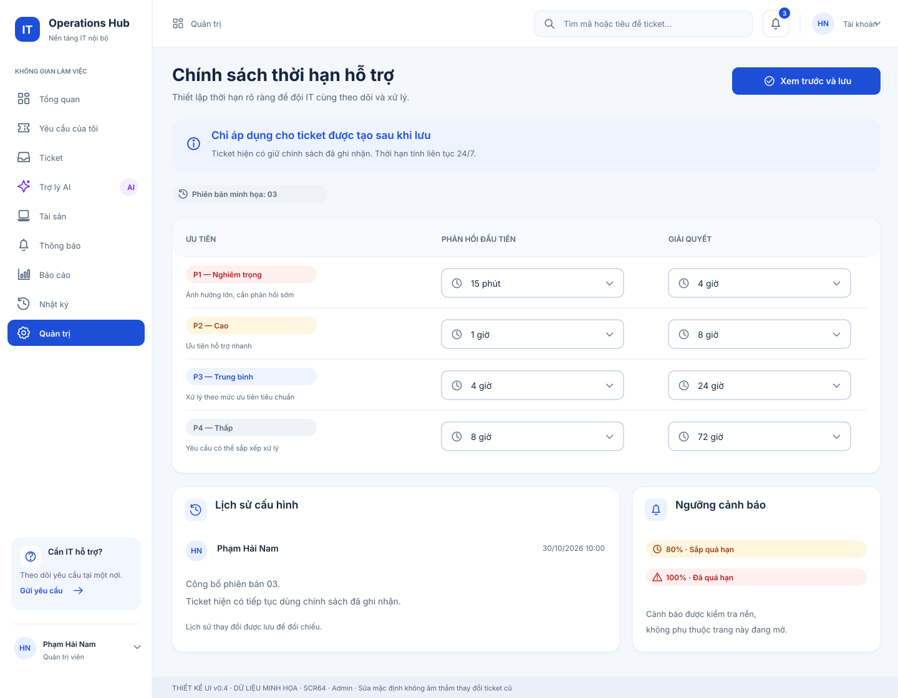
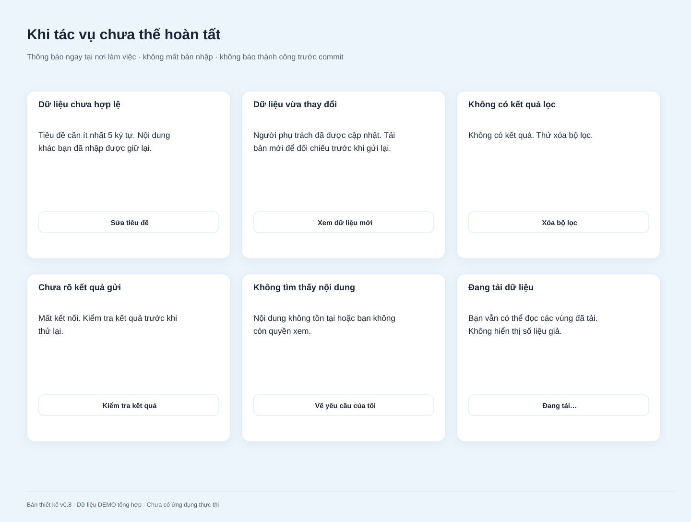
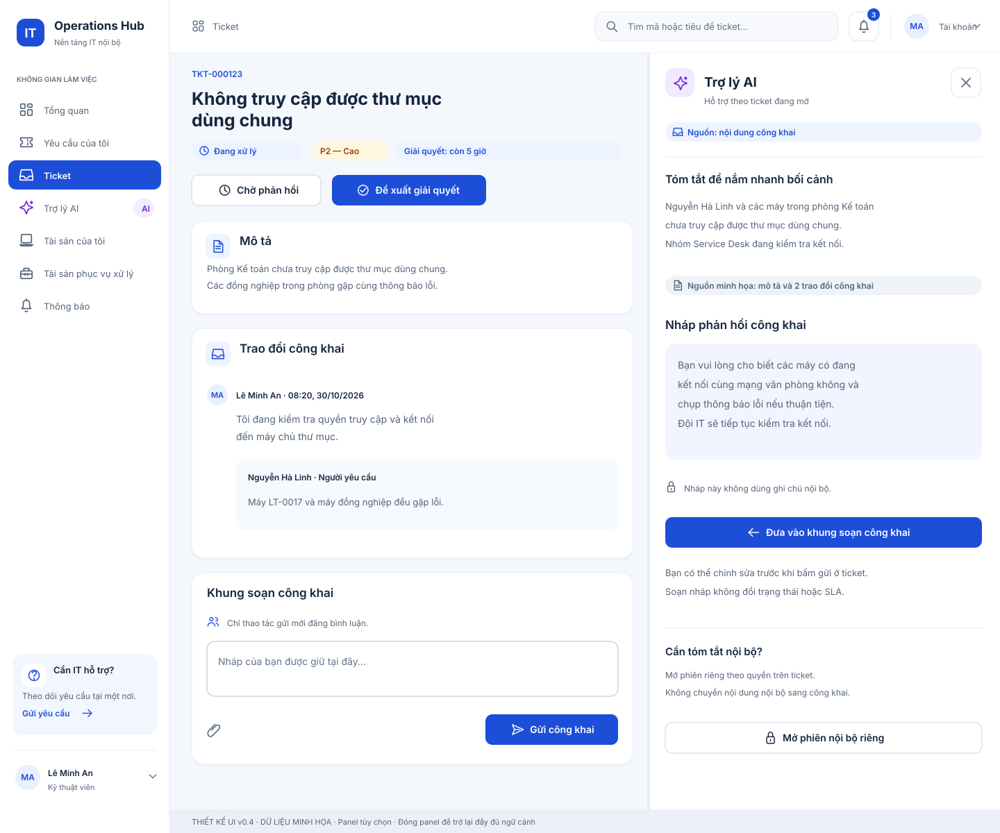
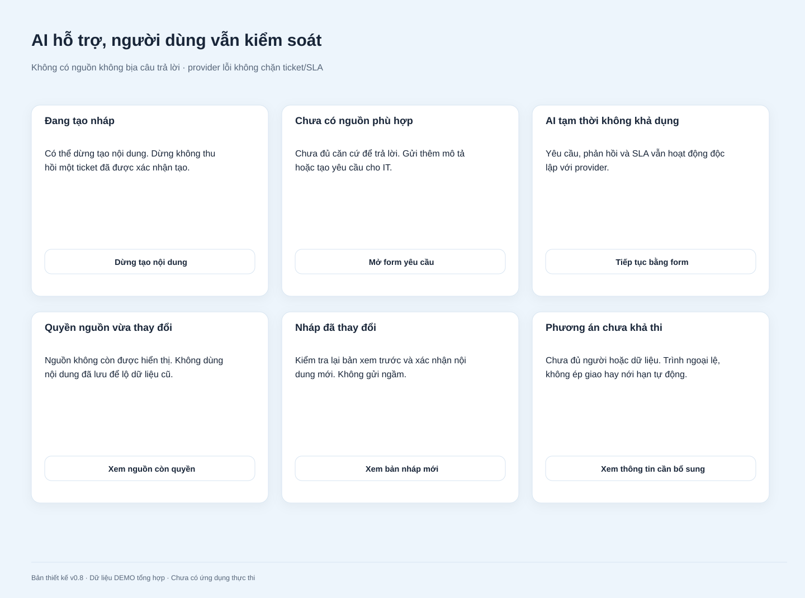
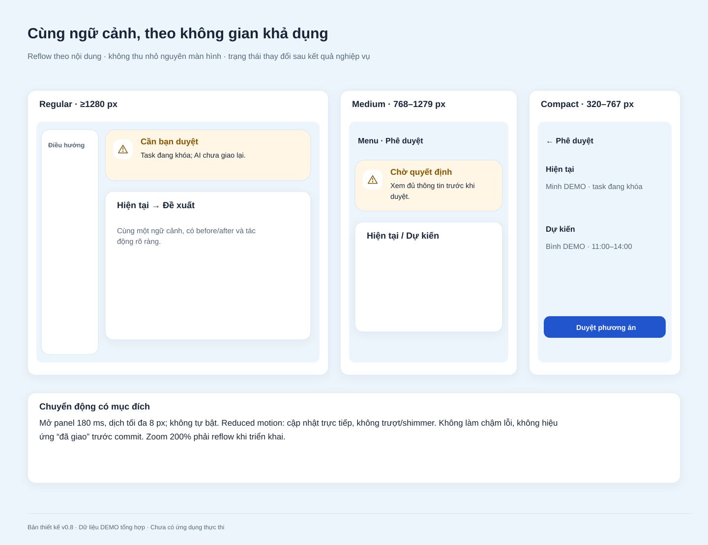

# Bộ bản vẽ UI/UX

**13 bản UI tĩnh (10 bản lõi và 3 bản AI) và 2 board thiết kế, phiên bản v0.4**, dùng dữ liệu hư cấu có nhãn. SVG là tài liệu thiết kế có thể phóng to, không có tương tác, không gửi request và không chứng minh ứng dụng đã có dữ liệu bền vững. Các nút biểu diễn hành động sẽ cần triển khai trong MVP.

Mở trực tiếp SVG trong trình duyệt hoặc công cụ thiết kế để xem và chỉnh sửa. Các bản xuất PNG giao diện đã được bỏ; thư mục chỉ giữ SVG, tài liệu và [use-cases-overview.png](use-cases-overview.png) theo yêu cầu. Riêng login có [minh họa PNG nền trong suốt](../illustrations/login-it-support.png) nhúng trực tiếp trong SVG. Hiển thị font có thể khác nhẹ theo thiết bị.

| Bản vẽ SVG | Vai trò / nhiệm vụ | Điểm cần review |
|---|---|---|
| [01 — Đăng nhập](01-login.svg) | Tất cả · SCR01 | Một luồng truy cập, không đăng ký hoặc gửi mail giả |
| [02 — Dashboard Manager](02-dashboard-manager.svg) | M/A · SCR12 | Hàng đợi hiện tại tách khỏi phân tích theo kỳ; KPI có thể chồng lấn |
| [03 — Danh sách ticket](03-tickets.svg) | M/A · SCR20 | Tìm/filter/sort, trạng thái có chữ, SLA chỉ rõ loại đồng hồ |
| [04 — Tạo yêu cầu](04-create-ticket.svg) | Requester · SCR21 | Priority đề xuất, tài sản tùy chọn, tệp có giới hạn |
| [05 — Ticket Technician](05-ticket-technician.svg) | Assignee · SCR22 | Công khai/nội bộ, hành động phù hợp trạng thái và người phụ trách |
| [06 — Ticket Requester](06-ticket-requester.svg) | Chủ ticket Resolved · SCR22 | Giải pháp, xác nhận đóng/mở lại, hoàn toàn không có nội dung nội bộ |
| [07 — Tài sản](07-asset.svg) | M/A · SCR32 | User hiện tại qua assignment, history giữ lại, thu hồi rõ |
| [08 — Cấu hình SLA](08-admin-sla.svg) | Admin · SCR64 | P1–P4, đơn vị thời lượng, phiên bản, tác động ticket mới |
| [09 — Mobile](09-mobile.svg) | Requester · SCR20/22 | Hai view390 px, trả lời Pending và thao tác chính |
| [10 — Trạng thái UX](10-ux-states.svg) | Các vai trò · mẫu dùng chung | Validation, conflict, filter rỗng và tải lỗi |
| [11 — Trợ lý AI](11-ai-assistant.svg) | Requester · SCR-AI01/02 | Nguồn, bản nháp và chuyển về form, chưa tạo ticket |
| [12 — AI trong ticket](12-ai-ticket-assistant.svg) | Technician · SCR-AI01/02 | Tóm tắt public và nháp phản hồi, chưa gửi bình luận |
| [13 — Trạng thái AI](13-ai-states.svg) | Mẫu bổ sung | Lỗi, thiếu nguồn, mất quyền và tách nội bộ/công khai |
| [14 — Icon và component](14-icons-and-components.svg) | Board thiết kế | 44 icon, nhãn, focus, hover và loading |
| [15 — Responsive và motion](15-responsive-motion.svg) | Storyboard tĩnh | Desktop/tablet/mobile và các khung mở panel; chưa chạy animation |

[Use case tổng quan — PNG](use-cases-overview.png) · [SVG nguồn](../../diagrams/use-cases-overview.svg). Đây là sơ đồ phụ lục, không tính vào 13 bản UI hoặc 2 board.

Các ảnh cũng được đính kèm trong [file UI/UX XMind](../../xmind/07-uiux.xmind); phần sơ đồ hành trình và cấu trúc dùng topic XMind chỉnh sửa được. Ảnh wireframe đính kèm không biến thành các control UI chỉnh sửa riêng trong XMind.

Xem [định hướng thị giác v0.4](../visual-refresh.md), [44 icon nguồn](../icons/), [motion/responsive](../motion-and-responsive.md) và [bản lưu giao diện v0.3](../archive/ui-v0.3.zip). Hai board bổ trợ không tạo thêm screen hoặc chức năng nghiệp vụ.

## Gallery

## Ranh giới độ phủ bản vẽ

Wireframe tập trung luồng ticket và các quyết định UX rủi ro. Dashboard cá nhân/Technician, báo cáo chi tiết, thông báo, hồ sơ, đổi password và các form quản trị khác **đã có đặc tả trong [UI/UX](../../07-uiux-specification.md), chưa có bản vẽ riêng**. Các dialog được mô tả theo trường, điều kiện và nội dung; chưa vẽ mọi biến thể. Đây là bộ thiết kế ban đầu, không gọi là đã hoàn thành hi-fi/prototype tương tác cho mọi screen.

Hai bản chi tiết ticket minh họa các thời điểm khác nhau của cùng ticket: Technician ở In Progress và Requester ở Resolved. Dữ liệu trong dashboard/bảng là bố cục minh họa, không phải một seed dataset đã kiểm chứng liên kết chéo.

Ba bản AI là phần bổ sung tùy chọn. Cả 13 bản đã được làm mới về thị giác ở v0.4; quyền, trạng thái và quy tắc nghiệp vụ lõi giữ nguyên. Menu AI minh họa cấu hình đang bật; ẩn các điểm truy cập AI khi tắt tính năng. [Thiết kế chatbot](../../10-ai-assistant.md) mô tả ranh giới hành động và nguồn; chưa có chatbot thực thi.
