# UI/UX design set v0.8

**37 SVGs: 34 UI designs + 3 boards**, synthetic DEMO only; no application/animation/live provider. Combines Apple Design Skill/earlier UI/P-047 quick cards, retaining business rules/roles/stack/**Vietnamese UI artwork**.

## Viewing and coverage

Open SVG in a browser or VS Code Preview or inline gallery. Standalone/zoomable; fonts may vary. Static controls are not executable. Root README keeps original heading order.

R=Requester, T=Technician, M=IT Manager, A=Admin. A view may illustrate multiple screen/interaction patterns without new IDs. SHARED boards are not business screens.

| Artifact | Role | Screen / interaction | Content |
| --- | --- | --- | --- |
| [01-login.svg](01-login.svg) | R | SCR01 | Login |
| [02-dashboard-manager.svg](02-dashboard-manager.svg) | M | SCR12 | IT Manager operations dashboard |
| [03-tickets.svg](03-tickets.svg) | M | SCR20 | Ticket list |
| [04-create-ticket.svg](04-create-ticket.svg) | R | SCR21 | Create support request |
| [05-ticket-technician.svg](05-ticket-technician.svg) | T | SCR22 | Technician ticket details |
| [06-ticket-requester.svg](06-ticket-requester.svg) | R | SCR22 | Requester result acceptance |
| [07-asset.svg](07-asset.svg) | M | SCR32 / SCR33 | Asset record |
| [08-admin-sla.svg](08-admin-sla.svg) | A | SCR64 | Default SLA policy |
| [09-mobile.svg](09-mobile.svg) | R | SCR20 / SCR22 | Mobile ticket and Pending reply |
| [10-ux-states.svg](10-ux-states.svg) | R | SCR90 / SCR91 | UX errors and recovery |
| [11-ai-assistant.svg](11-ai-assistant.svg) | R | SCR-AI01 / SCR-AI02 | AI Workspace — Requester |
| [12-ai-ticket-assistant.svg](12-ai-ticket-assistant.svg) | T | SCR-AI01 / SCR-AI02 / SCR22 | AI Workspace — Technician |
| [13-ai-states.svg](13-ai-states.svg) | R | SCR-AI01 / SCR-AI02 | AI availability and error states |
| [14-icons-and-components.svg](14-icons-and-components.svg) | M | SHARED | Icons and component board |
| [15-responsive-motion.svg](15-responsive-motion.svg) | M | SHARED | Responsive and motion storyboard |
| [16-dashboard-requester.svg](16-dashboard-requester.svg) | R | SCR10 | Requester dashboard |
| [17-dashboard-admin.svg](17-dashboard-admin.svg) | A | SCR12 / SCR60 | Admin dashboard |
| [18-ticket-account-provisioning.svg](18-ticket-account-provisioning.svg) | A | SCR22 / SCR60 | Account-provisioning ticket — Admin |
| [19-dashboard-technician.svg](19-dashboard-technician.svg) | T | SCR11 | Technician dashboard |
| [20-task-board.svg](20-task-board.svg) | M | SCR-OPS01 | IT task board |
| [21-plan-detail.svg](21-plan-detail.svg) | M | SCR-OPS02 | Plan details and dependencies |
| [22-workforce.svg](22-workforce.svg) | M | SCR-OPS03 | Workforce and availability |
| [23-coordination.svg](23-coordination.svg) | M | SCR-AI01 / SCR-AI02 / SCR-OPS04 | AI Workspace — exception proposal |
| [24-approval.svg](24-approval.svg) | M | SCR-AI01 / SCR-OPS05 | AI Workspace — approval details |
| [25-policy-workflow.svg](25-policy-workflow.svg) | M | SCR-OPS06 | Policies and workflows |
| [26-knowledge.svg](26-knowledge.svg) | R | SCR-OPS07 | Knowledge base |
| [27-admin-user-create.svg](27-admin-user-create.svg) | A | SCR60 | Create user — Admin |
| [28-account-profile.svg](28-account-profile.svg) | R | SCR02 / SCR03 | Profile and account security |
| [29-assets-list-form.svg](29-assets-list-form.svg) | M | SCR30 / SCR31 | Asset list and form |
| [30-reports.svg](30-reports.svg) | M | SCR40 | Operations reports |
| [31-notifications.svg](31-notifications.svg) | R | SCR50 | Notifications |
| [32-organization-admin.svg](32-organization-admin.svg) | A | SCR61 / SCR62 / SCR63 | Organization and category administration |
| [33-audit.svg](33-audit.svg) | M | SCR65 | Audit trail |
| [34-ai-settings.svg](34-ai-settings.svg) | A | SCR-AI03 | AI assistant availability settings |
| [35-task-progress.svg](35-task-progress.svg) | T | SCR-OPS01 / SCR-OPS02 | Task progress and results |
| [36-login-states.svg](36-login-states.svg) | R | SCR01 | Login interaction board |
| [37-ai-workspace.svg](37-ai-workspace.svg) | M | SCR-AI01 / SCR-AI02 / SCR-OPS04 | AI Workspace — normal state |

## Crosswalk to 36 IA patterns

All 36 IDs have at least one illustration. Profile 02/03, assets 30/31, organization 61/62/63, errors 90/91 share views/boards; not separate hi-fi variants for all. Dialog 23/24/25/33 are contextual/spec-defined, not standalone pages.

| Screen | SVG reference | Coverage |
| --- | --- | --- |
| SCR-AI01 | [11-ai-assistant.svg](11-ai-assistant.svg), [12-ai-ticket-assistant.svg](12-ai-ticket-assistant.svg), [13-ai-states.svg](13-ai-states.svg), [23-coordination.svg](23-coordination.svg), [24-approval.svg](24-approval.svg), [37-ai-workspace.svg](37-ai-workspace.svg) | Static sample, not every state/breakpoint |
| SCR-AI02 | [11-ai-assistant.svg](11-ai-assistant.svg), [12-ai-ticket-assistant.svg](12-ai-ticket-assistant.svg), [13-ai-states.svg](13-ai-states.svg), [23-coordination.svg](23-coordination.svg), [37-ai-workspace.svg](37-ai-workspace.svg) | Static sample, not every state/breakpoint |
| SCR-AI03 | [34-ai-settings.svg](34-ai-settings.svg) | Static sample, not every state/breakpoint |
| SCR-OPS01 | [20-task-board.svg](20-task-board.svg), [35-task-progress.svg](35-task-progress.svg) | Static sample, not every state/breakpoint |
| SCR-OPS02 | [21-plan-detail.svg](21-plan-detail.svg), [35-task-progress.svg](35-task-progress.svg) | Static sample, not every state/breakpoint |
| SCR-OPS03 | [22-workforce.svg](22-workforce.svg) | Static sample, not every state/breakpoint |
| SCR-OPS04 | [23-coordination.svg](23-coordination.svg), [37-ai-workspace.svg](37-ai-workspace.svg) | Static sample, not every state/breakpoint |
| SCR-OPS05 | [24-approval.svg](24-approval.svg) | Static sample, not every state/breakpoint |
| SCR-OPS06 | [25-policy-workflow.svg](25-policy-workflow.svg) | Static sample, not every state/breakpoint |
| SCR-OPS07 | [26-knowledge.svg](26-knowledge.svg) | Static sample, not every state/breakpoint |
| SCR01 | [01-login.svg](01-login.svg), [36-login-states.svg](36-login-states.svg) | Static sample, not every state/breakpoint |
| SCR02 | [28-account-profile.svg](28-account-profile.svg) | Static sample, not every state/breakpoint |
| SCR03 | [28-account-profile.svg](28-account-profile.svg) | Static sample, not every state/breakpoint |
| SCR10 | [16-dashboard-requester.svg](16-dashboard-requester.svg) | Static sample, not every state/breakpoint |
| SCR11 | [19-dashboard-technician.svg](19-dashboard-technician.svg) | Static sample, not every state/breakpoint |
| SCR12 | [02-dashboard-manager.svg](02-dashboard-manager.svg), [17-dashboard-admin.svg](17-dashboard-admin.svg) | Static sample, not every state/breakpoint |
| SCR20 | [03-tickets.svg](03-tickets.svg), [09-mobile.svg](09-mobile.svg) | Static sample, not every state/breakpoint |
| SCR21 | [04-create-ticket.svg](04-create-ticket.svg) | Static sample, not every state/breakpoint |
| SCR22 | [05-ticket-technician.svg](05-ticket-technician.svg), [06-ticket-requester.svg](06-ticket-requester.svg), [09-mobile.svg](09-mobile.svg), [12-ai-ticket-assistant.svg](12-ai-ticket-assistant.svg), [18-ticket-account-provisioning.svg](18-ticket-account-provisioning.svg) | Static sample, not every state/breakpoint |
| SCR23 | [03-tickets.svg](03-tickets.svg), [05-ticket-technician.svg](05-ticket-technician.svg) | Contextual; variants specified |
| SCR24 | [05-ticket-technician.svg](05-ticket-technician.svg), [06-ticket-requester.svg](06-ticket-requester.svg), [09-mobile.svg](09-mobile.svg) | Contextual; variants specified |
| SCR25 | [03-tickets.svg](03-tickets.svg) | Contextual; variants specified |
| SCR30 | [29-assets-list-form.svg](29-assets-list-form.svg) | Static sample, not every state/breakpoint |
| SCR31 | [29-assets-list-form.svg](29-assets-list-form.svg) | Static sample, not every state/breakpoint |
| SCR32 | [07-asset.svg](07-asset.svg) | Static sample, not every state/breakpoint |
| SCR33 | [07-asset.svg](07-asset.svg) | Contextual; variants specified |
| SCR40 | [30-reports.svg](30-reports.svg) | Static sample, not every state/breakpoint |
| SCR50 | [31-notifications.svg](31-notifications.svg) | Static sample, not every state/breakpoint |
| SCR60 | [17-dashboard-admin.svg](17-dashboard-admin.svg), [18-ticket-account-provisioning.svg](18-ticket-account-provisioning.svg), [27-admin-user-create.svg](27-admin-user-create.svg) | Static sample, not every state/breakpoint |
| SCR61 | [32-organization-admin.svg](32-organization-admin.svg) | Static sample, not every state/breakpoint |
| SCR62 | [32-organization-admin.svg](32-organization-admin.svg) | Static sample, not every state/breakpoint |
| SCR63 | [32-organization-admin.svg](32-organization-admin.svg) | Static sample, not every state/breakpoint |
| SCR64 | [08-admin-sla.svg](08-admin-sla.svg) | Static sample, not every state/breakpoint |
| SCR65 | [33-audit.svg](33-audit.svg) | Static sample, not every state/breakpoint |
| SCR90 | [10-ux-states.svg](10-ux-states.svg) | Static sample, not every state/breakpoint |
| SCR91 | [10-ux-states.svg](10-ux-states.svg) | Static sample, not every state/breakpoint |

## Gallery — work and coordination

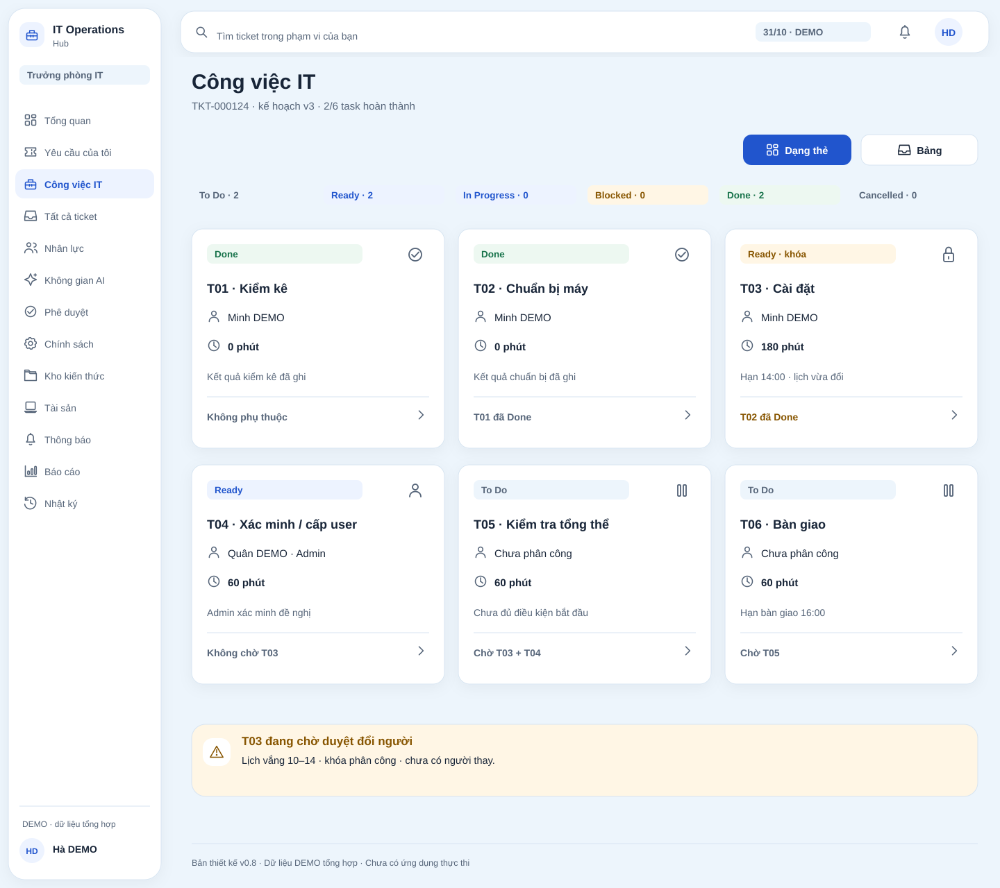

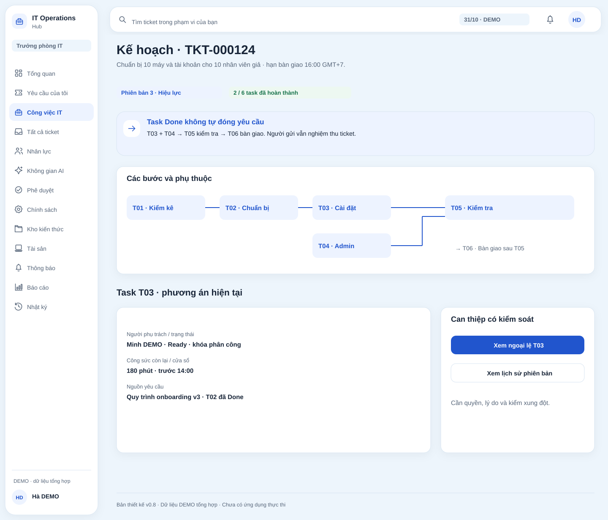

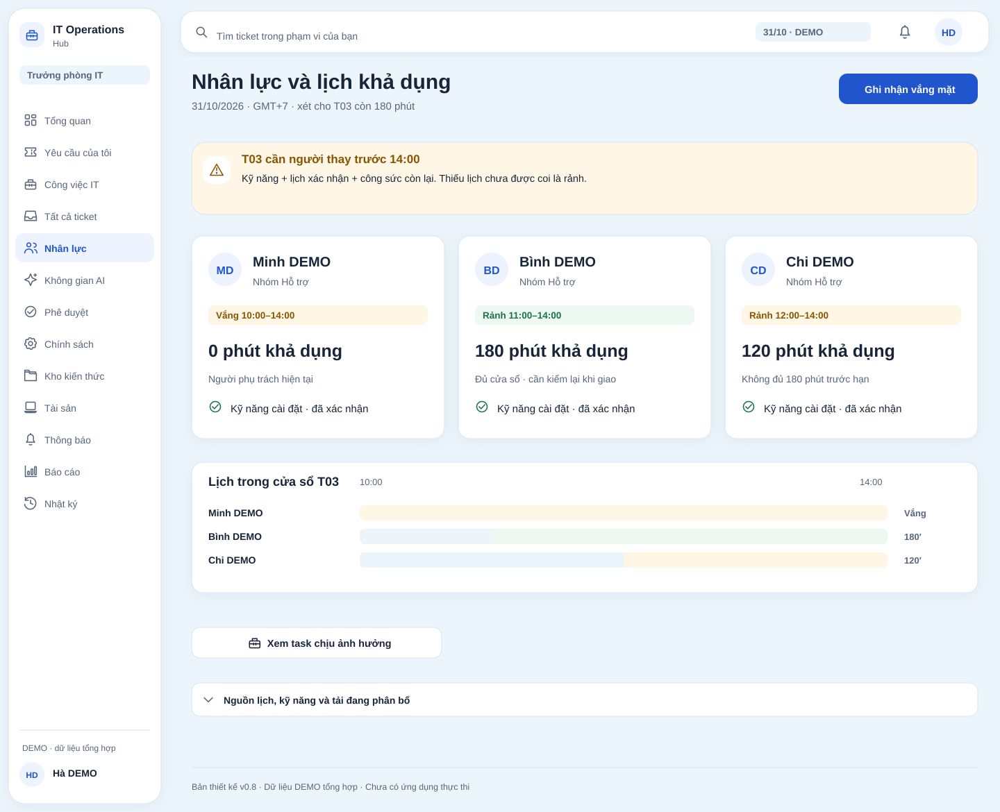

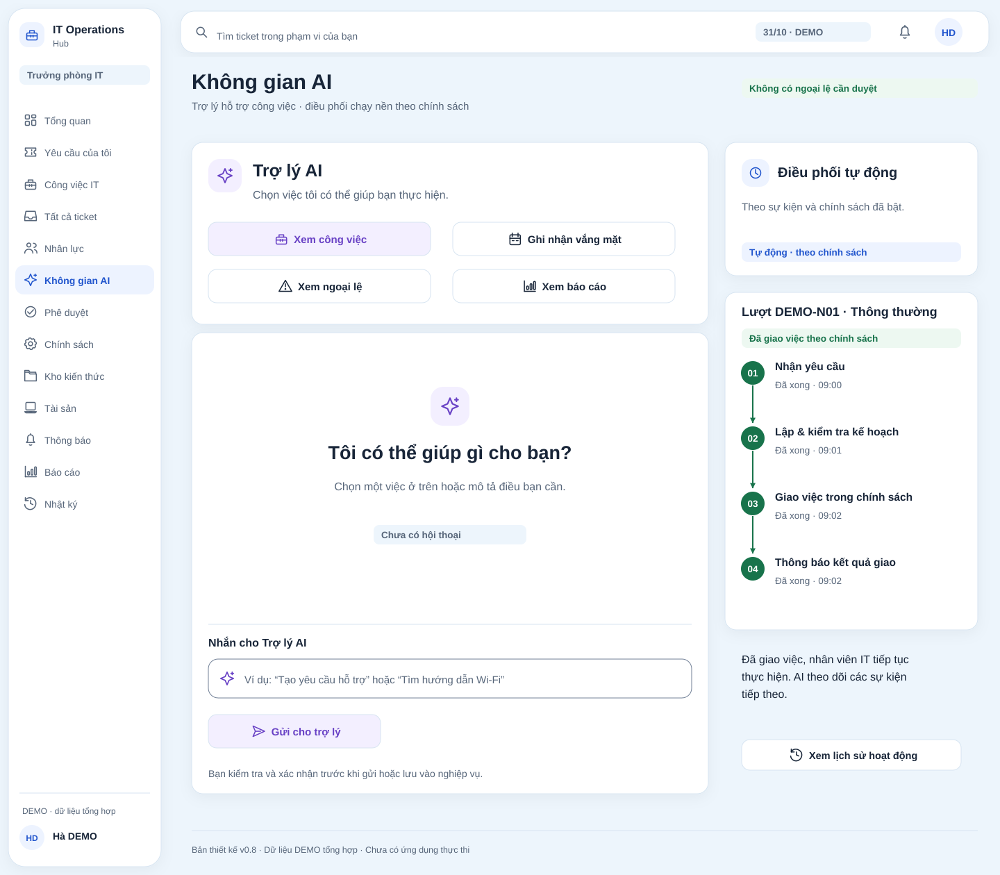

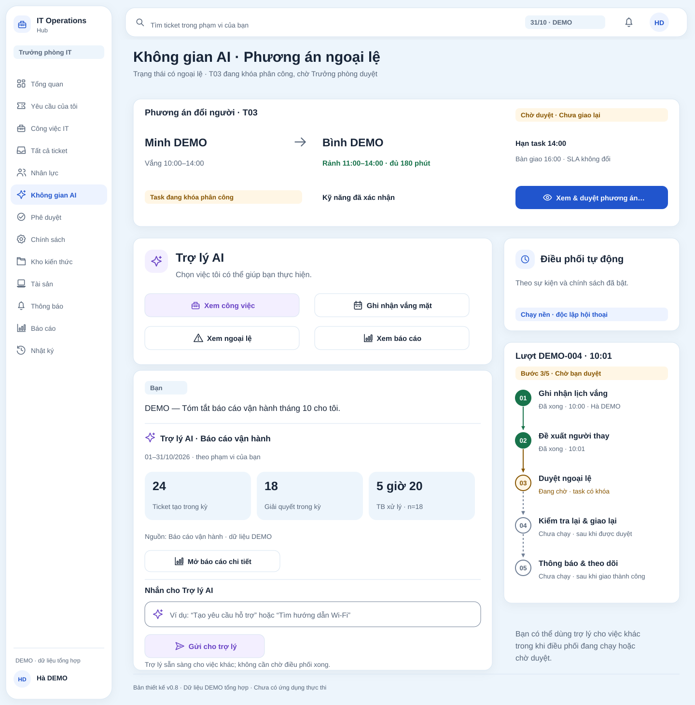

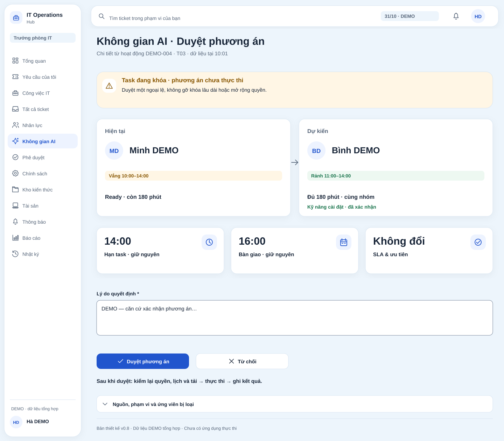

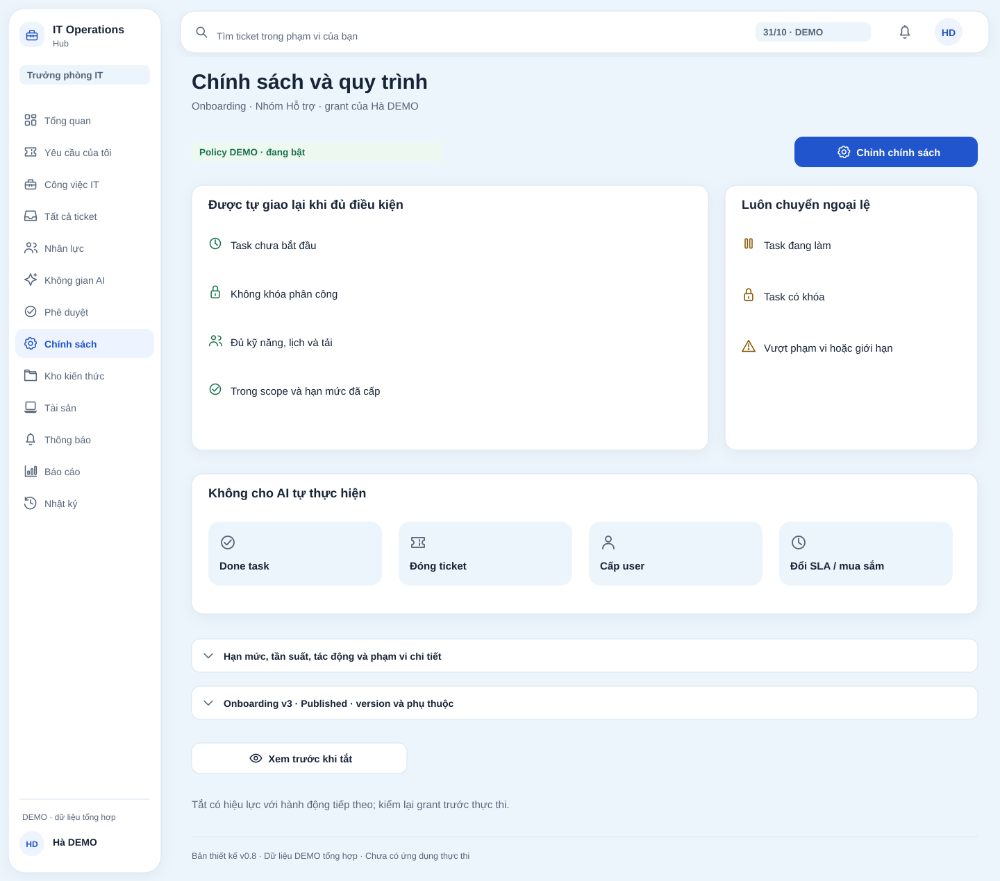

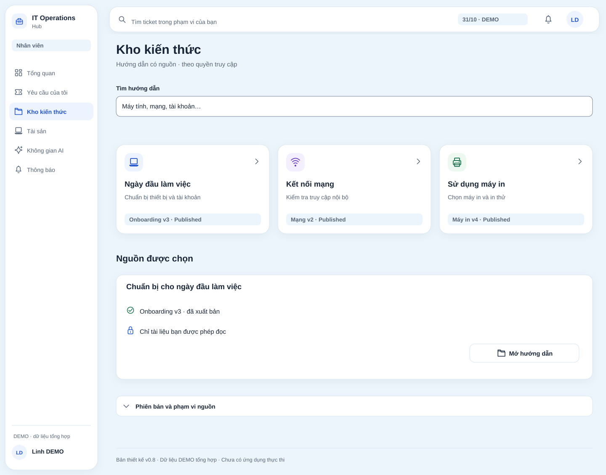

## Gallery — Requester, Technician, Admin

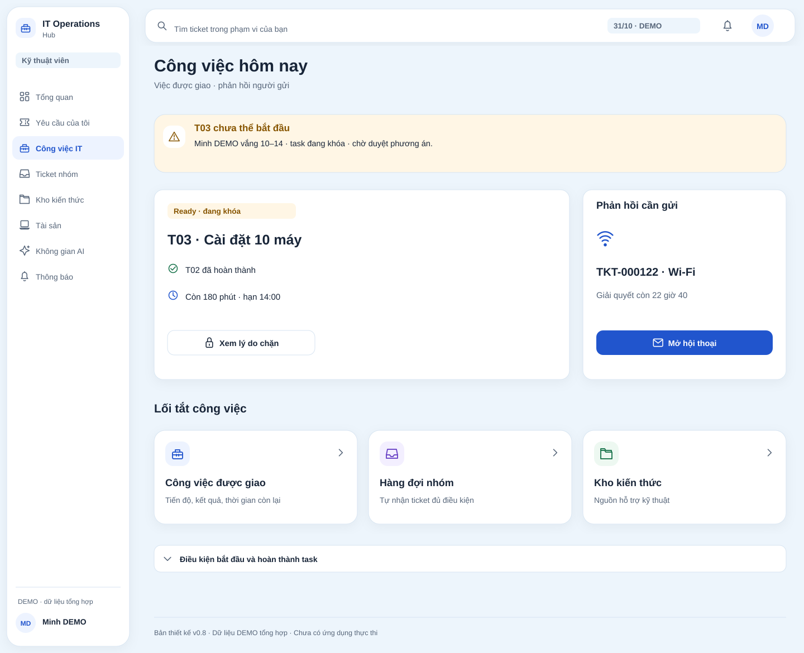

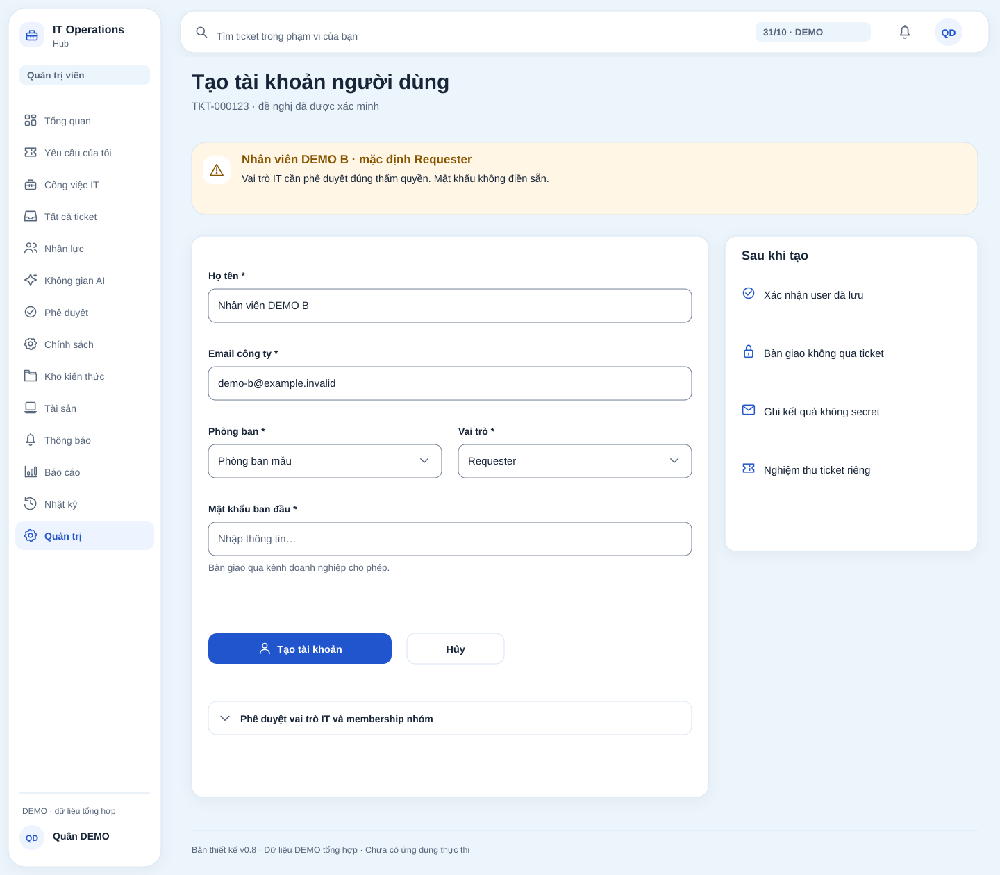

## Gallery — foundation and states

## Content, dataset, limits

[Screen spec](../../07-uiux-specification.md) is authoritative; controls do not grant rights. DEMO onboarding 20–25 has a locked task, distinct from unlocked diagram replanning. [Dataset](../visual-refresh.md) separates tickets/snapshots. Admin assets are not Requester permissions; KB reader not default publisher.

XMind images come from current SVGs. Reuse [44 icons](../icons/)/[login illustration](../illustrations/login-it-support.png). [Use-case PNG](use-cases-overview.png) is a separate appendix, not UI; [source SVG](../../diagrams/use-cases-overview.svg) must follow English diagram labels.

No live keyboard/HTML/zoom/reflow/assistive-technology/HTTP/provider checks. Loading/error boards are specifications; implementation needs real data. [Skill review](../uiux-review.md) separates measured/planned, no HIG/WCAG conformance claim.

## Designed interactions

Labeled icon cards/chips/disclosures reduce reading. 37 static SVGs execute no business actions. [Content/states](../content-and-states.md) defines destinations/effects; retain tables/six Task states/sources-ACL/decision≠execution. [References/tradeoffs](../visual-refresh.md).

## AI Workspace v0.8

UI11 R:Pending reply/public progress. UI12 T:confirmed composer. UI37 M:normal/no exception. UI23 M:conditional pending exception, not default. UI24:decision details in the same context. One screen, different rights/data, 37 artifacts/36 patterns, no added pages/rights. [D-42/registry](../../10-ai-assistant.md).

## Login and alignment v0.8

[Main login](01-login.svg) · [Six interaction groups](36-login-states.svg). Action icon-label groups centered; menus/cards/disclosures left. Board 36 supports SCR01, no new route. Input/password/focus/validation/loading/network/allowed return behavior specified in SCR01.

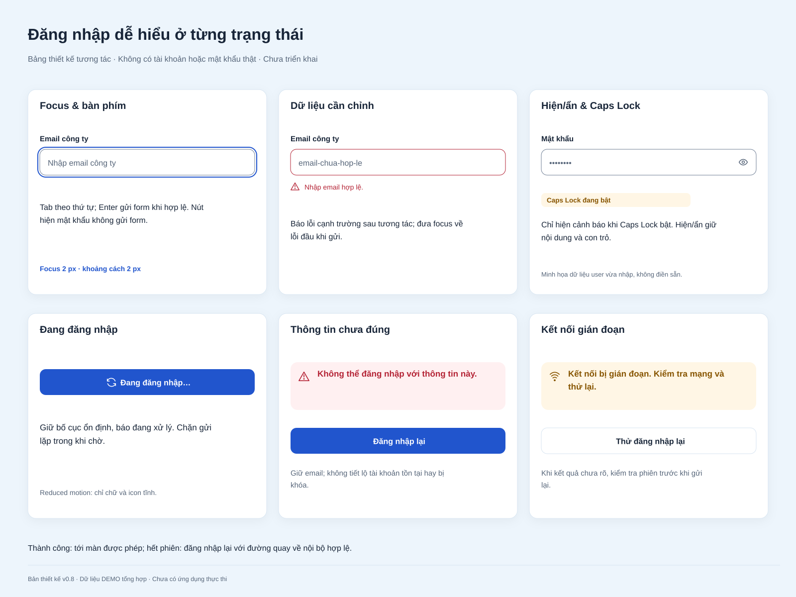

## Assistant recognition

UI11/12/23/37 have prominent assistant identity/4 authorized quick tasks/named composer/examples. Background region separately named/iconed. Suggestions start existing flows, never auto-send/elevate. [Behavior](../../07-uiux-specification.md)/[copy](../content-and-states.md).

## Assistant frame placement

Same column, capability header immediately above continuous chat, 12 px gap. Messages/forms/composer share the chat frame. UI23 full replacement proposal outside chat opens UI24; report conversation independently shows other assistant work.

## UI23 sequential progress

DEMO-004:record absence→propose→approve→recheck and reassign→notify and monitor. Five numbered steps/arrows, current 3/5, future dashed/not run. Locked-task branch only, no fake mandatory approval or changes to parallel DAGs.

## Normal and exception states

- **37-ai-workspace.svg:** normal default, no approval card, assistant first/new empty chat/one successful policy assignment run. Selected existing chats retain context/history.
- **23-coordination.svg:** explicit exception, locked T03 waiting 3/5, not yet reassigned; full before/after/review.
- **24-approval.svg:** decision diff/impact/reason/recheck before effect.

All states share /assistant, not three apps/routes. NORMAL/EXCEPTION fixtures independent; UI37 is not post-approval UI23. No actual runs→empty activity, no production DEMO logs.
