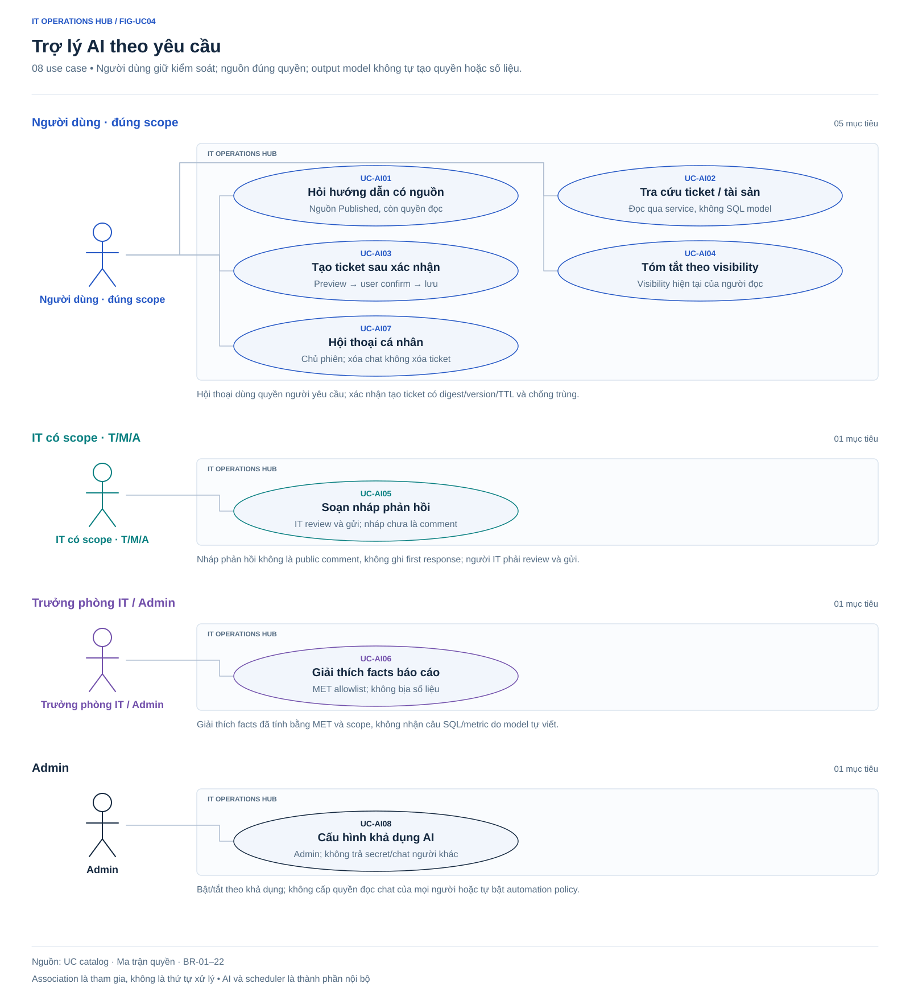
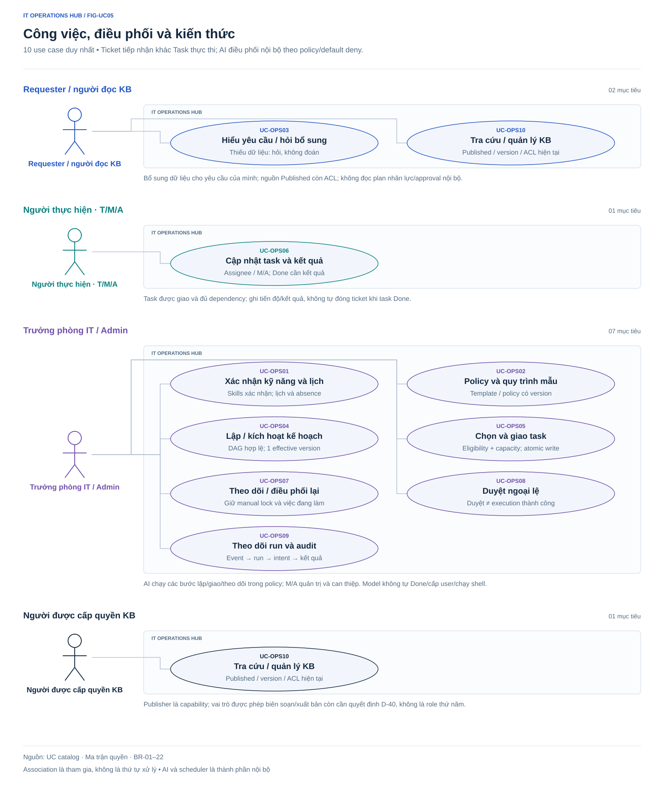

# Use-case and business-flow diagrams

**Target design, no implementation/application testing.** All views use the same UC catalog/state machines/permissions. Consistent labels/spacing/connectors/branch conditions. Overview and five detailed groups cover **51 UC=33 core+8 AI+10 OPS**.

## Viewing and interpretation

- VS Code Markdown/SVG previews; GitHub displays SVGs directly.
- Human actors outside system boundary, use-case ellipses, solid associations.
- AI_COORDINATOR/scheduler are internal, shown in architecture/sequences/executor notes, not human use-case actors.
- Role frames are views of one Hub; repeated IDs denote the same use case.
- Associations grant no blanket access; assignee/team/visibility/version/policy/capacity guards remain.

## Inventory, sources, notation

Follow [conventions](../documentation-standard.md). Figures are design-stage, owned by the project owner, without independent approval/running-system evidence. Architecture/ERD maintain Mermaid in Markdown plus rendered SVG. Use-case/flow/state vector SVGs are sources; PNG/XMind previews are derived.

| FIG ID | Type / question | Source / figure | Limit |
| --- | --- | --- | --- |
| FIG-UC00 | Role-goal overview | [Overview](use-cases-overview.svg), UC/permissions | Representative goals, not 51 ellipses |
| FIG-UC01 | Accounts/admin | [UC01–09](use-cases-access.svg) | Shared actions differ from Admin rights |
| FIG-UC02 | Tickets/SLA/notifications | [UC10–26](use-cases-ticket.svg) | Scheduler internal trigger |
| FIG-UC03 | Assets/reports/audit | [UC27–33](use-cases-operations.svg) | Detailed permission scopes |
| FIG-UC04 | On-demand assistant | [UC-AI01–08](use-cases-ai.svg) | Drafts/previews≠confirmed mutations |
| FIG-UC05 | Work/automation/KB | [UC-OPS01–10](use-cases-work-management.svg) | Internal AI/publisher capability, no fifth role |
| FIG-FLOW01 | Onboarding/exceptions | [Automation](automation-flow.svg), Flow 8–10, BR-14–22 | Illustrative flow; transactions in sequences |
| FIG-FLOW02 | Absence/reassignment | [Replanning](replanning-flow.svg), Flow 9, BR-16–19 | DEMO windows/respect locks-active work |
| FIG-FLOW03 | Request/acceptance | [Requester](../xmind/previews/07-flow-requester.svg), Journey 1, BR-04/08–10/14–20 | Public projection, Done≠Closed |
| FIG-FLOW04 | Technician | [Technician](../xmind/previews/08-flow-technician.svg), Journey 2, BR-04/05/06/08/15/16 | Task/Ticket distinct lifecycles |
| FIG-FLOW05 | IT Manager supervision | [Manager](../xmind/previews/09-flow-manager.svg), Journey 3, BR-16–19 | Policies/supervision/exceptions, no Team Lead |
| FIG-FLOW06 | Asset issue/return | [Assets](../xmind/previews/10-flow-asset.svg), Flow 4, BR-11 | M/A writes, no autonomous AI issue |
| FIG-FLOW07 | Revocation/handover | [Admin](../xmind/previews/11-flow-admin.svg), Flow 5, BR-01/05/12 | Emergency without replacement D-40 |
| FIG-FLOW08 | Error/conflict/retry | [Recovery](../xmind/previews/12-flow-conflict.svg), Flow 6, NFR | No blind retry/precommit success |
| FIG-FLOW09 | Notifications | [Notifications](../xmind/previews/13-flow-notification.svg), Flow 7, BR-06/10/12/19 | Current access, not stale sensitive payloads |
| FIG-MAP01 | Capability decomposition | [Product](../xmind/previews/01-product-map.svg), scope/F/BR/permissions | Design, not enterprise survey evidence |
| FIG-MAP06 | Information/screen grouping | [IA](../xmind/previews/06-information-architecture.svg), SCR/permissions | 36 patterns, groups do not grant access |
| FIG-DAG01 | Onboarding DAG | [Dependencies](onboarding-task-dag.svg), Flow 8 | 6 DEMO tasks/parallelism, no ticket auto-close |
| FIG-ST01 | Task transitions | [Task states](task-states.svg), BR-15 | 6 states/10 edges/BRguards |
| FIG-ST02 | Approval/execution | [Approval](approval-states.svg), BR-18 | Separate lifecycles, Approved≠Succeeded |
| FIG-ST03 | Ticket transitions | [Tickets](ticket-states.svg), BR-04 | Task/approval states never replace ticket states |
| FIG-ST04 | Asset transitions | [Assets](asset-states.svg), BR-11 | 4 states/8 edges, separate assignment history |
| FIG-ERD01 | Logical ownership/cardinality | [Data model](../requirements/conceptual-data-model.md) | Not physical schema/migration |
| FIG-ERD02 | Identity/organization | [Identity](erd-identity.svg) | Selected keys/fields, source cardinality |
| FIG-ERD03 | Tickets/conversations/files | [Tickets](erd-ticket-sla.svg) | Selected keys/fields, source cardinality |
| FIG-ERD04 | Assets/assignments | [Assets](erd-assets.svg) | Selected keys/fields, source cardinality |
| FIG-ERD05 | Plans/tasks/dependencies | [Plans](erd-work-plans.svg) | Selected keys/fields, source cardinality |
| FIG-ERD06 | Skills/calendar/allocation | [Workforce](erd-workforce.svg) | Selected keys/fields, source cardinality |
| FIG-ERD07 | Policies/versions/grants | [Policy](erd-policy.svg) | Selected keys/fields, source cardinality |
| FIG-ERD08 | Events/execution/audit | [Execution](erd-execution.svg) | Selected keys/fields, source cardinality |
| FIG-ERD09 | Knowledge/ACL/index | [Knowledge](erd-knowledge.svg) | Selected keys/fields, source cardinality |
| FIG-ERD10 | Conversations/sources | [Assistant](erd-assistant.svg) | Selected keys/fields, source cardinality |
| FIG-ERD11 | Confirmation/AI costs | [Usage](erd-confirmation-usage.svg) | Selected keys/fields, source cardinality |
| FIG-ERD12 | SLA snapshots/clocks | [SLA](erd-sla-clocks.svg) | Selected keys/fields, source cardinality |
| FIG-CTX01 | System context | [Context](system-context.svg), architecture§1/2 | Users versus external systems |
| FIG-CNT01 | Containers/data paths | [Containers](system-containers.svg), architecture§1–5 | Modules not microservices |
| FIG-SEQ01 | Model/transaction/approval | [Planning](automation-sequence.svg), BR-17–19 | One event; subsequent actions recheck |
| FIG-SEQ02 | Approval/execution | [Approval](approval-sequence.svg), BR-18 | Decision≠effect/postdecision validation |
| FIG-DEP01 | Deployment/recovery | [Deployment](deployment-topology.svg), architecture§9 | Hosting/HA/RPO/RTO open |
| FIG-CMP01 | C4 C3 API | [API](c4-components-api.svg), [source](../architecture/c4/03-components.md) | Transport/identity/domain/UoW, not microservices |
| FIG-CMP02 | C4 C3 worker | [Worker](c4-components-worker.svg), [source](../architecture/c4/03-components.md) | Claim/snapshot/model/revalidate/commit, separate queues |
| FIG-CODE01 | C4 L4 code collaboration | [Assignment](c4-code-assignment.svg), [source](../architecture/c4/04-code.md) | Proposed classes/files, no code |

27 XMind previews comprise 18 decomposition maps (including Product/IA), 7 directed activities, 2 state graphs FIG-ST03/04. Preserve two-sided central Product/IA format/thick bright borders; activities retain their own notation. Architecture/data mind maps do not replace containers/ERDs. [Wireframes](../design/wireframes/README.md) describe coverage/DEMO data, not UML/running UI.

## Context, containers, sequences, deployment

[Architecture views](architecture.md) show trust/data ownership/model-outside-TX/stale-approval/recovery. Use-case associations do not define execution order.

## Overview by role

Representative goals; detailed groups list each ID. [Catalog](../03-use-cases.md)/[permissions](../requirements/permissions-matrix.md) own guards.

## Accounts and administration — UC01–UC09

Admin alone creates users/roles/default SLA. Manager policies UC-OPS02 differ from assistant availability UC-AI08.

## Tickets, SLA, notifications — UC10–UC26

UC10 shares Ticket service with confirmed UC-AI03. Preserve states/24-7 SLA/separate task-plans; AI chat/reminders not first response.

## Assets, dashboards, audit — UC27–UC33

One active asset assignment; workforce/automation reporting through UC-OPS09, KB through UC-OPS10. No autonomous issue/ticket-driven user creation.

## On-demand assistant — UC-AI01–08

User-authorized conversation; unconfirmed previews create no ticket; IT reviews/sends replies. [Assistant catalog](../ai/use-cases-stories-and-acceptance.md).

## Work, coordination, knowledge — UC-OPS01–10

Background AI within policy; active/locked/out-of-authority work escalates. KB publisher is granted capability, not new role.

## Automation, task DAG, replanning

[Flow 8–10](../05-user-flows.md)/[BR-14–22](../requirements/business-rules.md). No locks during models; shortages/stale data cannot force execution.

## Separate task and approval states

BR-15:Blocked→Ready after checks; Done/Cancelled not automatically reopened; Done≠ticket Closed.

BR-18:Approved≠Succeeded; recheck policy/version/capacity; stale re-evaluated.

## ERD, IA, XMind

[Logical ERD](../requirements/conceptual-data-model.md) has 11 selected-field/cardinality views; FIG-ERD01 keeps full graph. [IA](../04-information-architecture.md) defines 36 patterns. [XMind](../xmind/README.md) retains source-linked UC/story/screen notes; previews are connected diagrams, not abbreviated card tables.

Overview PNG in [wireframes](../design/wireframes/README.md) derives from current SVG. UI illustrations prove no runtime behavior; archives historical only.
