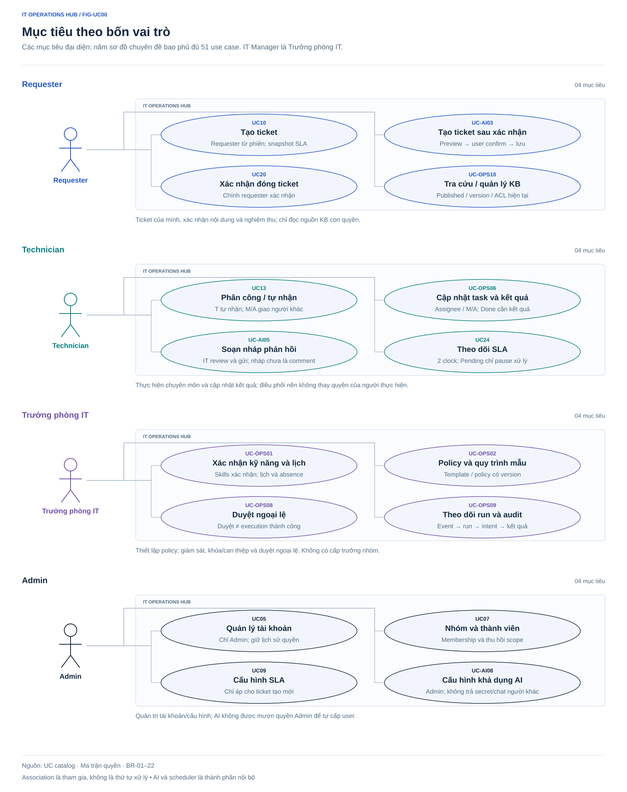

# Sơ đồ Use Case — xem trực tiếp

Bốn sơ đồ SVG dùng cùng hệ màu, kiểu chữ và bố cục theo vai trò. Các liên kết nằm trong từng góc nhìn để dễ đọc và tránh đường nối chạy xuyên toàn bộ hình. SVG là nguồn chỉnh sửa trực tiếp; không cần công cụ dựng sơ đồ riêng để xem.

## Cách xem và đọc sơ đồ

- **VS Code:** mở README này rồi nhấn **Ctrl + Shift + V**; hoặc mở file `.svg` bằng **Open With… → Image Preview**.
- **GitHub:** mở thư mục `docs/diagrams` để xem README và các hình, hoặc mở từng file SVG.
- **Chỉnh sửa:** mở SVG bằng công cụ chỉnh vector. Giữ nguyên mã UC, actor, phạm vi quyền và quan hệ khi đổi bố cục.

Actor nằm ngoài đường bao hệ thống; hình ellipse biểu diễn use case, đường liền biểu diễn actor tham gia. Mỗi khung là một góc nhìn của **cùng một hệ thống cho một tổ chức**, không phải một ứng dụng riêng.

**Mã UC lặp lại vẫn là cùng một use case.** Các tác vụ dùng chung áp dụng cho cả bốn vai trò; Admin kế thừa nghiệp vụ IT Manager. Góc nhìn “IT Manager / Admin” trình bày các tác vụ chung, các khác biệt quyền được ghi ở chú thích và ma trận quyền. “Người yêu cầu của ticket” là quan hệ với bản ghi, không chỉ là vai trò Requester.

## Tổng quan theo vai trò

[Mở SVG tổng quan](use-cases-overview.svg). Hình tóm lược 12 mục tiêu tiêu biểu; ba hình chi tiết bên dưới bao phủ đầy đủ 33 UC.

## Tài khoản và quản trị — UC01–UC09

[Mở SVG tài khoản và quản trị](use-cases-access.svg)

## Ticket, SLA và thông báo — UC10–UC26

[Mở SVG ticket và SLA](use-cases-ticket.svg). Có 17 UC duy nhất; một UC có thể xuất hiện ở nhiều góc nhìn. Bộ lập lịch chỉ kích hoạt tác vụ nền; worker nằm trong hệ thống, nhân sự IT nhận cảnh báo theo quyền.

## Tài sản, dashboard và nhật ký — UC27–UC33

[Mở SVG tài sản và quan sát](use-cases-operations.svg)

Đối chiếu với [catalog 33 use case](../03-use-cases.md) và [ma trận quyền](../requirements/permissions-matrix.md). Association không tự cấp quyền trên mọi bản ghi. Bộ [XMind Use Cases](../xmind/02-use-cases.xmind) tiếp tục phục vụ chỉnh sửa bản đồ actor–goal.
