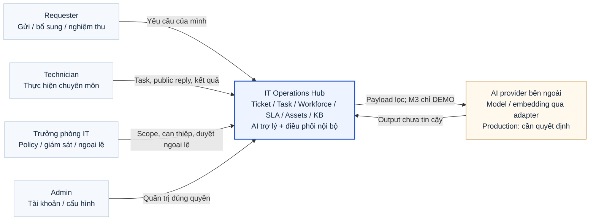
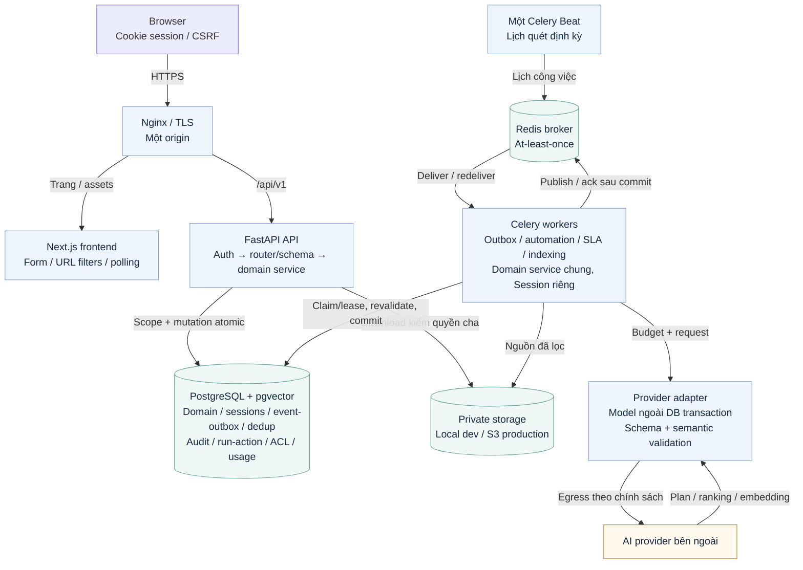
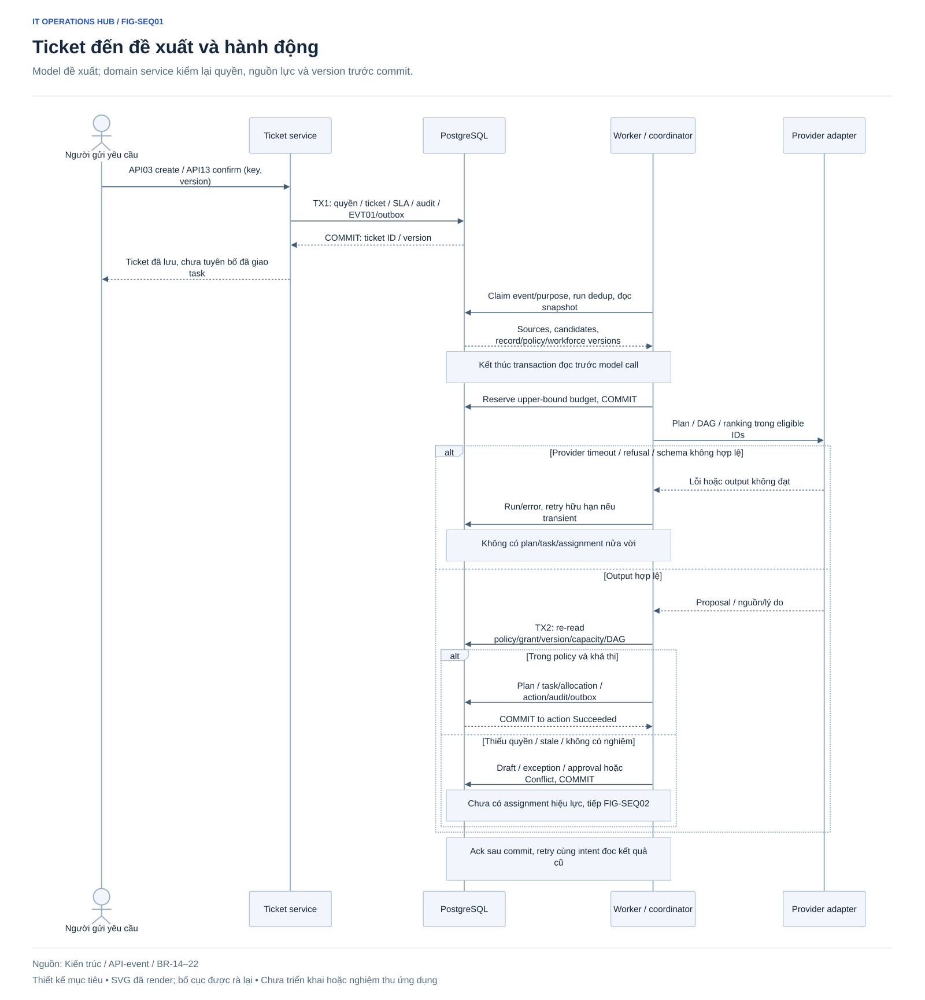
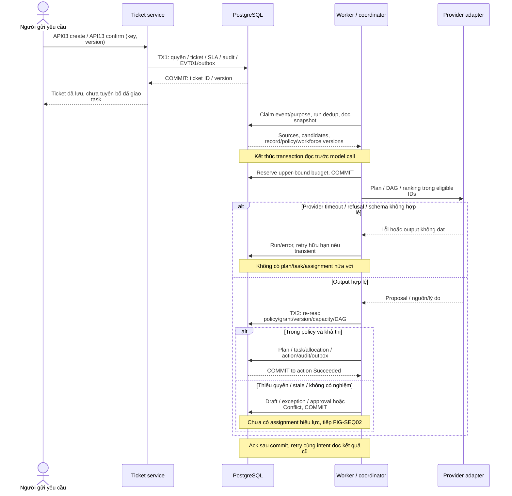
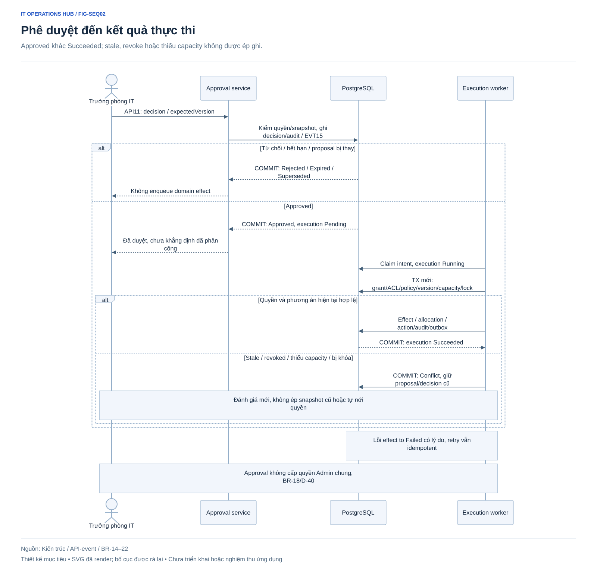
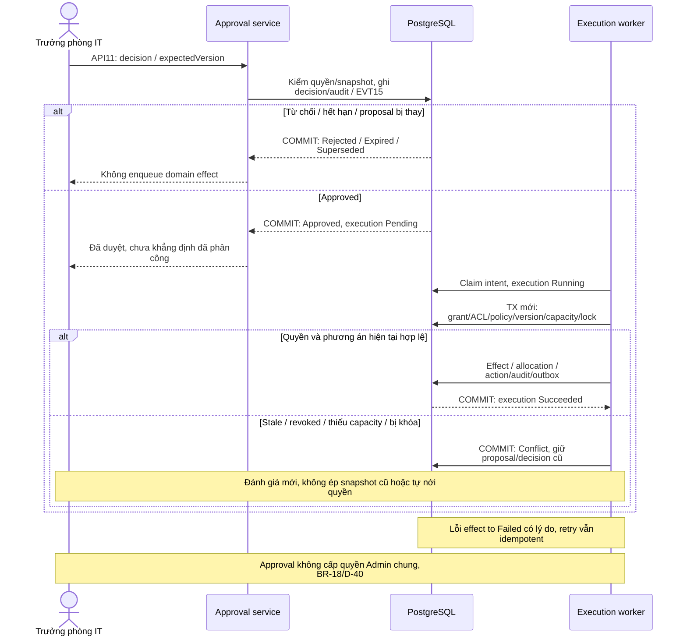
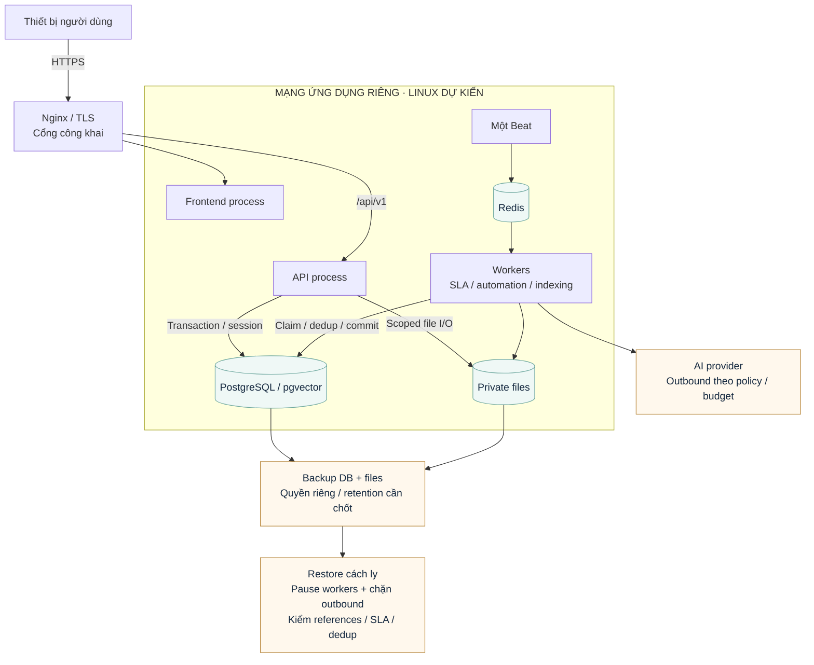

# Các góc nhìn kiến trúc

SVG dưới đây đã được render từ nguồn Mermaid đi kèm. Các hình mô tả thiết kế mục tiêu, không phải triển khai đã chạy. Ký pháp context/container phân tầng theo C4; sequence thể hiện thứ tự gọi và transaction. [Kiến trúc chuẩn](../technical/architecture.md), [API/event](../technical/api-design.md) và [BR-14–22](../requirements/business-rules.md) quy định hành vi.

## FIG-CTX01 — Bối cảnh và ranh giới hệ thống

Bốn vai trò người dùng; AI_COORDINATOR ở trong Hub; provider ở ngoài trust boundary.

Nguồn Mermaid

## FIG-CNT01 — Container và đường dữ liệu

Frontend không đọc DB; broker không là nguồn chuẩn; model không giữ transaction/lock.

Nguồn Mermaid

## FIG-SEQ01 — Ticket đến đề xuất và hành động

Model đề xuất; domain service kiểm lại quyền, nguồn lực và version trước commit.

Nguồn Mermaid

## FIG-SEQ02 — Phê duyệt đến kết quả thực thi

Approved khác Succeeded; stale, revoke hoặc thiếu capacity không được ép ghi.

Nguồn Mermaid

## FIG-DEP01 — Triển khai và phục hồi dự kiến

Topology logic; chưa chốt hosting/HA/RPO/RTO và chưa có production chạy.

Nguồn Mermaid

## Điều kiện đọc và giới hạn

Không có cấp Trưởng nhóm IT riêng. AI/provider không có credential domain; Trưởng phòng IT thiết lập policy, giám sát và duyệt ngoại lệ. Core cần PG/storage sẵn sàng; lỗi provider không tự làm mất khả dụng core. Broker outage có thể làm SLA scan trễ và phải quét bù. Approval không thay quyền Admin cấp tài khoản. M3 chỉ thử DEMO/test trong giới hạn D-39 khi được yêu cầu triển khai riêng.
