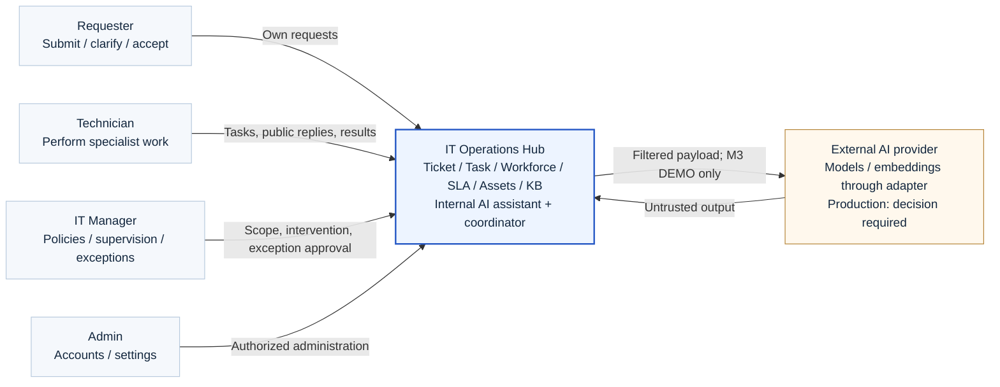
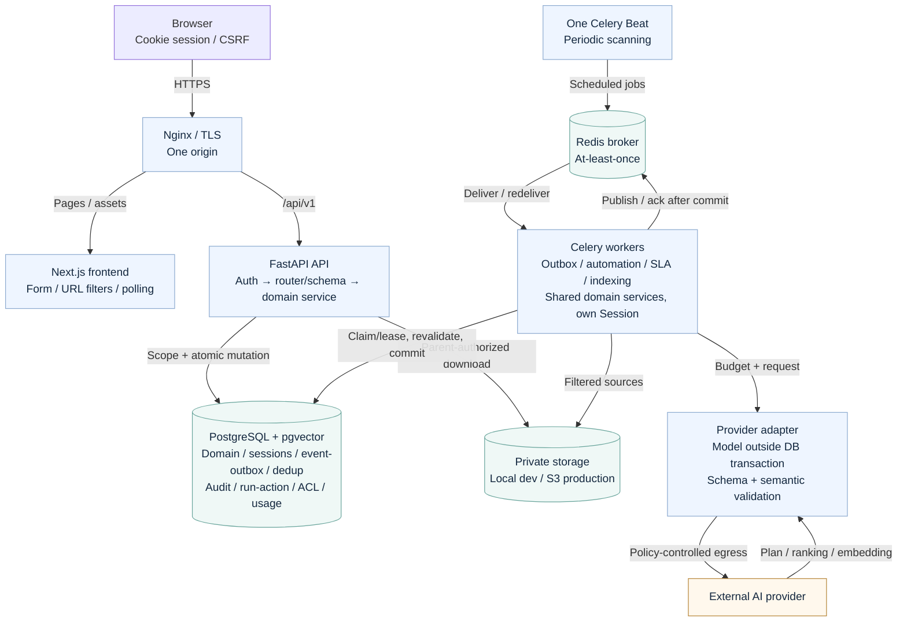
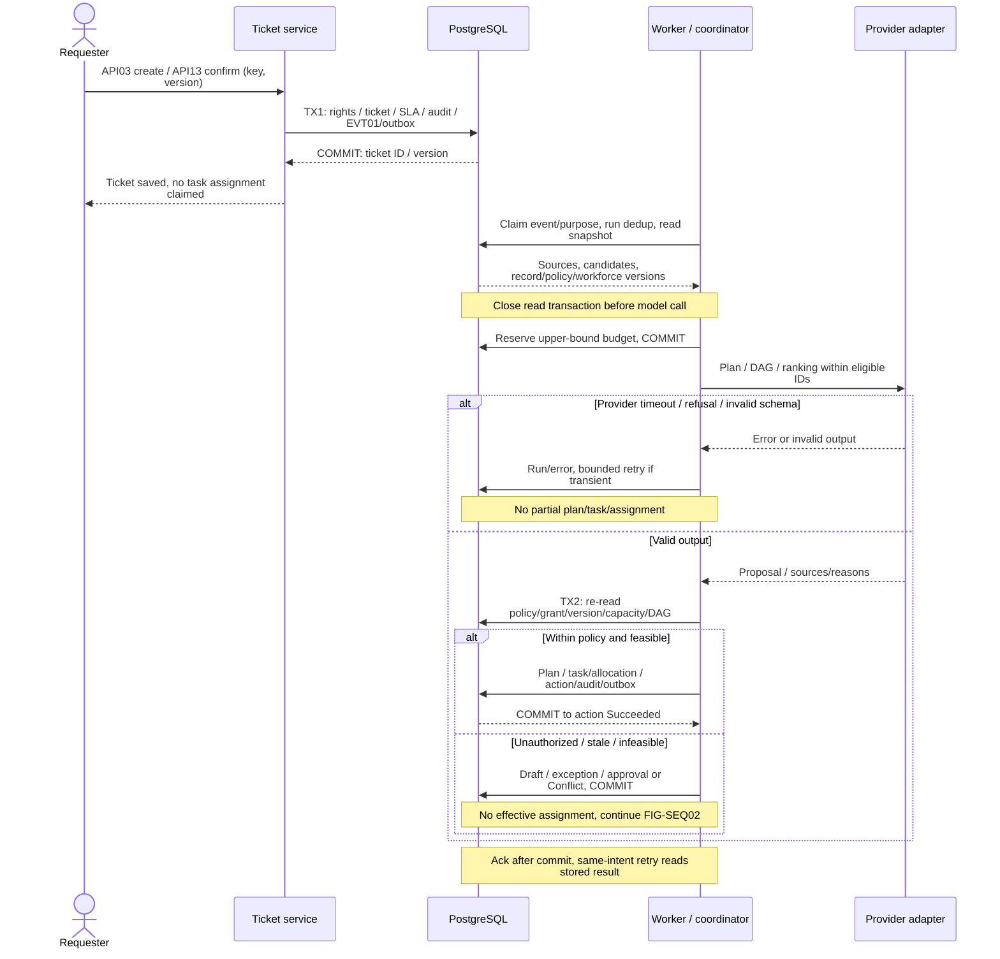
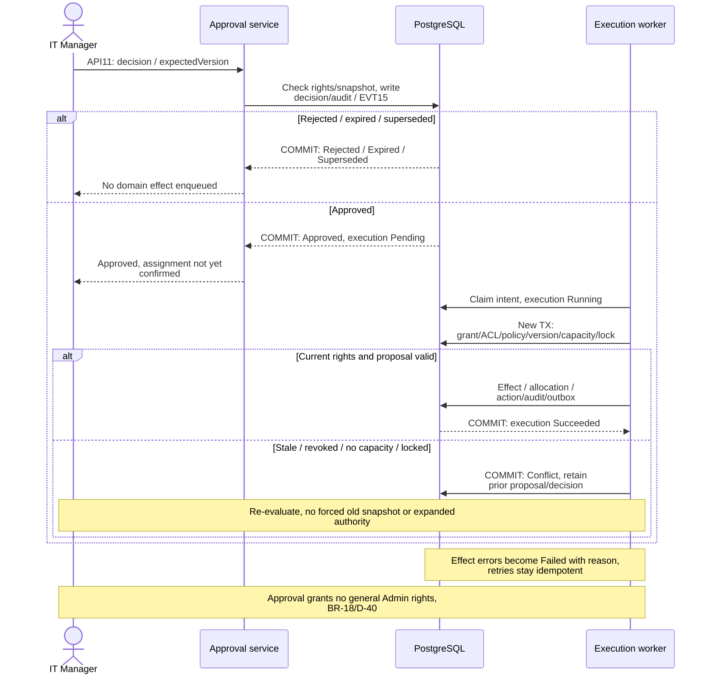
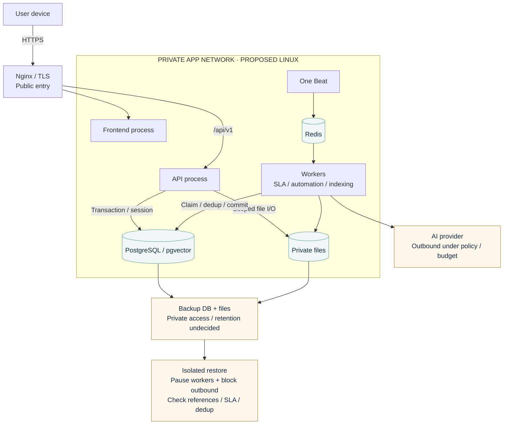

# Architecture views

SVGs are rendered from accompanying Mermaid sources. Target design, not deployed systems. C4-style context/container views separate levels; sequences show order/transactions. [Architecture](../technical/architecture.md), [API/events](../technical/api-design.md), [BR-14–22](../requirements/business-rules.md) define behavior.

## FIG-CTX01 — System context and boundaries

Four user roles; AI_COORDINATOR inside Hub; provider outside trust boundary.

Mermaid source

## FIG-CNT01 — Containers and data paths

Frontend has no DB access; broker is not the system of record; model waits hold no transactions/locks.

Mermaid source

## FIG-SEQ01 — Ticket to proposal and action

Model proposes; domain services recheck rights/resources/versions before commit.

Mermaid source

## FIG-SEQ02 — Approval to execution outcome

Approved differs from Succeeded; stale/revoked/insufficient capacity cannot force writes.

Mermaid source

## FIG-DEP01 — Proposed deployment and recovery

Logical topology; hosting/HA/RPO/RTO remain undecided, no production deployment.

Mermaid source

## Interpretation and limits

No IT Team Lead tier. AI/providers have no domain credentials; IT Manager sets policy/supervises/approves exceptions. Core requires healthy PostgreSQL/storage; provider failure alone does not disable it. Broker outages may delay SLA scans and require catch-up. Approval never replaces Admin provisioning rights. Future M3 is DEMO/test only within D-39 after a separate implementation request.
