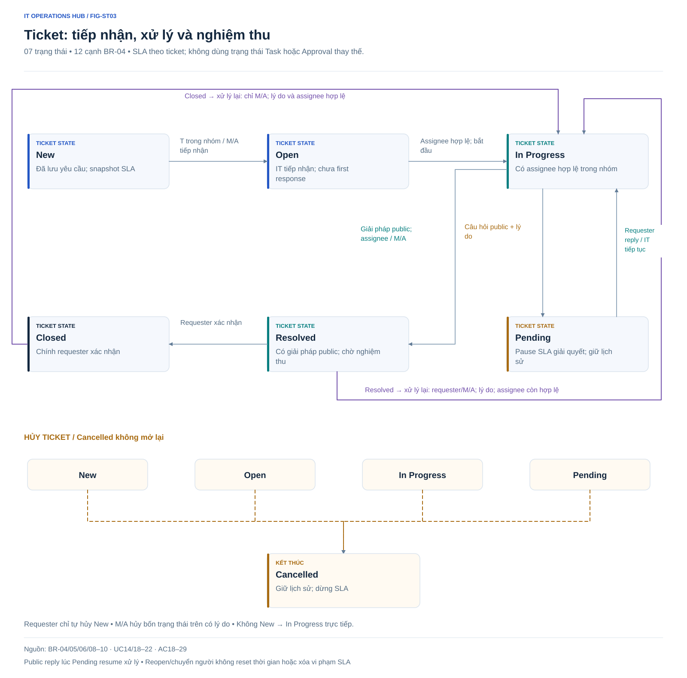
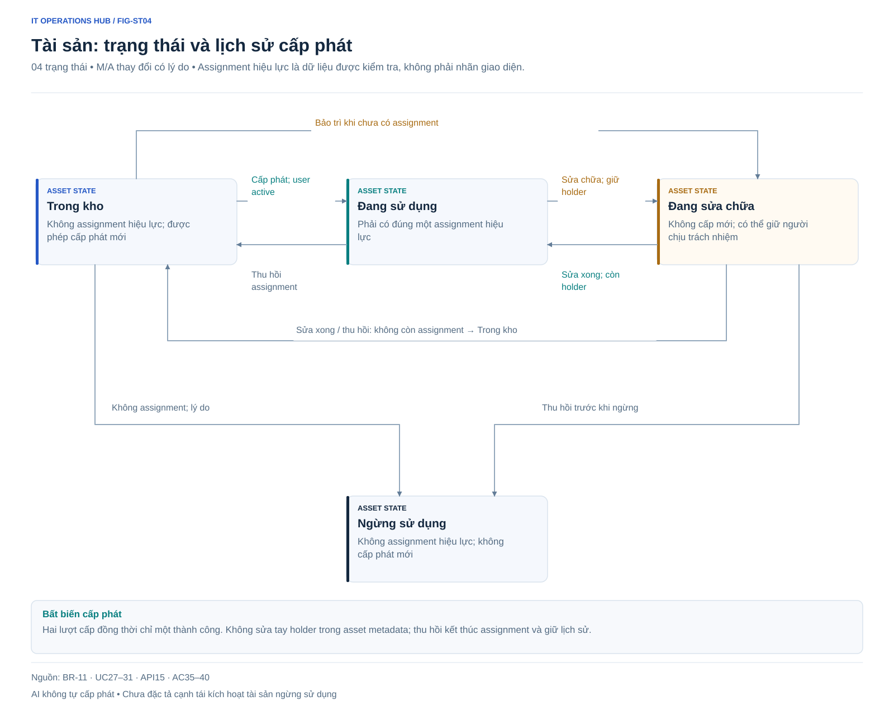
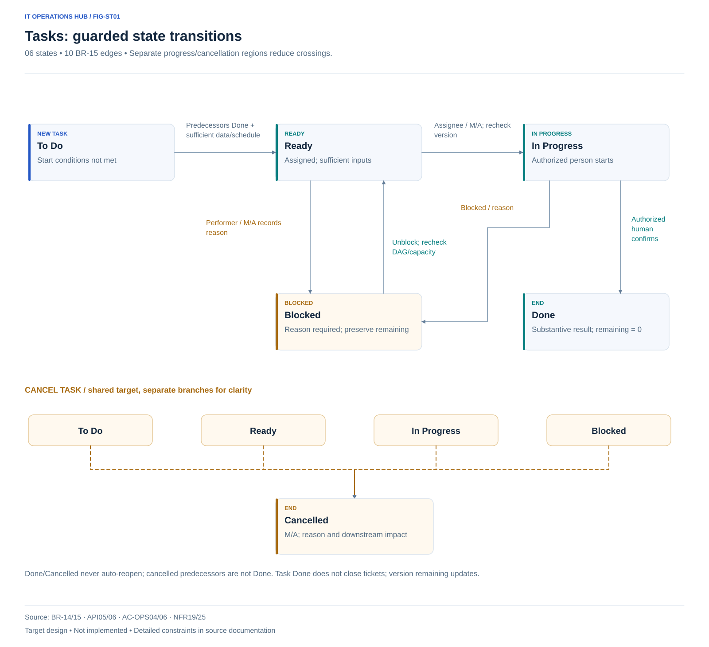
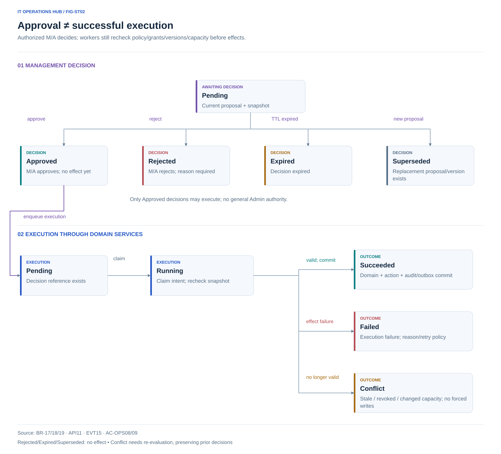

# Business rules

This is the shared source for use cases, AC, screen information, and metric formulas. Details extending the brief reference [proposed decisions](../decisions/design-decisions.md).

## BR-01 — Identity and history

One organization, four user roles; AI_COORDINATOR is a background service identity under D-35/D-38. Admin creates accounts; no public signup. Normalize emails and enforce uniqueness. Do not delete historical accounts. Lock revokes all server sessions; unlock never restores them. Role/membership changes apply on the next request. No passwords/tokens/file bodies in audit. See [permissions](permissions-matrix.md).

Under D-29, department heads submit Service Request / Account tickets as Requester. Admin verifies authority/need and creates under Administration → Users, default Requester. Department head is not a new role or necessarily IT Manager; ticket submission does not grant accounts/rights. IT roles need authorized approval; membership is separate. Head remains requester and accepts closure. Passwords use enterprise handover outside tickets. First Admin/initial department-head accounts use authorized setup. See [provisioning](account-provisioning.md).

## BR-02 — Ticket identity and data

Generate unique codes such as `TKT-000123`; gaps are acceptable and codes are never reused. Creator is requester in MVP; no on-behalf submission. Types: personal incident, service request. Default team is Admin-selected active intake; nonexistent automatic routing must not lose requests [D-02].

Title/description/type/category/impact/urgency required; asset/files optional. Onboarding requires verified employee list/device configuration/quantity/handover deadline before automatic planning/assignment. These are not mandatory for every ticket or employee-directory rights. Proposed limits: title 5–180 characters, description 10–10, 000, comments/solutions/reasons maximum 10, 000; required reasons at least 10 meaningful trimmed characters. Whitespace-only invalid; preserve erroneous forms.

## BR-03 — Priority

| Impact / Urgency | High | Medium | Low |
| --- | --- | --- | --- |
| High — organization | P1 | P2 | P3 |
| Medium — team/department | P2 | P3 | P3 |
| Low — individual | P3 | P3 | P4 |

Server computes priority; Requester cannot supply P1 directly. IT verifies; M/A overrides with reason, old/new values, elapsed clocks. T suggests through internal notes, no override. Override does not silently edit original impact/urgency.

## BR-04 — State machine

| From | To | Actor and extra guards |
| --- | --- | --- |
| New | Open | Team T or M/A; acceptance is not first response |
| New | Cancelled | Requester cancels, or M/A with reason |
| Open | In Progress | Valid team assignee; T must be assignee, M/A may act |
| Open | Cancelled | M/A with reason |
| In Progress | Pending | Assignee/M/A; required public question/reason |
| In Progress | Resolved | Assignee/M/A; required public solution |
| In Progress | Cancelled | M/A with reason |
| Pending | In Progress | Substantive public requester reply, or assignee/M/A resumes with reason |
| Pending | Cancelled | M/A with reason |
| Resolved | Closed | Original requester confirms |
| Resolved | In Progress | Requester/M/A, reopen reason, valid assignee |
| Closed | In Progress | M/A only, reason, valid assignee |
| Cancelled | — | Terminal, no reopen |

No other transitions. Assignment/comments/files/priority do not change state, except requester replies while Pending. No New→In Progress shortcut. No auto-close/ticket deletion. Requester cancellation of New requires confirmation, optional reason; M/A cancellation always requires a reason.

[Open XMind](../xmind/05-business-rules.xmind)

## BR-05 — Assignment and concurrency

Assignee must be active T/M/A and a current responsible-team member. M/A may transfer teams with a reason, selecting an eligible new-team assignee or clearing it. In Progress/Pending requires a valid replacement, never ownerless active work. Transfers never reset SLA.

T only self-claims **unassigned** own-team tickets. Every mutation checks versions; concurrent claims allow one success. Others see the new assignee after authorization recheck and keep input. No silent overwrite/automatic state-mutation retry.

## BR-06 — Conversations and visibility

Public comments need trimmed content and may include files. Internal notes have separate visibility; sent notes cannot become public. Opening tickets defaults composer to public; switching retains separate in-memory drafts without internal-to-public copying [D-05]. No sensitive localStorage.

Pending questions/Resolved solutions are **real public TicketComments** committed atomically with state. Preview the outgoing content. They may satisfy BR-08; standalone state events do not. Resolved permits discussion but needs reasoned reopening; Closed/Cancelled read-only.

## BR-07 — Files

Allow PNG/JPEG/WebP/PDF [D-06], each ≤**10, 000, 000 bytes**, at most 5/submission for tickets/comments/notes. No SVG/GIF/Office/executables. Server validates extension/MIME/content; client provides early guidance.

Files inherit parent ticket/public-comment/internal-note visibility, no separate ACL choice. Requester gets no note-file metadata/download. Downloads check current access; no public upload path. One invalid file prevents the submission commit, preserving text/valid files for correction. Interrupted post-ticket uploads must not duplicate tickets; future UX explicitly states whether creation occurred [D-07]. No claim of existing antivirus scanning.

## BR-08 — First response

Starts at `createdAt`; ends on a substantive public comment from authorized IT. Assignment, New→Open, notes, content-free attachments, requester comments do not count. IT requesters cannot self-satisfy first response [D-08]. Pending does not pause it.

`firstResponseElapsed = firstResponseAt - createdAt`; absent response uses `now - createdAt`. Cancelled stops live monitoring without fabricated responses; preserve breaches. A public solution may set first response in the same resolution transaction.

For IT self-handled tickets lacking another IT person's valid response, Resolved/Closed/Cancelled stops **active alert monitoring** and shows no valid IT response, never fake timestamps/on-time results. If reopened without response, count from creation including terminated intervals. Proposed convention [D-21] needs business validation.

## BR-09 — Resolution and snapshots

Sum time in **New, Open, In Progress**. Pending/Resolved/Closed do not consume it; Cancelled ends monitoring. Reopening resumes remaining budget, not zero; exhausted tickets reopen overdue. Persist run/pause intervals or equivalent, not simply `resolvedAt-createdAt`.

| Priority | Response | Resolution |
| --- | --- | --- |
| P1 | 15 minutes | 4 hours |
| P2 | 1 hour | 8 hours |
| P3 | 4 hours | 24 hours |
| P4 | 8 hours | 72 hours |

Ticket snapshot stores the full P1–P4 table/policy version at creation. Priority changes use the new level **from that ticket's snapshot** against elapsed usage; record the applied adjustment [D-09]. Default edits affect later tickets only. Increased budgets/default edits never delete breaches.

Compare response elapsed with new response budget too, without changing `firstResponseAt`. A newly breached priority budget is recorded at adjustment time, not backdated as an old commitment. Preserve prior budgets/outcomes for reporting.

## BR-10 — SLA labels and alerts

Separate clocks. During monitoring: <80% Within target; 80%–<100% At risk; ≥100% Breached. Stopped clocks show Responded/Resolved and on-time/breach result, not a continuing countdown. Pending resolution shows Paused plus elapsed usage; historical alerts remain visible.

Proposed background scan ≤60 seconds, independent of pages. Notify current assignee/active IT Managers; if unassigned, Managers; if no active Manager, Admin [D-10]. Domain events/workers share rules.

Dedup key: ticket + clock type + threshold 80/100 + budget-adjustment version + recipient. Repeats do not duplicate. Reopen/team transfer does not create a budget version. First scan beyond 100% sends overdue only, not obsolete 80% warning. Priority changes may alert under new budgets, never repeat a breach within that version. Record actual threshold-crossing time if derivable and worker detection time.

## BR-11 — Assets

Unique asset code; serial optional but unique if supplied [D-11]. Types: laptop, desktop, monitor, printer, network device. If both exist, purchase date must not follow warranty expiry.

| State | New issue | Rule |
| --- | --- | --- |
| In Stock | Yes | No active assignment |
| In Use | No | Exactly one active assignment |
| Under Repair | No | May retain assignment to record responsibility; explicit label |
| Retired | No | Return assignment first |

Issue only In Stock to active users; record user, department-at-issue, timestamp, issuer, notes. Concurrent issue allows one success. Return ends assignment without deletion, target In Stock/Under Repair. Do not edit current holder in metadata forms. Repair→In Use requires retained assignment; otherwise In Stock. M/A state edits need reason/history.

### Asset state edges and guards

| From | To | Guard / effect |
| --- | --- | --- |
| In Stock | In Use | M/A, active user, atomic single assignment |
| In Use | In Stock | Return/end assignment, preserve history |
| In Use | Under Repair | M/A reason, assignment may remain |
| Under Repair | In Use | Repair complete, active assignment remains |
| In Stock | Under Repair | Reasoned maintenance, no assignment |
| Under Repair | In Stock | Repair/return complete, no assignment |
| In Stock | Retired | M/A reason, no assignment |
| Under Repair | Retired | Return assignment first, M/A reason |

No direct In Use→Retired with holder or Retired reactivation specified. These are BR-11 design edges, not executed actions or AI asset-issue policy.

## BR-12 — Events, notifications, audit

TicketEvent records state/priority/team/assignee changes with actor/time/old/new/reason. Visibility excludes notes/internal reasons from public events. AssetAssignment/AuditLog records issue/return/state. User-permission/SLA audit is Admin-only.

Assignment notifies assignee; public comments/states notify currently authorized requester/assignee excluding actor; notes notify authorized assignee excluding actor only. No internal requester content. Notifications store recipient/event/read state, minimal previews, and read-time authorization. No MVP email.

## BR-13 — Time and DEMO data

Store business time in UTC; display default **Asia/Ho_Chi_Minh**, `dd/MM/yyyy HH:mm`. Convert date filters into UTC boundaries using display timezone. SLA runs 24/7 including nights/weekends. Designs label illustrative data; DEMO seeds/flags are future implementation requirements, no seed exists. The 31 October phase updated documentation only.

## BR-14 — Tickets, plans, tasks

Tickets retain BR-04/SLA. Each has multiple tasks/plan versions, only one Effective version. Plan: Draft → Effective → Superseded/Cancelled. Activating versions handles in-progress/locked tasks and preserves history. Do not enforce one plan per ticket across all history.

Task has team/assignee, skills, estimated/remaining minutes, start/deadline, dependencies, result/version. Internal plans/tasks are not returned to Requesters; filtered public progress may be aggregated. All tasks finished does not auto-Resolve/Close; authorized humans perform BR-04. AI cannot autonomously confirm Done/Resolved/Closed.

## BR-15 — Task states and dependencies

| From | To | Conditions |
| --- | --- | --- |
| To Do | Ready | Required predecessors Done, valid assignment, sufficient data/schedule window |
| Ready | In Progress | Authorized assignee/M/A; recheck dependencies/active membership/version |
| Ready / In Progress | Blocked | Performer/M/A reason/event; preserve remaining/history |
| Blocked | Ready | Unblock reason, dependency/capacity review; resume through Ready→In Progress |
| In Progress | Done | Authorized performer/M/A, substantive result, remaining=0 |
| To Do / Ready / Blocked / In Progress | Cancelled | M/A reason, downstream/plan impact review; preserve history |
| Done / Cancelled | — | No autonomous reopening/regression; controlled replacement task/plan |

Same-state progress updates remaining/result with version. Increased estimates recheck load/feasibility. Dependencies belong to one plan version, no self/cycle/unknown references. DAG changes with active work need review/approval. Cancelled predecessors do not satisfy Done; successors remain blocked until valid replanning.

## BR-16 — Candidates, schedules, capacity

Backend filters active IT users with action-specific authority (e.g., Admin for account creation), permitted memberships, verified required skills, availability. Model ranks only this set, with operational reasons, not personnel performance appraisal.

Use minutes within concrete planning windows. For person u/period p: capacity = min (configured work budget, scheduled minutes minus union of absences); load = summed allocated remaining effort of non-Done/non-Cancelled tasks, including Blocked across relevant plans; free = capacity − load. Daily budgets apply day-by-day then sum. No double absence subtraction/overlap counting. New allocations must fit every period/slot, not aggregate alone.

Multi-period tasks need explicit schedule/period allocations totaling remaining effort, not repeated full effort or arbitrary even splits. Unallocated tasks are not zero: expose risk/clarify before automatic assignment. Total capacity still requires DAG/window/deadline/SLA checks. Staff schedules do not change 24/7 SLA.

Check/reserve atomically with appropriate workforce/allocation versions/locks; two workers cannot reuse capacity. Missing verified skills/schedules/estimates require clarification/confirmed templates, not assumed availability. Period/budget/slot/calendar values: D-40.

## BR-17 — Automation policies and grants

Default deny. Manager grants workflow/team/priority/actions/limits, grantor/expiry/version. AI_COORDINATOR uses current grants only. Without valid policy: draft/approval, no effective assignment. Unstarted-task assignment/reassignment within scope allowed; in-progress/locked requires approval. SLA/commitment/priority/out-of-team changes require management approval. Reminders have rate/recipient limits. No autonomous completion/closure/account creation/shell.

Every tool rechecks policy/grantor/rights/version/feasibility immediately before writing, including retries/post-approval. DEMO policies never become enterprise policies automatically.

## BR-18 — Approval and manual intervention

Approval contains before/after/reason/impact, sources, snapshots of ticket/plan/task/policy/workforce. Pending → Approved/Rejected/Expired/Superseded; execution separately Pending/Running/Succeeded/Failed/Conflict. Authorized M/A decide. Stale proposals cannot apply; re-evaluation creates new proposal/approval retaining old records.

Approved still needs effective policy/eligible candidate/capacity; approval does not permit overbooking. Beyond-scope exceptions require authorized management services or bounded action/scope/expiry grants allowed by policy, never general Admin rights. If policy disallows the exception, management adjusts policy/resources or handles manually, then re-evaluates. Infeasibility may require separately authorized resource/commitment changes. Respect manual assignments/locks/in-progress work on later runs. Disabling automation blocks new actions; undo uses valid audited compensation, never history deletion.

## BR-19 — Events, retries, deduplication

Commit domain + outbox + audit atomically. At-least-once workers are idempotent by intent/target/version. Events include ticket creation/information, task progress/blocked/done, schedules/skills/load/membership, SLA/deadline risk, policy/approval, KB/index. Duplicate/replay/retry does not multiply versions/tasks/assignments/allocations/notifications.

Close snapshot transactions before models; new execution transactions re-read versions/locks. Timeouts/invalid output create no partial tasks. Transient errors use bounded backoff; rights/stale/infeasibility go to re-evaluation/management. Durable outbox recovers broker outages. Persist failures/dead-letter with audited retries. Physical keys/claims need architectural refinement, not Redis locks alone.

## BR-20 — Assistant, confirmation, model security

Q&A/search/summaries/drafts do not write domains. Conversational tickets need confirmed preview digest/version/TTL; user-authorized idempotent mutation; changed content requires reconfirmation. Assistant prepares existing-use-case cards/forms; users review/confirm; core APIs recheck rights/state/version and save with user actor. IT reviews/sends replies through workspace/ticket composers; chat/preview is not first response. Done needs human result/remaining 0; correct requester accepts tickets. D-42 grants neither AI_COORDINATOR borrowing nor autonomous users/roles.

Ticket/KB content is data, not authorization instructions. Models have no DB/session credentials or self-added tools/SQL/URLs. Filter payloads before providers, escape output, recheck access before render/history/cache. No prompt/body/secrets in default audit.

## BR-21 — Knowledge and RAG

KB Draft/Published/Retired, immutable published versions, explicit ACL/audience/publisher. Only accessible Published versions enter retrieval/model/citations. ACL changes/revocation apply immediately at query/output/history without waiting for embeddings. Chunks/vectors bind source version/model/index state; Celery indexes in background. No sources means explicit insufficient evidence. Detailed editor/ACL rights remain D-40; keyword search alone is not full RAG.

## BR-22 — Reporting, traces, acceptance

Trace each action to event/run/policy version/grantor/actor/source/record versions, intent/redacted arguments, before/after/result/error; model/prompt/usage/latency/cost where available. Do not fabricate missing usage/cost. Services/queries compute facts by scope/period/timestamp. Retain MET01–15/add MET16–22; drafts are not executions.

A1–A13/AC-OPS01–12 are future criteria requiring success/exceptions, real model/persisted data, replay/concurrency/permissions/failure/restore. Mocks support suitable tests, not replacement acceptance. No current application/test/measured efficiency results.
