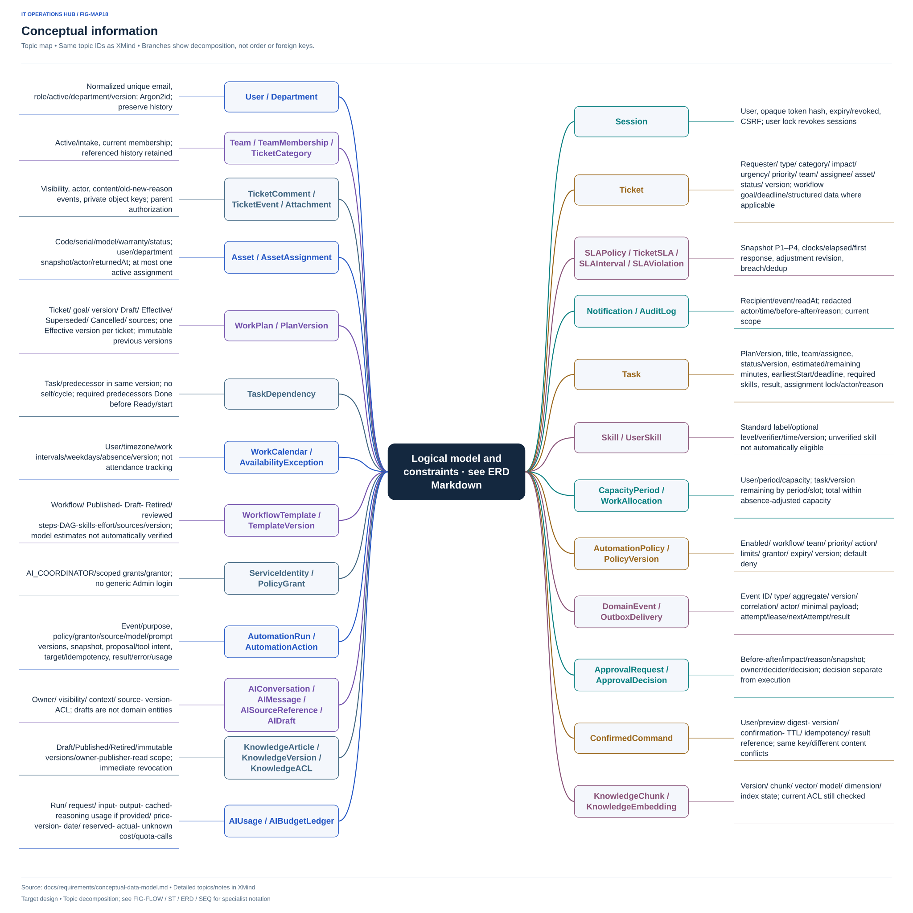

# Mô hình thông tin khái niệm

Mô hình này phục vụ phân tích và IA, **không phải schema database, migration hoặc thiết kế API**. Tên trường là thuật ngữ thống nhất để mô tả hành vi.

[Mở file XMind](../xmind/05-business-rules.xmind)

## Đối tượng và thông tin cần biểu đạt

| Đối tượng | Thông tin chính và cách sử dụng |
|---|---|
| User | Tên, email, vai trò, phòng ban, trạng thái hoạt động; danh tính assignee/requester, không hiển thị mật khẩu/hash/token |
| Department | Tên, mã, trạng thái; user hiện tại và phòng ban snapshot của assignment là hai khái niệm khác nhau |
| Team | Tên, mã, trạng thái, cờ nhóm tiếp nhận; danh sách thành viên hiện tại |
| TeamMembership | User, nhóm, hiệu lực; bỏ thành viên không xóa lịch sử hành động trước đây |
| TicketCategory | Mã, nhãn, hoạt động; danh mục dừng vẫn đọc được trên ticket cũ |
| Ticket | ID/mã, requester, loại, tiêu đề, mô tả, category, impact, urgency, priority, team, assignee tùy chọn, asset tùy chọn, status, thời điểm, version |
| TicketComment | Người viết, nội dung, public/internal, thời điểm, loại nội dung: trao đổi/câu hỏi/giải pháp; không sửa/xóa trong MVP |
| Attachment | Tên hiển thị, media type, kích thước, khóa lưu trữ riêng tư, ticket, comment tùy chọn; nếu gắn comment thì ticket phải khớp |
| TicketEvent | Actor/hệ thống, loại event, cũ/mới, lý do, thời điểm, visibility; nối timeline mà không lộ nội bộ |
| SLAPolicy | Phiên bản bảng P1–P4, ngân sách, thời điểm hiệu lực, actor sửa |
| TicketSLA | Snapshot, ngân sách đang áp dụng, phản hồi đầu, thời gian hoạt động tích lũy, mốc chạy/dừng, các lần điều chỉnh và lịch sử vi phạm |
| Asset | Mã, serial, loại, hãng/model, ngày mua/bảo hành, trạng thái, ghi chú; user hiện tại suy ra từ assignment |
| AssetAssignment | Asset, user, phòng ban lúc giao, thời điểm giao/thu hồi, người thực hiện, ghi chú; tối đa một dòng chưa thu hồi/asset |
| Notification | Người nhận, tham chiếu event/ticket, loại, thời điểm, readAt; nội dung preview không vượt quyền |
| AuditLog | Actor, thao tác, đối tượng, cũ/mới đã lọc bí mật, thời điểm; không chứa bản sao mật khẩu hoặc token |

## Ràng buộc cần giữ khi thiết kế kỹ thuật

ID nội bộ không thay thế mã hiển thị. Không dựa vào ID khó đoán để cấp quyền. SLA phải lưu đủ diễn biến để tính lại giờ hoạt động và giữ breach history; có thể cần thêm bản ghi interval/violation khi thiết kế vật lý, đây không phải thêm module sản phẩm.

Session server và cơ chế phiên bản cần có trong mô hình triển khai dù chưa nằm ở danh sách entity nghiệp vụ gốc. Unique/index/foreign key/transaction sẽ được đặc tả lúc M1; bộ tài liệu này chưa chọn ORM, khóa hay cấu trúc bảng cụ thể.
