# Target data model and ERD

**31 October 2026 · Logical model, not a running schema/DDL/migration.** Retain core entities and add work management/workforce/automation/knowledge. Physical fields/types/indexes need PostgreSQL + SQLAlchemy + Alembic refinement, not Django ORM.

## Core entities

| Entity | Data/constraints |
| --- | --- |
| User / Department | Normalized unique email, role/active/department/version; Argon2id; preserve history |
| Session | User, opaque token hash, expiry/revoked, CSRF; user lock revokes sessions |
| Team / TeamMembership / TicketCategory | Active/intake, current membership; referenced history retained |
| Ticket | Requester/type/category/impact/urgency/priority/team/assignee/asset/status/version; workflow goal/deadline/structured data where applicable |
| TicketComment / TicketEvent / Attachment | Visibility, actor, content/old-new-reason events, private object keys; parent authorization |
| SLAPolicy / TicketSLA / SLAInterval / SLAViolation | P1–P4 snapshot, clocks/elapsed/first response, adjustment revision, breach/dedup |
| Asset / AssetAssignment | Code/serial/model/warranty/status; user/department snapshot/actor/returnedAt; at most one active assignment |
| Notification / AuditLog | Recipient/event/readAt; redacted actor/time/before-after/reason; current scope |

## Work, workforce, automation, and AI entities

| Entity | Data/constraints |
| --- | --- |
| WorkPlan / PlanVersion | Ticket/goal/version/Draft/Effective/Superseded/Cancelled/sources; one Effective version per ticket; immutable previous versions |
| Task | PlanVersion/title/team/assignee/state/version/estimated-remaining minutes/earliestStart/deadline/skills/result/assignment lock-actor-reason |
| TaskDependency | Task/predecessor in same version; no self/cycle; required predecessors Done before Ready/start |
| TaskSkillRequirement | Task/skill/optional minimum level/source; verified taxonomy, no inferred certifications |
| Skill / UserSkill | Standard label/optional level/verifier/time/version; unverified skill not automatically eligible |
| WorkCalendar / AvailabilityException | User/timezone/work intervals/weekdays/absence/version; not attendance tracking |
| CapacityPeriod / WorkAllocation | User/period/capacity; task/version remaining by period/slot; total within absence-adjusted capacity |
| WorkflowTemplate / TemplateVersion | Workflow/Published-Draft-Retired/reviewed steps-DAG-skills-effort/sources/version; model estimates not automatically verified |
| AutomationPolicy / PolicyVersion | Enabled/workflow/team/priority/action/limits/grantor/expiry/version; default deny |
| ServiceIdentity / PolicyGrant | AI_COORDINATOR/scoped grants/grantor; no generic Admin login |
| DomainEvent / OutboxDelivery | Event ID/type/aggregate/version/correlation/actor/minimal payload; attempt/lease/nextAttempt/result |
| AutomationRun / AutomationAction | Event/purpose/policy/grantor/source/model-prompt versions/snapshot/proposal-tool intent/target/idempotency/result/error/usage |
| ApprovalRequest / ApprovalDecision | Before-after/impact/reason/snapshot; owner/decider/decision; decision separate from execution |
| AIConversation / AIMessage / AISourceReference / AIDraft | Owner/visibility/context/source-version-ACL; drafts are not domain entities |
| ConfirmedCommand | User/preview digest-version/confirmation-TTL/idempotency/result reference; same key/different content conflicts |
| KnowledgeArticle / KnowledgeVersion / KnowledgeACL | Draft/Published/Retired/immutable versions/owner-publisher-read scope; immediate revocation |
| KnowledgeChunk / KnowledgeEmbedding | Version/chunk/vector/model/dimension/index state; current ACL still checked |
| AIUsage / AIBudgetLedger | Run/request/input-output-cached-reasoning usage if provided/price-version-date/reserved-actual-unknown cost/quota-calls |

[DBML/schema mapping](../database/README.md) provides selected fields, not DDL/migrations. source_versions/snapshot_versions maps are multi-aggregate/version JSON, not integers.

## Logical ERD

Views separate domains to show entities/keys/cardinality. Selected fields are not the full schema. Logical names/types require SQLAlchemy/Alembic review; physical nullability/indexes/FKs/naming remain open. Repeated entities are the same entity, not new tables. Preserve overall-source cardinalities.

| View | Scope |
| --- | --- |
| FIG-ERD02 | [Identity and organization](../diagrams/erd-identity.svg) |
| FIG-ERD03 | [Tickets, conversations, and files](../diagrams/erd-ticket-sla.svg) |
| FIG-ERD04 | [Assets and assignment history](../diagrams/erd-assets.svg) |
| FIG-ERD05 | [Plans, tasks, and dependencies](../diagrams/erd-work-plans.svg) |
| FIG-ERD06 | [Skills, schedules, and allocations](../diagrams/erd-workforce.svg) |
| FIG-ERD07 | [Policies, versions, and grants](../diagrams/erd-policy.svg) |
| FIG-ERD08 | [Events, execution, and audit](../diagrams/erd-execution.svg) |
| FIG-ERD09 | [Knowledge, ACL, and indexing](../diagrams/erd-knowledge.svg) |
| FIG-ERD10 | [Conversations and source references](../diagrams/erd-assistant.svg) |
| FIG-ERD11 | [Ticket confirmation and AI costs](../diagrams/erd-confirmation-usage.svg) |
| FIG-ERD12 | [SLA snapshots and clocks](../diagrams/erd-sla-clocks.svg) |

TaskDependency endpoints are task/predecessor in the same version. Actor/source fields are typed logical references, not promised polymorphic FKs. External entities repeat for context. Actor/usage-source/partial-unique rules are below.

### FIG-ERD02 — Identity and organization

Mermaid source and cardinality

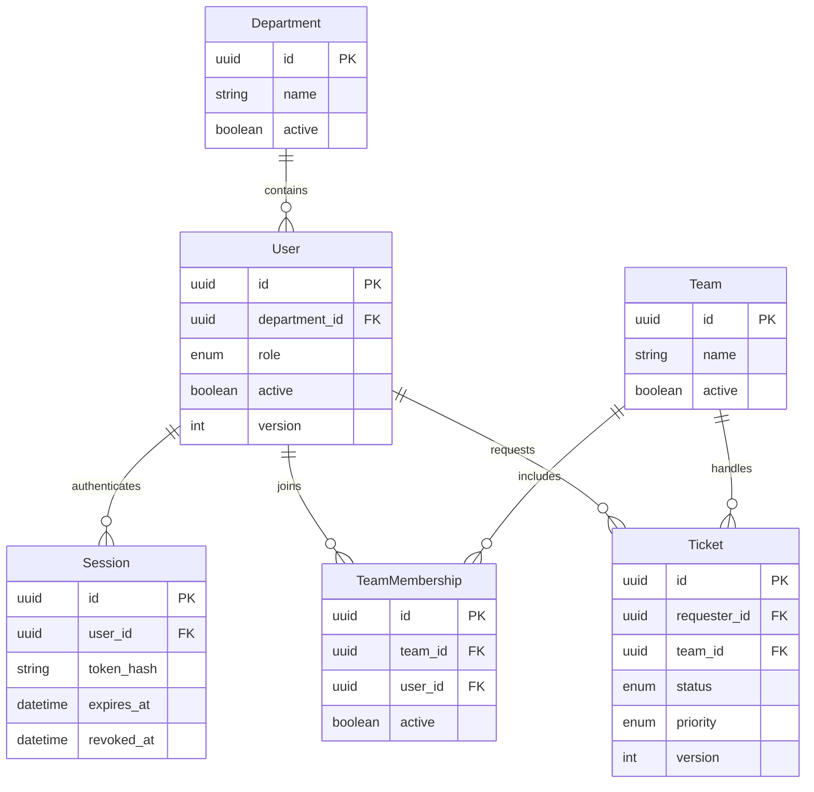

### FIG-ERD03 — Tickets, conversations, and files

Mermaid source and cardinality

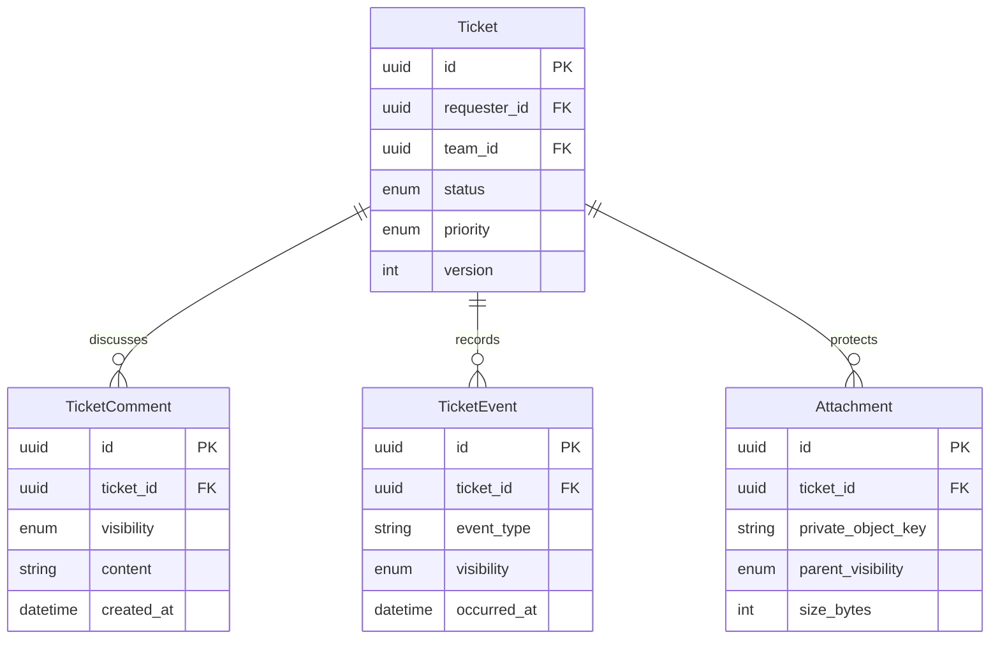

### FIG-ERD04 — Assets and assignment history

Mermaid source and cardinality

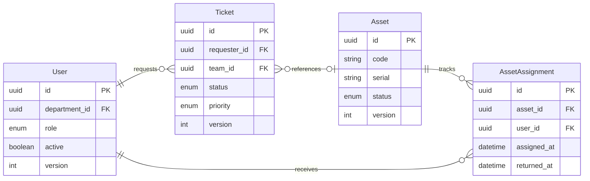

### FIG-ERD05 — Plans, tasks, and dependencies

Mermaid source and cardinality

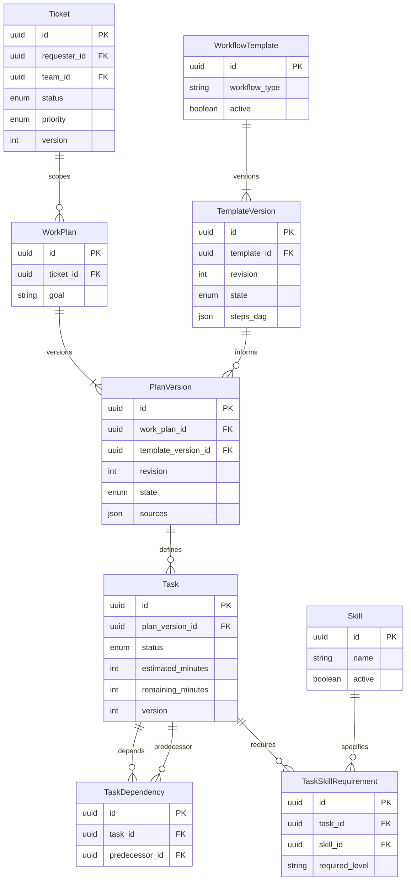

### FIG-ERD06 — Skills, schedules, and allocations

Mermaid source and cardinality

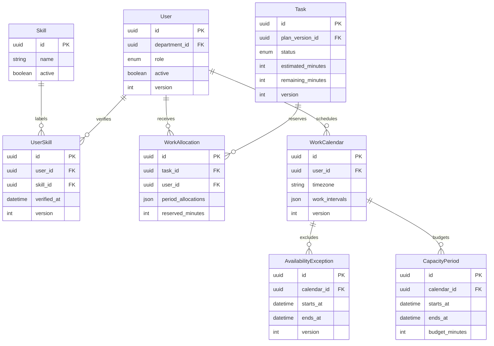

### FIG-ERD07 — Policies, versions, and grants

Mermaid source and cardinality

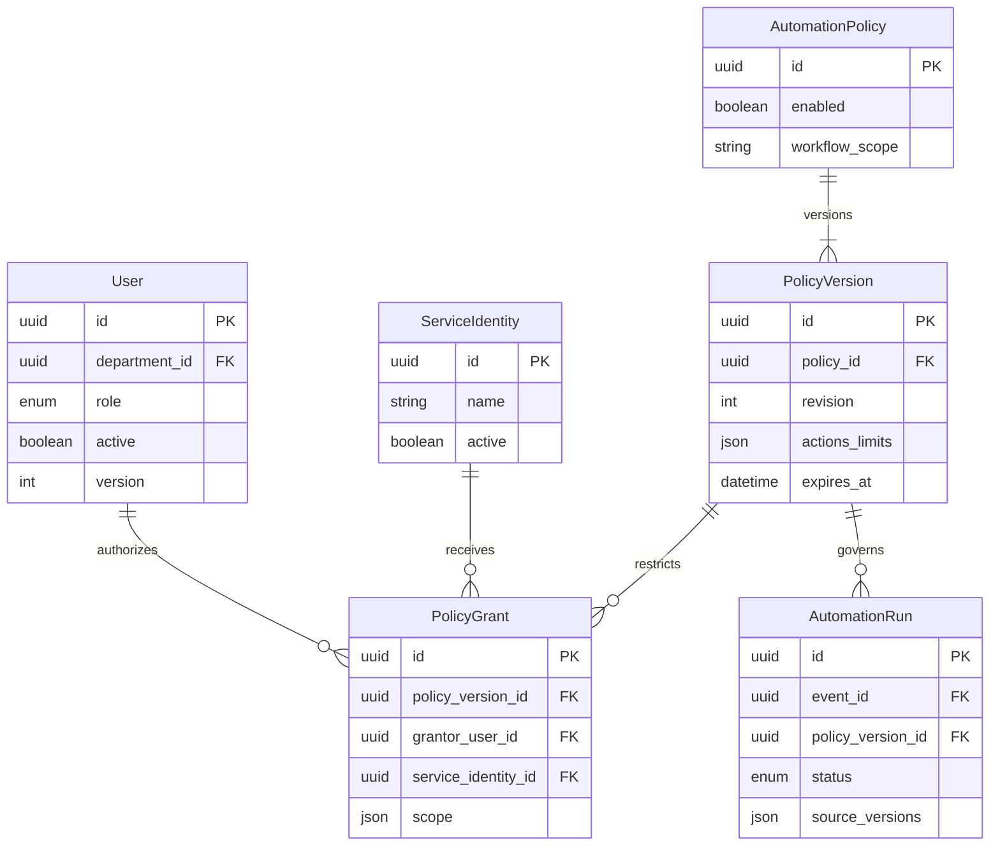

### FIG-ERD08 — Events, execution, and audit

Mermaid source and cardinality

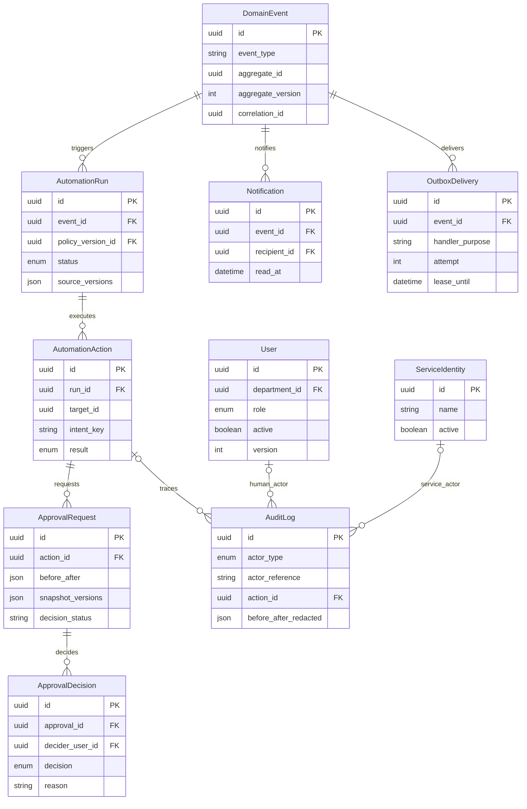

### FIG-ERD09 — Knowledge, ACL, and indexing

Mermaid source and cardinality

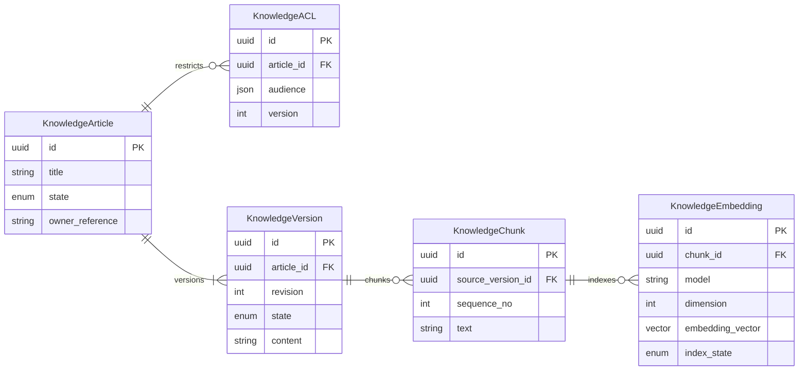

### FIG-ERD10 — Conversations and source references

Mermaid source and cardinality

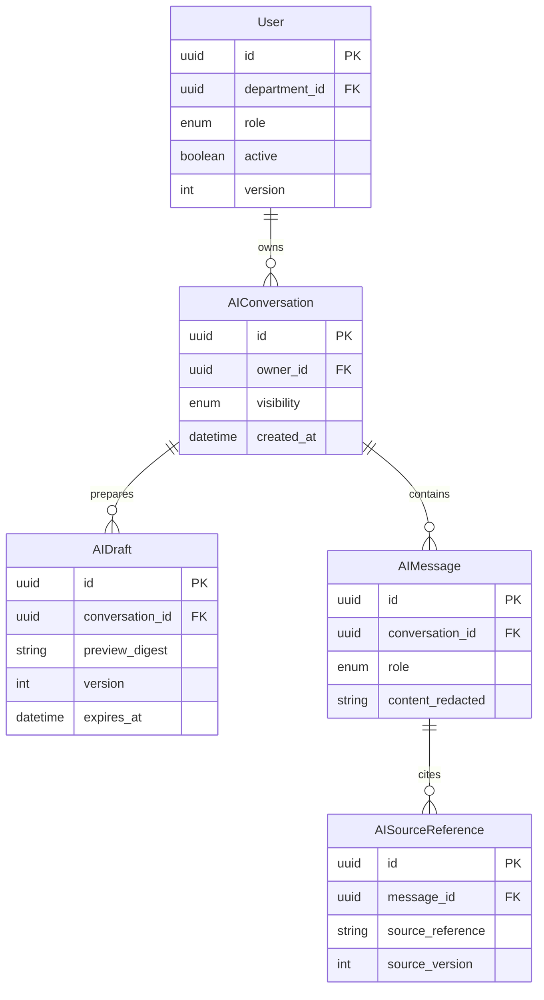

### FIG-ERD11 — Ticket confirmation and AI costs

Mermaid source and cardinality

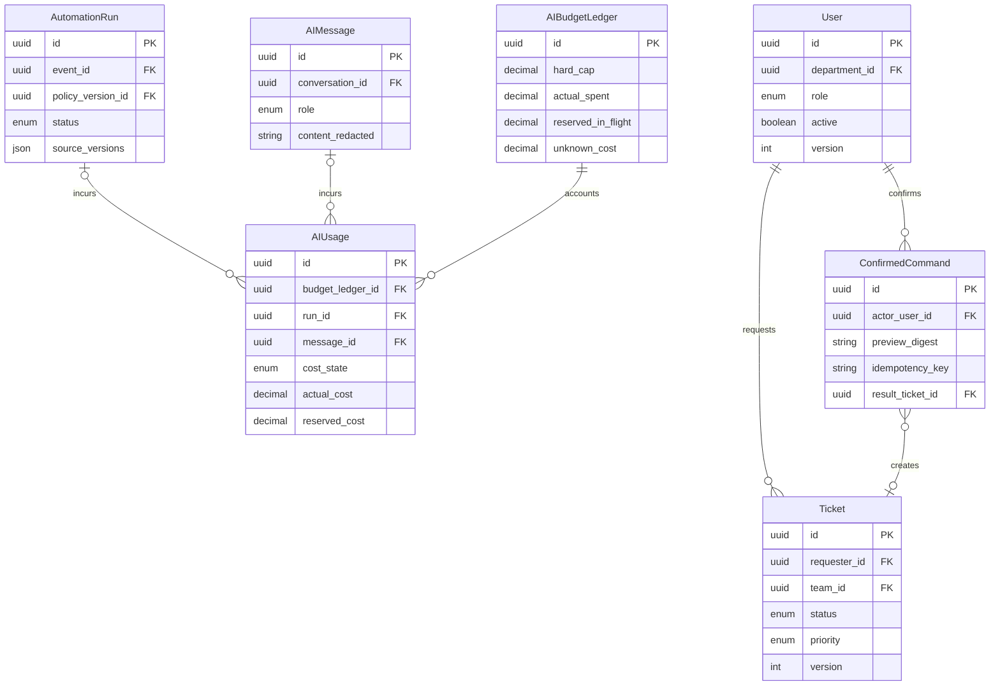

### FIG-ERD12 — SLA snapshots and clocks

Mermaid source and cardinality

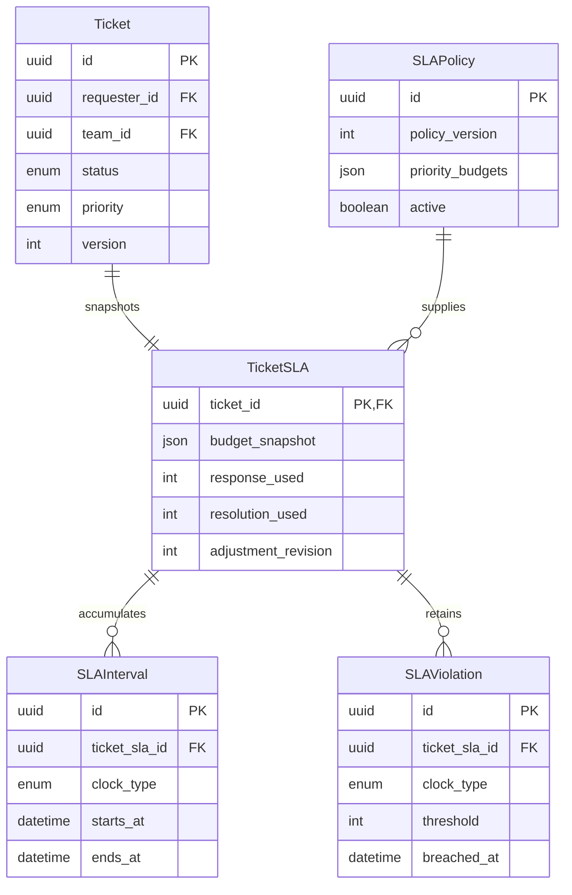

### FIG-ERD01 — Overall relationship list

All relationships used to reconcile domain views

```mermaid
erDiagram
    Department ||--o{ User : contains
    User ||--o{ Session : authenticates
    User ||--o{ TeamMembership : joins
    Team ||--o{ TeamMembership : includes
    User ||--o{ Ticket : requests
    Team ||--o{ Ticket : handles
    Ticket ||--|| TicketSLA : snapshots
    Ticket ||--o{ TicketComment : discusses
    Ticket ||--o{ TicketEvent : records
    Ticket ||--o{ Attachment : protects
    TicketSLA ||--o{ SLAInterval : accumulates
    TicketSLA ||--o{ SLAViolation : retains
    SLAPolicy ||--o{ TicketSLA : supplies
    Asset ||--o{ AssetAssignment : tracks
    User ||--o{ AssetAssignment : receives
    Ticket }o--o| Asset : references
    Ticket ||--o{ WorkPlan : scopes
    WorkPlan ||--|{ PlanVersion : versions
    PlanVersion ||--o{ Task : defines
    Task ||--o{ TaskDependency : depends
    Task ||--o{ TaskDependency : predecessor
    Task ||--o{ TaskSkillRequirement : requires
    Skill ||--o{ TaskSkillRequirement : specifies
    Task ||--o{ WorkAllocation : reserves
    User ||--o{ WorkAllocation : receives
    User ||--o{ UserSkill : verifies
    Skill ||--o{ UserSkill : labels
    User ||--o{ WorkCalendar : schedules
    WorkCalendar ||--o{ AvailabilityException : excludes
    WorkCalendar ||--o{ CapacityPeriod : budgets
    WorkflowTemplate ||--|{ TemplateVersion : versions
    TemplateVersion ||--o{ PlanVersion : informs
    AutomationPolicy ||--|{ PolicyVersion : versions
    User ||--o{ PolicyGrant : authorizes
    ServiceIdentity ||--o{ PolicyGrant : receives
    PolicyVersion ||--o{ PolicyGrant : restricts
    DomainEvent ||--o{ OutboxDelivery : delivers
    DomainEvent ||--o{ AutomationRun : triggers
    PolicyVersion ||--o{ AutomationRun : governs
    AutomationRun ||--o{ AutomationAction : executes
    AutomationAction ||--o{ ApprovalRequest : requests
    ApprovalRequest ||--o{ ApprovalDecision : decides
    KnowledgeArticle ||--|{ KnowledgeVersion : versions
    KnowledgeArticle ||--o{ KnowledgeACL : restricts
    KnowledgeVersion ||--o{ KnowledgeChunk : chunks
    KnowledgeChunk ||--o{ KnowledgeEmbedding : indexes
    User ||--o{ AIConversation : owns
    AIConversation ||--o{ AIMessage : contains
    AIMessage ||--o{ AISourceReference : cites
    AIConversation ||--o{ AIDraft : prepares
    User ||--o{ ConfirmedCommand : confirms
    ConfirmedCommand }o--o| Ticket : creates
    AutomationRun o|--o{ AIUsage : incurs
    AIMessage o|--o{ AIUsage : incurs
    AIBudgetLedger ||--o{ AIUsage : accounts
    DomainEvent ||--o{ Notification : notifies
    AutomationAction o|--o{ AuditLog : traces
    User o|--o{ AuditLog : human_actor
    ServiceIdentity o|--o{ AuditLog : service_actor
```

## Versions, constraints, authorization

Do not make Ticket→Plan globally unique: retain history with one conditionally unique effective version. TaskDependency is same-version, service-validated DAG before commit. Plan changes review active/locked tasks rather than replacing performed work. AssetAssignment partial uniqueness applies where returnedAt is null; optional inventory reservation needs a separate undecided lifecycle/entity under D-40.

Allocation checks/writes use resource transactions/locks, not model workload numbers. Events/actions/confirmed commands/notifications have architectural unique business keys; mutations are versioned. No chat/KB/vector cascade deletes of domain records. Retention/tombstones/audit require policy.

Requester projections exclude workforce/internal plans/actions/approvals. Current KB ACL overrides stale vectors/caches; citations reference readable versions. Service identities/grantors differ from humans. Decide physical schema/index/isolation/exact names before implementation.

## Relationship dictionary and cross-entity invariants

FIG-ERD01 uses crow's-foot: `||` exactly one, `o|` zero/one, `o{` zero/many, `|{` one/many. Task–TaskDependency edges represent `task_id`/`predecessor_id`, not two tables. Dictionary entities without diagram fields do not imply CRUD.

| Relationship / invariant | Logical meaning | Proposed enforcement |
| --- | --- | --- |
| Ticket → WorkPlan → PlanVersion | Proposal history; one effective version per ticket | Transactions/versions/conditional uniqueness; physical key refinement |
| TaskDependency endpoints | Same version, no self/cycle, predecessor Done before Ready/start | FKs/checks plus service DAG/state validation, not frontend-only |
| Task → TaskSkillRequirement → Skill | Required skills differ from verified user skills | Standard taxonomy/server eligibility/version rechecks |
| Task → WorkAllocation → User | Scheduled remaining effort per period within current capacity | Atomic calendar/absence/load locks/rechecks; schedule edits share ordering |
| Asset → AssetAssignment | Many historical, at most one unreturned | Partial unique/transaction; reservations separate/undecided |
| PolicyVersion / PolicyGrant → Run/Action | Preserve used authorization evidence; current rights still rechecked | Grantor/scope/expiry/active/version; audit is not authority |
| Approval → Decision/execution | Immutable decision/decider, separate effect result | Snapshot/transition guards/action idempotency; Approved ≠ Succeeded |
| AIUsage → Run or AIMessage | Automation/assistant charges; retries separate usage | Typed request/run/message sources; not every chat needs a run |
| AuditLog → User or ServiceIdentity | Manual/automatic actors, optional action reference | Human User versus service identity/grantor; not every audit needs action |
| KB version/chunk/embedding | Derived data does not own reading rights | Current source article/version ACL; no retained revoked cache/index permissions |

## Lifecycles, storage, deletion

Deleting chat/vectors never cascades to Ticket/Task/AssetAssignment/AuditLog/event history. Locked users retain historical references with immediate session/access revocation. Published/Effective versions/recorded decisions retain historical content; new linked versions/decisions replace them.

Conversation deletion follows approved chat retention; ConfirmedCommand/domain results retain required dedup/audit evidence. Files need stage/finalize/reconciliation since DB cannot roll back objects. KB revocation blocks reads before chunk/cache cleanup. Retention/anonymization/tombstones/purge/key-ledger lifetimes remain D-40; no deletion jobs/migrations exist.

[Business rules](business-rules.md) · [Permissions](permissions-matrix.md) · [Architecture/transactions](../technical/architecture.md) · [API design](../technical/api-design.md).

## Shared-workspace action cards — D-42

Action cards are AssistantResult/message/draft UI declarations under owner/resource scope, not permission-granting entities. ConfirmedCommand/result_ticket_id retain ticket-draft meaning. Other forms store domain aggregate/audit/idempotency results, not tasks/assets/approvals in result_ticket_id. Redacted conversation/message/card correlation grants no chat access. Physical card storage/redaction/retention needs D-40 refinement; selected ERDs are not migrations. Automation event/run lifetimes do not depend on conversations.
